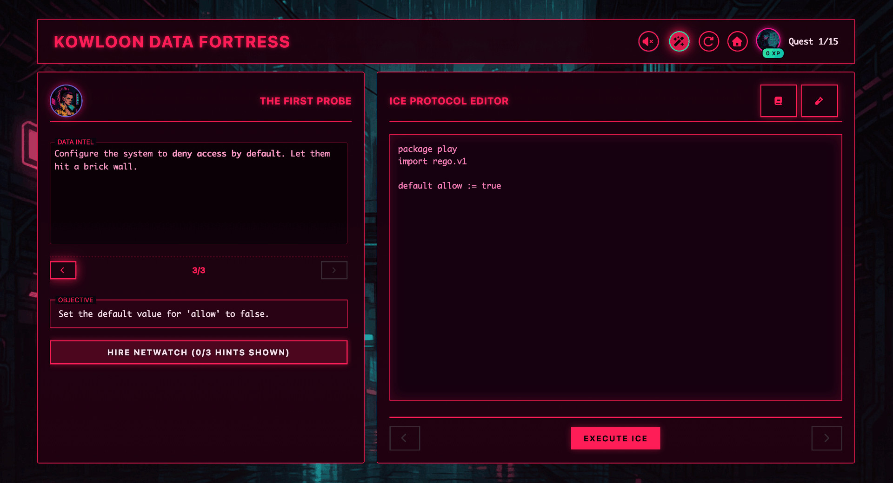
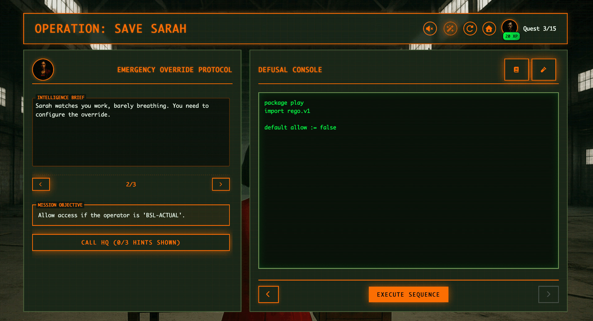
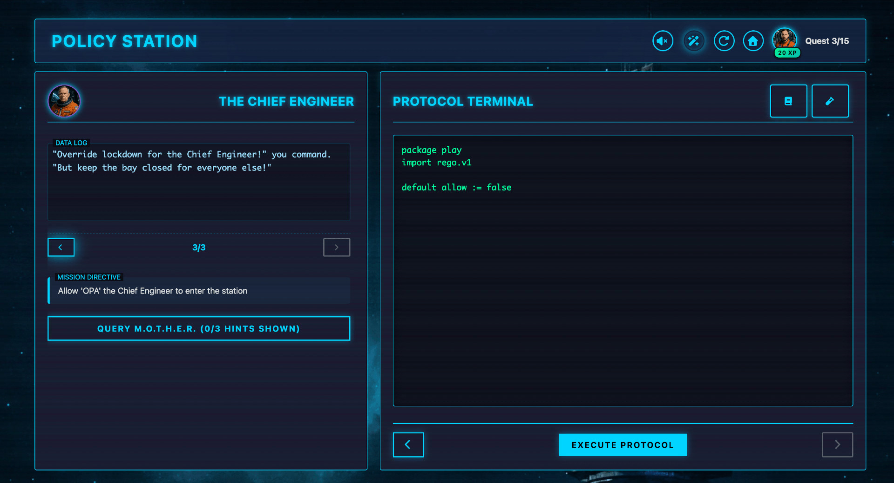
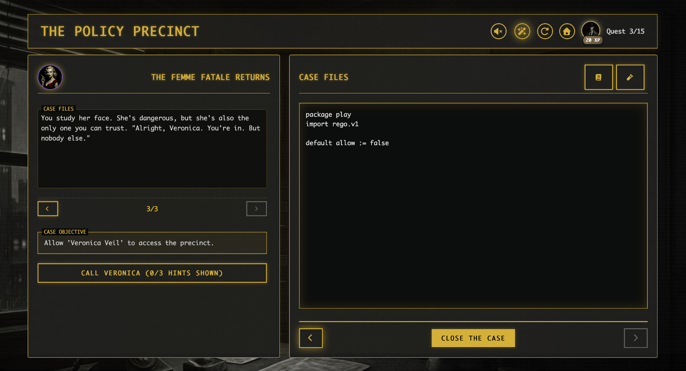

# Rego Adventure

An interactive learning platform for mastering Policy-Based Access Control (PBAC) using Open Policy Agent (OPA) and Rego policy language through themed quest-based challenges.

## example deployment

A deployment with custom quests exists at [https://regoadventure.r5i.xyz](https://regoadventure.r5i.xyz).

Use the following credentials:

- user: rego
- pass: adventure

### Gallery of custom adventures

[](docu/images/screenshot_ui_1.jpg) [](docu/images/screenshot_ui_2.jpg)

[](docu/images/screenshot_ui_3.jpg) [](docu/images/screenshot_ui_4.jpg)

## Architecture

The system breaks down into two main parts. A Go backend handles HTTP requests, quest loading, policy verification through OPA, and optional JWT authentication. The JavaScript frontend provides the interactive adventure interface with dynamic theming based on quest pack genre.

### Backend (Go)

- HTTP Server: gin-gonic based REST API
- Quest System: Dynamic quest pack loading from JSON files
- Policy Verification: OPA integration for Rego policy evaluation against test cases
- Authentication: Optional OIDC/JWT authentication with JWKS validation

**Key Components:**

- [`main.go`](main.go:1) - Application entry point and initialization
- [`backend/http/`](backend/http/) - HTTP server, routing, and middleware
- [`backend/quest/`](backend/quest/) - Quest models, repository, and verification logic
- [`backend/config/`](backend/config/) - Configuration management

### Frontend (JavaScript)

- Adventure Interface: Single-page application for quest progression
- Theme System: Dynamic styling based on quest pack genre

**Structure:**

- [`frontend/adventure/`](frontend/adventure/) - Main game interface
- [`frontend/quests/`](frontend/quests/) - Quest pack definitions (JSON) and assets

**Startup reveal and CSP:** `frontend/adventure/index.html` hides the document in an inline
`<style>` block and reveals it once the SPA entry point adds the `loaded` class. That inline block
requires the `style-src 'unsafe-inline'` entry of the Content-Security-Policy set in
`backend/http/middleware.go`. Tightening `style-src` without adding a hash for that block makes the
application boot invisible.

## Prerequisites

You'll need Go 1.27 or higher. Docker is optional but useful for containerized deployment, and Kubernetes if you are going that route.

## Installation

### Local Development

1. Clone the repository
2. Install dependencies:

   ```bash
   go mod download
   ```

3. Set required environment variables:

   ```bash
   export DOMAIN="http://localhost:8080"
   export PORT="8080"
   ```

4. Optional authentication configuration:

   ```bash
   export AUTH_ENABLED="true"
   export AUTH_ISSUER="https://your-issuer.com"
   export AUTH_DISCOVERY_URL="https://your-issuer.com/.well-known/openid-configuration"
   export AUTH_CLIENT_ID="your-client-id"
   export AUTH_AUDIENCE="your-audience"
   export AUTH_ALLOWED_ALGORITHMS="RS256"
   ```

5. Run the application:

   ```bash
   go run main.go
   ```

## Running the Application

### Development Mode

```bash
go run main.go
```

Access the application at `http://localhost:8080`

### Production Build

```bash
go build -ldflags "-s -w" -trimpath -o rego-adventure .
./rego-adventure
```

### Docker

Build the image:

```bash
docker build -t rego-adventure .
```

Run the container:

```bash
docker run -p 8080:8080 \
  -e DOMAIN="http://localhost:8080" -e PORT="8080" \
  rego-adventure
```

See [`docker-compose.yml`](docu/deploy/docker/docker-compose.yml) for Docker Compose configuration.

### Kubernetes

Use the Helm chart unless you specifically want bare manifests.

#### Helm chart

The chart lives in [ghmer/rego-adventure-charts](https://github.com/ghmer/rego-adventure-charts), is
versioned exactly like this application (chart `2.5.4` deploys image `v2.5.4`), and is published to
two channels:

```bash
# OCI artifact, Helm >= 3.8
helm install rego-adventure oci://ghcr.io/ghmer/charts/rego-adventure \
  --namespace rego-adventure --create-namespace \
  --set config.domain=https://rego.mydomain.local

# or the classic Helm repository
helm repo add rego-adventure https://ghmer.github.io/rego-adventure-charts
helm repo update
helm install rego-adventure rego-adventure/rego-adventure \
  --namespace rego-adventure --create-namespace \
  --set config.domain=https://rego.mydomain.local
```

`config.domain` is the value that matters: the application accepts only that origin for CORS, so it
has to be the address users actually visit. The chart validates every other setting against a JSON
schema, refuses incomplete OIDC configurations at render time, and defaults to the hardened pod
settings shown in the [Kubernetes manifests](docu/deploy/k8s/deployment.yaml) below. Quest packs and
the impressum override are configured with `questPacks.*` and `impressum.*`; see the
[chart README](https://github.com/ghmer/rego-adventure-charts/blob/main/charts/rego-adventure/README.md).

#### Bare manifests

Either:

```bash
kubectl apply -k docu/deploy/k8s
```

Or if you prefer to apply files individually:

```bash
kubectl apply -f docu/deploy/k8s/configmap.yaml
kubectl apply -f docu/deploy/k8s/deployment.yaml
kubectl apply -f docu/deploy/k8s/service.yaml
kubectl apply -f docu/deploy/k8s/ingress.yaml
```

Configuration is managed via ConfigMap. Update [`configmap.yaml`](docu/deploy/k8s/configmap.yaml) with your environment-specific values.

## Testing

| Layer | Command | CI job |
| ------- | --------- | -------- |
| Backend unit, handler and loader tests | `go test -race -count=1 ./backend/... ./cmd/... .` | `go-ci.yml` |
| Backend lint | `golangci-lint run ./backend/... ./cmd/... .` | `go-ci.yml` |
| Backend static analysis | `gosec -quiet ./backend/... ./cmd/... .` | run locally |
| Frontend unit tests | `npm test` in `frontend/adventure`, with the pinned toolchain installed ephemerally as CI does: `npm install --no-save --no-audit --no-fund vitest@5.0.0 happy-dom@20.14.3` | `frontend-ci.yml` |
| Frontend lint | `npx eslint src` in `frontend/adventure` after `npm install --no-save --no-audit --no-fund eslint@10.10.0 @eslint/js@10.0.1 globals@17.12.0` | `frontend-ci.yml` |
| Quest editor rule tests | `node --test docu/quest-editor/` | `frontend-ci.yml` |
| Import map drift | `go run ./cmd/importmapgen/main.go`, then require `frontend/adventure/index.html` unchanged | `frontend-ci.yml` |
| Browser and command-line QA suites | `node docu/qa/<suite>.cjs` | none |

The QA suites in `docu/qa/` start their own server on a free port and drive a real browser through
Playwright, which is resolved from the machine rather than declared as a dependency. Six suites:
`spa-qa` (the adventure interface), `dialog-qa` (the seven dialogs), `editor-qa` (the quest editor),
`save-compat` (saved-state compatibility), `cli-qa` (the command-line tools) and `session-qa` (a
signed session token that expires during a quest, on the start screen and inside a quest). They run by
hand against the change they test: each removes the quest packs it generates and reports any tree
change it did not make itself.

## Project Structure

```text
.
├── main.go                # Application entry point
├── cmd/
│   ├── assetgen/          # Quest pack asset generator
│   ├── importmapgen/      # Quest editor import map generator
│   └── solutionverifier/  # Quest pack solution verifier
├── backend/
│   ├── config/            # Configuration management
│   ├── http/              # HTTP server and routing
│   ├── logger/            # Logging setup
│   └── quest/             # Quest system logic
├── frontend/
│   ├── adventure/         # Main game interface
│   ├── quests/            # Quest packs (JSON + assets)
│   └── shared/            # Shared CSS, fonts, and resources
├── docu/
│   ├── deploy/            # Deployment configurations
│   │   ├── docker/        # Docker Compose
│   │   └── k8s/           # Kubernetes manifests
│   ├── images/            # Documentation images
│   ├── qa/                # Browser and command-line QA suites
│   ├── quest-editor/      # Browser-based quest editor
│   ├── utilities/         # Documentation utilities
│   ├── quests.md          # Quest pack format documentation
│   └── state-machines.md  # State machines the code implements
├── Dockerfile             # Multi-stage container build
└── go.mod                 # Go dependencies
```

## Configuration

### Environment Variables

| Variable                  | Required    | Default | Description                                                                                                                                       |
| ------------------------- | ----------- | ------- | ------------------------------------------------------------------------------------------------------------------------------------------------- |
| `DOMAIN`                  | Yes         | -       | Application domain (e.g., `https://example.com`)                                                                                                  |
| `PORT`                    | No          | `8080`  | HTTP server port                                                                                                                                  |
| `AUTH_ENABLED`            | No          | `false` | Enable OIDC authentication (booleans accept `true`/`false`/`1`/`0`; anything else fails startup)                                                  |
| `AUTH_ISSUER`             | Conditional | -       | OIDC issuer URL (required if auth enabled)                                                                                                        |
| `AUTH_DISCOVERY_URL`      | Conditional | -       | OIDC discovery endpoint (required if auth enabled)                                                                                                |
| `AUTH_CLIENT_ID`          | Conditional | -       | OIDC client ID (required if auth enabled)                                                                                                         |
| `AUTH_AUDIENCE`           | Conditional | -       | JWT audience claim (required if auth enabled)                                                                                                     |
| `AUTH_ALLOWED_ALGORITHMS` | No          | `RS256` | Comma-separated list of allowed JWT signing algorithms (`RS256`, `RS384`, `RS512`, `PS256`, `PS384`, `PS512`, `ES256`, `ES384`, `ES512`, `EdDSA`) |
| `TRUSTED_PROXIES`         | No          | -       | Comma-separated CIDR ranges for trusted proxies                                                                                                   |
| `SHOW_IMPRESSUM`          | No          | `false` | Enable impressum/legal notice page link in footer                                                                                                 |
| `LOG_LEVEL`               | No          | `info`  | Log level: `debug`, `info`, `warn`, or `error`                                                                                                     |

> **Note:** `DOMAIN` is normalized to its origin (scheme + host); any path or trailing slash is stripped so CORS matching (which compares against the browser `Origin` header) cannot silently break.

> **Note:** When deploying behind a proxy or load balancer (e.g., nginx, Kubernetes ingress, cloud load balancer), it is important to set `TRUSTED_PROXIES` to ensure accurate client IP detection. Without this configuration, the application will see the proxy's IP address instead of the actual client IP. Set this to the CIDR range(s) of your trusted proxy infrastructure (e.g., `TRUSTED_PROXIES="10.0.0.0/8,172.16.0.0/12"`).

### Authentication

The application uses the **OIDC/OAuth2 Authorization Code Flow** if `AUTH_ENABLED` is set to `true`. More information can be found in [AUTHENTICATION.md](AUTHENTICATION.md).

### Impressum / Legal Notice Configuration

The application includes an optional impressum (legal notice) page that can be enabled for deployments requiring legal compliance (e.g., German TMG requirements).

**Enable the Impressum Page:**

Set the `SHOW_IMPRESSUM` environment variable to `true`:

```bash
export SHOW_IMPRESSUM="true"
```

**Customize the Impressum Content:**

The default impressum page at [`frontend/adventure/impressum.html`](frontend/adventure/impressum.html) is a template with placeholder content. You **must** customize it with your actual legal information before deploying to production.

**Docker Deployment:**

Override the impressum file using a volume mount in your `docker-compose.yml`:

```yaml
services:
  rego-adventure:
    # ... other configuration ...
    environment:
      - SHOW_IMPRESSUM=true
    volumes:
      # Mount your custom impressum file
      - ./custom-impressum.html:/app/frontend/adventure/impressum.html:ro
```

Create your `custom-impressum.html` file with your actual legal information, then start the container.

**Kubernetes Deployment:**

**Option 1: Using a ConfigMap (Recommended):**

1. Create a ConfigMap with your custom impressum content:

```bash
kubectl create configmap impressum-html --from-file=impressum.html=./custom-impressum.html
```

1. Update your deployment to mount the ConfigMap:

```yaml
apiVersion: apps/v1
kind: Deployment
metadata:
  name: rego-adventure
spec:
  template:
    spec:
      containers:
        - name: rego-adventure
          env:
            - name: SHOW_IMPRESSUM
              value: "true"
          volumeMounts:
            - name: impressum-volume
              mountPath: /app/frontend/adventure/impressum.html
              subPath: impressum.html
              readOnly: true
      volumes:
        - name: impressum-volume
          configMap:
            name: impressum-html
```

**Option 2: Using a PersistentVolume:**

Mount a PersistentVolume containing your custom impressum.html file to `/app/frontend/adventure/impressum.html`.

**Important Notes:**

- The impressum page is disabled by default (`SHOW_IMPRESSUM=false`)
- When enabled, a link appears in the application footer
- Always replace placeholder content with actual legal information
- Ensure compliance with your local legal requirements (TMG, GDPR, etc.)

## Quest Packs

Quest packs are defined in JSON format in a dedicated folder under [`frontend/quests/`](frontend/quests/) (for example: `frontend/quests/my-quest-pack`). If that folder holds no pack, the application still starts: `/api/packs` answers an empty list and the start screen says that no adventure packs are loaded instead of showing an empty selection. Each pack contains:

- Metadata (title, description, genre)
- Prologue and epilogue narratives
- Quest definitions with test cases
- Theme-specific assets (images, audio, styles)

### What the Browser Receives

`GET /api/packs/{packId}` serves a projection of the pack, not the pack file. It omits the solution,
the hint texts, the hidden support modules and the test cases; `hints_count`, `has_solution` and
`has_support_modules` say what exists, so the interface can render its controls without the content.
Each withheld item is served by the endpoint that needs it: hints and solution on a confirmed reveal
(`Cache-Control: no-store`), support modules on request, and the test cases through
`GET /api/packs/{packId}/quests/{questId}/test-payload` when the test modal opens.

That endpoint is a convenience layer, not a secrecy boundary. It answers every test's input, its
`data` document and its expected outcome to any client that asks, and its response is cacheable for
five minutes (`Cache-Control: private, max-age=300`). A pack's tests are readable by anyone who can
reach the server; the projection keeps the startup payload small, it does not hide the truth table
the player is coding against.

### Asset Generator

The asset generator tool creates new quest pack scaffolding with placeholder assets and configuration files. A run that fails part way through leaves no partial pack: everything it had already written below the pack directory is removed again, and content that was already there is left alone.

**Location:** [`cmd/assetgen/`](cmd/assetgen/)

**Usage:**

```bash
go run cmd/assetgen/main.go -theme <theme-name> -output <output-directory>
```

**Example:**

```bash
go run cmd/assetgen/main.go -theme western -output frontend/quests

# creates a folder "western" below "frontend/quests"
```

**Generated Files:**

- `quests.json` - Quest pack definition with 3 sample quests
- `theme.css` - Theme-specific CSS variables and overrides
- `custom.css` - Template for theme-specific visual effects
- `README.md` - Quest pack customization guide
- `assets/` - Directory containing placeholder images:
  - `bg-adventure.jpg` (1920x1080) - Background image
  - `hero-avatar.png` (128x128) - Player avatar
  - `npc-questgiver.png` (128x128) - Quest giver avatar
  - `icon-success.png` (128x128) - Success icon
  - `icon-failure.png` (128x128) - Failure icon
  - `perfect_score.png` (512x512) - Perfect score image
  - `bg-music.m4a` - Silent placeholder track for background music

All generated images are solid color placeholders. Replace with theme-appropriate artwork before deployment.

### Mounting Quest Packs

Custom quest packs can be added to the application by mounting them into the container. The target directory is `/app/frontend/quests/`.

**Docker:**

Mount your local quest pack folder to a subdirectory within `frontend/quests`:

```bash
docker run -v ./my-pack:/app/frontend/quests/my-pack ...
```

**Docker Compose:**

Mount your local quest pack folder using the `volumes` configuration:

```yaml
volumes:
  - ./my-pack:/app/frontend/quests/my-pack
```

**Kubernetes:**

Mount a volume containing your quest pack structure to the same path:

```yaml
volumeMounts:
  - name: my-quest-pack
    mountPath: /app/frontend/quests/my-pack
```

## Quest Editor

A browser-based visual editor for creating and modifying quest packs. The editor provides a complete interface for managing all aspects of quest pack development without requiring manual JSON editing.

**Location:** [`docu/quest-editor/`](docu/quest-editor/)

**How to Use:**

1. Open [`index.html`](docu/quest-editor/index.html) in a web browser
2. Click "Load Quest File" and select a `quests.json` file from any quest pack
3. Edit quest content using the visual interface
4. Click "Save" to download the modified `quests.json` file

For more complete documentation, check out [`README_EDITOR.md`](README_EDITOR.md). Before an
export, the editor checks the pack against the same rules the backend enforces at pack load;
[`docu/quest-editor/QA.md`](docu/quest-editor/QA.md) lists the checks a change to the tool is
verified by, and `node --test docu/quest-editor/` runs its rule tests.

## deployment

The application is designed for cloud-native deployment with:

- Read-only root filesystem support
- Non-root user execution (UID 10001)
- Health check endpoints (`/health`)

Refer to:

- [`Dockerfile`](Dockerfile) for container build configuration
- [`docker-compose.yml`](docu/deploy/docker/docker-compose.yml) for Docker-based setups,
- the [Helm chart](https://github.com/ghmer/rego-adventure-charts) for Kubernetes deployments, and
- [`kustomization.yaml`](docu/deploy/k8s/kustomization.yaml) for bare Kubernetes manifests

### Quest Packs Deployment

Locally, a quest pack must go in the `frontend/quests` folder.

For Kubernetes or Docker Compose deployments, you can mount them there too.

### Replacing the SPA Document

`frontend/adventure/index.html` is read once, when the server starts, and served from memory
afterwards. The import map block inside it is part of those bytes, and its Content-Security-Policy
hash is computed in the same step. Replacing the file inside a running container changes nothing
until the process restarts.

Quest packs, images, audio, `theme.css` and `custom.css` are read per request and need no restart,
nor do the SPA's JavaScript modules, which are ordinary static files.

## License

This project is licensed under the Apache License 2.0 - see the [LICENSE](LICENSE) file for details.

## Copyright

Copyright 2025 Mario Enrico Ragucci - see [COPYRIGHT.md](COPYRIGHT.md) for details.
