# Implicit State Machines: a runtime behaviour reference

| | |
| ---- | ---- |
| Document | `docu/state-machines.md` |
| What it describes | The 42 implicit state machines that run the Rego Adventure platform |
| Status | Living reference, kept alongside the code; see git history for the last full audit pass. CI checks every `file:line` citation below against the sources (`cmd/doccite`) |
| Audience | Maintainers, reviewers, contributors; planning documents that point at machines |
| Related | [`README.md`](../README.md) (system overview), [`docu/quests.md`](quests.md) (pack format), [`docu/deploy/`](deploy/) (deployment) |

---

## Contents

1. [Purpose and audience](#1-purpose-and-audience)
2. [Scope](#2-scope)
3. [How this was derived](#3-how-this-was-derived)
4. [Reading conventions](#4-reading-conventions)
5. [Behaviour map](#5-behaviour-map)
6. [Part A · Application lifecycle and session](#6-part-a--application-lifecycle-and-session)
7. [Part B · Gameplay core](#7-part-b--gameplay-core)
8. [Part C · Interface surfaces](#8-part-c--interface-surfaces)
9. [Part D · Persistence and transport](#9-part-d--persistence-and-transport)
10. [Part E · Server](#10-part-e--server)
11. [Part F · Tooling](#11-part-f--tooling)
12. [Cross-cutting state concepts](#12-cross-cutting-state-concepts)
13. [Verified hazards](#13-verified-hazards)
14. [Keeping this document current](#14-keeping-this-document-current)

Appendix A. [Glossary](#appendix-a--glossary)

---

## 1. Purpose and audience

Forty-two state machines run this codebase, and none of them is declared as a state machine. Most have no transition table anywhere: their state is a boolean, a `hidden` class, a timer or a status code, and the transitions are whatever the surrounding code happens to allow. Where a table does exist in the code (the music states, the dialog dismissal policy, the progression transitions), it sits in a module comment beside the single owner of that state, and a test fails when a second writer appears.

The rest is emergent. State lives in scattered booleans, `hidden` CSS classes, `disabled` attributes, `localStorage` keys, timers, context cancellation and HTTP status codes. That is workable until two people, or two changes, touch the same scattered piece at once. Once a machine has a name and a number, precise questions get precise answers: who writes its state, which transitions are legal, what happens on the paths nobody planned.

This document names and describes all of them. Each machine carries a stable identifier, `M#1` through `M#42`, so that discussions, refactor plans, tests and reviews can point at one machine instead of re-describing it.

Three audiences:

* **Maintainers** changing behaviour: the entry for each machine they touch lists the writer-ownership rules that must keep holding.
* **Reviewers** judging a change: each entry cites its evidence, so a claim can be re-checked against the current tree.
* **Planners** sequencing work: the hazards in section 13 and the cross-cutting tables in section 12 collect what is worth acting on.

## 2. Scope

Covered:

* the SPA, `frontend/adventure/` (`src/` plus `index.html`), and the shared CSS it loads (`frontend/shared/css`)
* the Go backend, `backend/` and `cmd/`
* the operator's quest editor, `docu/quest-editor`

Not covered: the quest pack content and its JSON format (`docu/quests.md` has that), deployment (`docu/deploy/`), and the CI pipelines (`.github/`).

## 3. How this was derived

There is no shortcut through these descriptions. Every mutable field, guard clause, early return, timer, `open`/`closed` element and status-code branch in the covered code was followed to its effect on later behaviour, and the machines were then named in one pass over the result.

Two honesty notes apply to everything below.

First, line references drift. Symbols survive refactors; line numbers do not. When a line reference looks wrong, locate the code by symbol name or quoted fragment. The numbers here were accurate when the audit pass ran.

Second, an entry is a claim, not a promise. Each one carries its evidence so it can be re-verified, and where a claim is subtle, the entry says so in place: the verifier that aborts evaluation on the first runtime error and discards the rest (M#12), the CLI score whose denominator a timeout can shrink (M#37), the resume path that reads state before its own transitions run (M#27).

## 4. Reading conventions

**Machine identifiers.** `M#n` identifiers are stable. They survive rewrites of this document, and discussions and planning documents point at machines by them. New machines take the next free number.

**State carrier.** In the tables and per-machine cards, the *state carrier* is the variable or attribute that really holds the machine's state, as opposed to code that merely reads or renders it. Carriers come in four shapes: a variable, a DOM attribute or class, a timer or promise, and a value the server returns.

**Owners.** Each machine card opens with a metadata line. *Carrier* names the state; *owner* names the module that writes it, or the single function that re-derives it; *persisted* says whether the state survives a page reload.

**Citations.** Bare frontend file names (`quest-manager.js`, `app.js`, `state-service.js`, `index.html`, …) mean the SPA, i.e. `frontend/adventure/src/…` and `frontend/adventure/index.html`. Bare `main.go` means the server entry point at the repository root. Everything else is qualified: the operator tool is always `docu/quest-editor/app.js`, the CLIs are always `cmd/solutionverifier/main.go`, `cmd/importmapgen/main.go` and `cmd/assetgen/tools/assetgen/generator.go`, and every path in the behaviour map is fully spelled out.

**Notation.** Diagrams are Mermaid `stateDiagram-v2` or flowchart blocks, which GitHub and most Markdown viewers render directly. They are schematic: each shows the transitions that shape the machine, while conditional detail and edge cases live in the entry text beneath.

**Cross-references.** Machines refer to each other by `M#n`, and the notation is the same in the entry text and in the derived documents.

## 5. Behaviour map

The forty-two machines group into six parts, by the question a reader brings:

| Part | Question it answers | Machines |
| ---- | ----------------- | -------- |
| [A · Application lifecycle and session](#6-part-a--application-lifecycle-and-session) | How does the page get to a signed-in, usable state? | M#1, M#2, M#42 |
| [B · Gameplay core](#7-part-b--gameplay-core) | Where does the player stand, and what may they do there? | M#4, M#5, M#6, M#7, M#8, M#9 |
| [C · Interface surfaces](#8-part-c--interface-surfaces) | How does the interface move, react, play and fade? | M#3, M#14-M#26 |
| [D · Persistence and transport](#9-part-d--persistence-and-transport) | What outlives a click, and what crosses the network? | M#10, M#11, M#27, M#28, M#29 |
| [E · Server](#10-part-e--server) | How does the Go side boot, serve and guard? | M#12, M#13, M#30-M#36 |
| [F · Tooling](#11-part-f--tooling) | What do the offline tools and the operator's editor do, and what can fail? | M#37-M#41 |

The full index, in machine order:

| M# | Machine | Where | State carrier | Part |
| ---- | --------- | ------- | --------------- | ---- |
| 1 | Application boot | `frontend/adventure/src/app.js:70` | control flow + `beginQuestInFlight` | A |
| 2 | Authentication / session (client) | `services/auth-service.js`, `managers/ui-manager.js:432` | `userManager`, `ConfigService.config`, `renewalInFlight`, `renewalRefused` | A |
| 3 | Screen + pack/theme context | `managers/pack-manager.js`, `managers/ui-manager.js:272` | `hidden` classes, `loadSeq` | C |
| 4 | Adventure progression | `services/state-service.js`, `managers/quest-manager.js` | `currentQuestId`, `activeQuestId` | B |
| 5 | History mode (derived) | `services/state-service.js:316` | `isHistoryMode` | B |
| 6 | Interaction gating (editor/verify/hint) | `services/state-service.js:499`, `managers/ui-manager.js:333` | one gate: `readOnly` + two `disabled` flags + pane `hidden` | B |
| 7 | Hint/solution reveal | `services/reveal-service.js:39`, `managers/quest-manager.js:525` | `hintsUsed`, `solutionViewed` | B |
| 8 | Async reveal overlay (race control) | `managers/quest-manager.js:51` | `revealPhase`, `revealQuestId`, `revealPromise` | B |
| 9 | Quest scoring / replay | `services/state-service.js:404` | `questScores`, `totalScore` | B |
| 10 | Editor persistence (autosave) | `managers/grimoire-autosave.js`, `managers/ui-manager.js:289` | autosave timer, `save-indicator` class | D |
| 11 | Verify request (client) | `managers/event-manager.js:292` | `verifying`, button label | D |
| 12 | Verify pipeline (server) | `backend/http/handlers.go:221`, `backend/quest/verifier.go:334` | `context` + error shape | E |
| 13 | Verification outcome shape | `backend/quest/verifier.go` | `Error` / `Results` / `Undefined` | E |
| 14 | Dialogs | `managers/modal-manager.js:83` | `<dialog open>` | C |
| 15 | Result modal | `managers/modal-manager.js:258` | `open` + `nextQuestBtn` visibility | C |
| 16 | Perfect score reveal | `managers/quest-manager.js:337`, `managers/modal-manager.js:353` | `perfectScoreBtn` `hidden` | C |
| 17 | Quest footer visibility | `managers/ui-manager.js:177` | footer `hidden` class | C |
| 18 | Lore pagination | `managers/quest-manager.js:252` | `currentLoreIndex` | C |
| 19 | Background music | `managers/audio-manager.js:44` | `musicState`, `pauseTimer` | C |
| 20 | Web Audio graph lifecycle | `managers/audio-manager.js:113` | `audioCtx`, `gainNode`, `audioGraphFallback` | C |
| 21 | Visual effects toggle | `managers/ui-manager.js:420` | `body.effects-disabled` | C |
| 22 | Result effects (confetti / dark overlay) | `src/effects.js` | `confettiInterval`, `#dark-overlay.active` | C |
| 23 | Tutorial | `src/tutorial.js` | `driverObj`, `hiddenElementsState`, storage flag | C |
| 24 | Toast notifications | `services/toast-service.js` | `toast-show` / `toast-hide` classes | C |
| 25 | Copy-to-clipboard feedback | `managers/ui-render.js:189` | `dataset.copyFeedback` | C |
| 26 | Interface minimize | `managers/ui-manager.js:229` | `interfaceMinimized`, `game-interface.minimized` | C |
| 27 | localStorage persistence / resume | `services/state-service.js:103`, `services/storage-service.js` | `PACK_ID` pointer × `PACK_STATE` | D |
| 28 | API request + token renewal | `services/api-service.js:93`, `services/auth-service.js:24` | `ApiError.status`, `ApiError.authFailure` | D |
| 29 | Lazy reveal caches | `managers/quest-manager.js:43`, `managers/modal-manager.js:61` | `Map` keys | D |
| 30 | Backend process lifecycle | `backend/http/shutdown.go:80`, `main.go` | `context` + `errCh` | E |
| 31 | Backend config / auth boot gate | `backend/config/config.go` | `Auth.Enabled`, `JWKS` | E |
| 32 | Quest pack load pipeline | `backend/quest/loader.go`, `backend/quest/repository.go:61` | repo map membership | E |
| 33 | Server auth middleware decision | `backend/http/middleware.go:155` | sequential guards | E |
| 34 | Static asset request gates | `backend/http/routes.go:239`, `backend/http/security.go` | sequential gates | E |
| 35 | SPA fallthrough routing | `backend/http/routes.go:297` | path classification | E |
| 36 | Progressive disclosure of quest content | `backend/quest/public.go`, `backend/http/handlers.go` | payload projection + `Cache-Control` | E |
| 37 | `solutionverifier` CLI | `cmd/solutionverifier/main.go:98` | exit code + counters | F |
| 38 | `assetgen` pack scaffolding | `cmd/assetgen/tools/assetgen/generator.go:116` | files on disk | F |
| 39 | `importmapgen` rewriting | `cmd/importmapgen/main.go` | file bytes + gates | F |
| 40 | Quest editor (operator tool) | `docu/quest-editor/app.js`, `docu/quest-editor/rules.js` | `questData`, `openTestCase`, view `active` class | F |
| 41 | Quest editor test modal | `docu/quest-editor/app.js:812` | `openTestCase {mode, questIndex, testIndex}` | F |
| 42 | Page-ready gate (whole-document reveal) | `frontend/adventure/src/app.js:21` | `html.loaded` class | A |

---

## 6. Part A · Application lifecycle and session

Everything from a blank page to a signed-in player. Three machines take part, and they are ordered by reach, not by number: the document reveal (M#42) decides whether any boot output is visible at all, the boot script (M#1) decides where the page lands, and the session machine (M#2) decides who is using it.

### M#1 · Application boot

**Carrier:** control flow plus `beginQuestInFlight` (`frontend/adventure/src/app.js:70`) · **Owner:** `app.js` (`init()`) · **Persisted:** no

`init()` runs as a straight-line script with four exits, and each exit leaves the UI in a different persistent condition. `beginQuestInFlight` (`frontend/adventure/src/app.js:70`) is a mutex over pack entry: the pack cards are clickable while the resume path is still running.

| State | Carried by |
| ------- | ----------- |
| `Booting` | control flow |
| `ConfigUnavailable` | `questPackList.innerHTML` error text, `ConfigService.config === null` |
| `AwaitingLogin` | `loginContainer` visible, `questPackList.hidden` |
| `PackListReady` | cards rendered, no `currentPackId` |
| `Resuming` / `InAdventure` | `state.currentPackId`, `showScreen('game')` |
| `ResumeFailed` | `PACK_ID` removed after a failed resume |
| `FatalApiError` | `questPackList.innerHTML` (401 vs generic) |

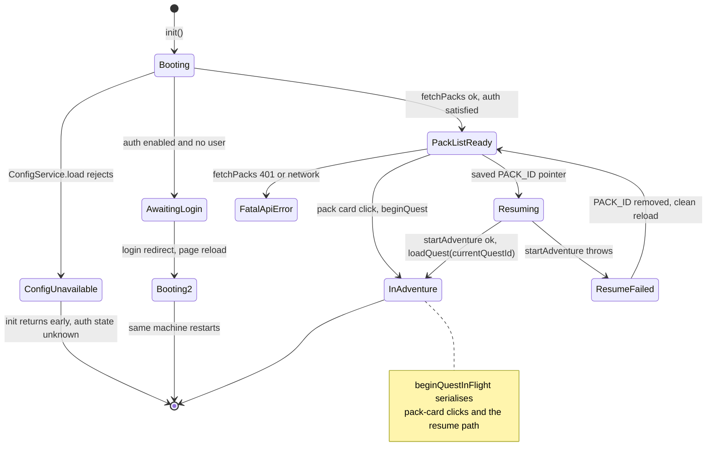

Notes:

* A pack-card click during `Resuming` is dropped without a word (`if (beginQuestInFlight) return`). No feedback, no queueing.
* `ConfigUnavailable` is the only state in which authentication is *unknown* rather than disabled. The code says so deliberately (`frontend/adventure/src/app.js:89-91`).
* `ResumeFailed` keeps the pack's `PACK_STATE` and drops the pointer, so the next load starts on the pack list with progress still resumable.
* None of this is observable until the page-ready gate fires (M#42). The document stays hidden until `html.loaded` is added (`frontend/adventure/src/app.js:19-25`), and the `readyState` branch means that can happen before or after `init()` begins.

### M#2 · Authentication / session (client)

**Carrier:** `ConfigService.config`, the module-level `userManager` closure, `renewalInFlight`, `renewalRefused` · **Owner:** `auth-service.js`; rendered by `ui-manager.js:432` · **Persisted:** the OIDC session, in issuer-managed storage

States are spread over `ConfigService.config`, the module-level `userManager` closure variable and the DOM.

| State | Carried by |
| ------- | ----------- |
| `ConfigNotLoaded` | `ConfigService.config === null` → `isEnabled()` falsy |
| `OpenMode` | `config.enabled === false`, `userManager === null` |
| `Unauthenticated` | `getUser()` → null; login button visible |
| `Redirecting` | `signinRedirect()`, page leaves |
| `Callback` | URL has `?code=`, `signinCallback()`, then URL scrubbed |
| `Authenticated` | user with unexpired `access_token` |
| `TokenExpired` | `user.expired === true` |
| `Renewing` | `renewalInFlight` (`auth-service.js:98-122`): one attempt every caller waits on |
| `RenewalRefused` | `renewalRefused` (`auth-service.js:115`), held for the life of the page |
| `SignedOut` | `signoutRedirect()` |

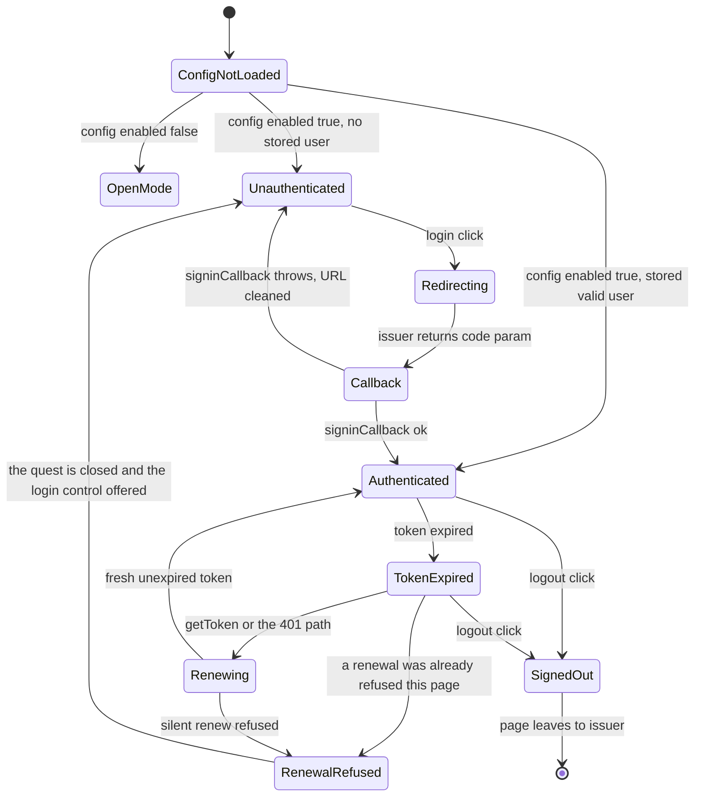

`ConfigNotLoaded` behaves like `OpenMode` for `isEnabled()`: a missing config is indistinguishable from auth-disabled except inside `init()`. A request made in that window would go out without `Authorization` (`api-service.js:61-64`). None is made there: `ConfigService.load()` is awaited before auth setup, before the listeners that could trigger a request and before `fetchPacks()` (`frontend/adventure/src/app.js:98-139`). `/config` is fetched with `API.CONFIG_TIMEOUT_MS` (`config-service.js:33`) and never carries a token.

Three details the diagram leaves out:

* `Callback` is entered from the URL alone, with no variable involved. The code param is removed in *all* cases, so a failing callback cannot loop (`auth-service.js:63-71`).
* One attempt serves every caller: `getToken` and the 401 path await the same `renewalInFlight`, so concurrent 401s cannot start a second `signinSilent()` over the same OIDC storage keys.
* A refusal is held for the life of the page. `announceSessionLost` runs the handler at `frontend/adventure/src/app.js:113-116`, which calls `PackManager.returnHome()` (progress flushed and kept, pack pointer cleared) and `updateAuthUI(false, true)`. The message is the `renewal_failed` branch of `apiErrorHint` (`error-service.js:33`), the one the failed request shows as a toast. Login and logout clear the refusal by leaving the page.

### M#42 · Page-ready gate (whole-document reveal)

**Carrier:** `html.loaded` class · **Owner:** inline `<style>` in `frontend/adventure/index.html` plus the reveal block at `src/app.js:17-25` · **Persisted:** no

The document itself is a two-state machine that no code names: `html` ships invisible and is revealed by adding the `loaded` class (`frontend/adventure/index.html:42-53`, `frontend/adventure/src/app.js:17-25`). It sits *outside* every other machine's view, yet it decides whether any of them is observable.

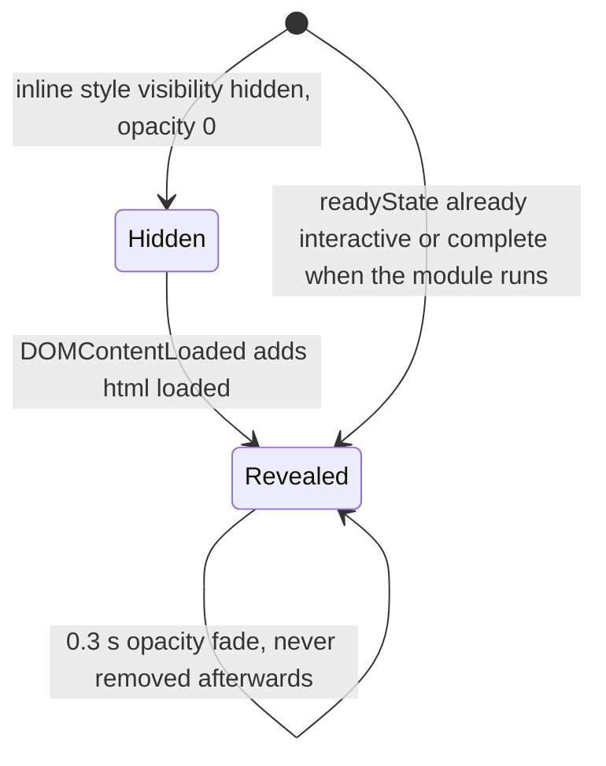

Two mutually exclusive entry branches (`readyState` guard, `frontend/adventure/src/app.js:19-25`). The reveal can happen **before** `init()` starts or after it, so "booting but invisible" and "booting but visible" are both reachable. This is the machine that decides whether M#1's early exits are seen at all.

Nothing ever removes `loaded`, and the reveal uses `visibility: hidden` rather than `display: none`. Every element of every other machine exists and occupies layout while invisible, so measurements such as `offsetWidth` still work during `Hidden`.

The reveal is also a **CSP dependency**. The rule lives in an inline `<style>`, which is permitted only because `style-src` carries `'unsafe-inline'` (`middleware.go:100`). Tighten that header without a hash for this block and the app boots into permanent invisibility, a silent failure indistinguishable from a blank-page bug (M#30, M#35).

---

## 7. Part B · Gameplay core

The game itself. Six machines define where the player stands (M#4, M#5) and what may be done there (M#6); what a hint costs, and when (M#7, M#8); how points are kept (M#9). Everything else in this document orbits one of them.

### M#4 · Adventure progression

**Carrier:** `currentQuestId`, `activeQuestId`, `questScores` · **Owner:** transitions in `state-service.js`, rendered by `quest-manager.js` · **Persisted:** yes (pack body, M#27)

The central machine. Three integers encode the whole game:

| Variable | Domain | Meaning |
| ---------- | -------- | --------- |
| `currentQuestId` | `0 … N+1` | `0` = prologue, `1…N` = quest, `N+1` = epilogue; `isEpilogueCursor` (`state-service.js:486`) defines the upper sentinel |
| `activeQuestId` | `0 … N+1` | the unlocked frontier; sentinel `N+1` = "epilogue visited" |
| `questScores[questId]` | present/absent | quest completed |

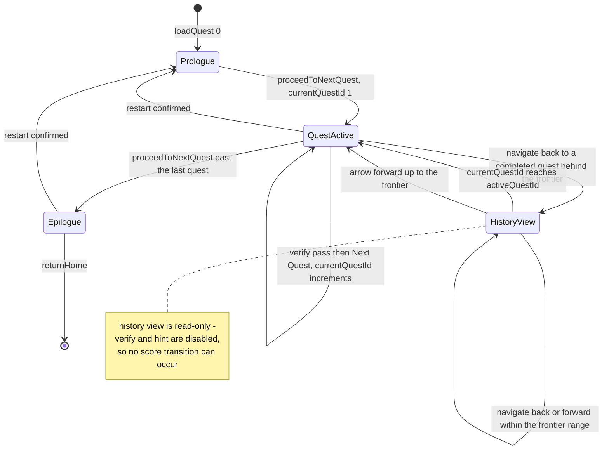

Transitions in detail:

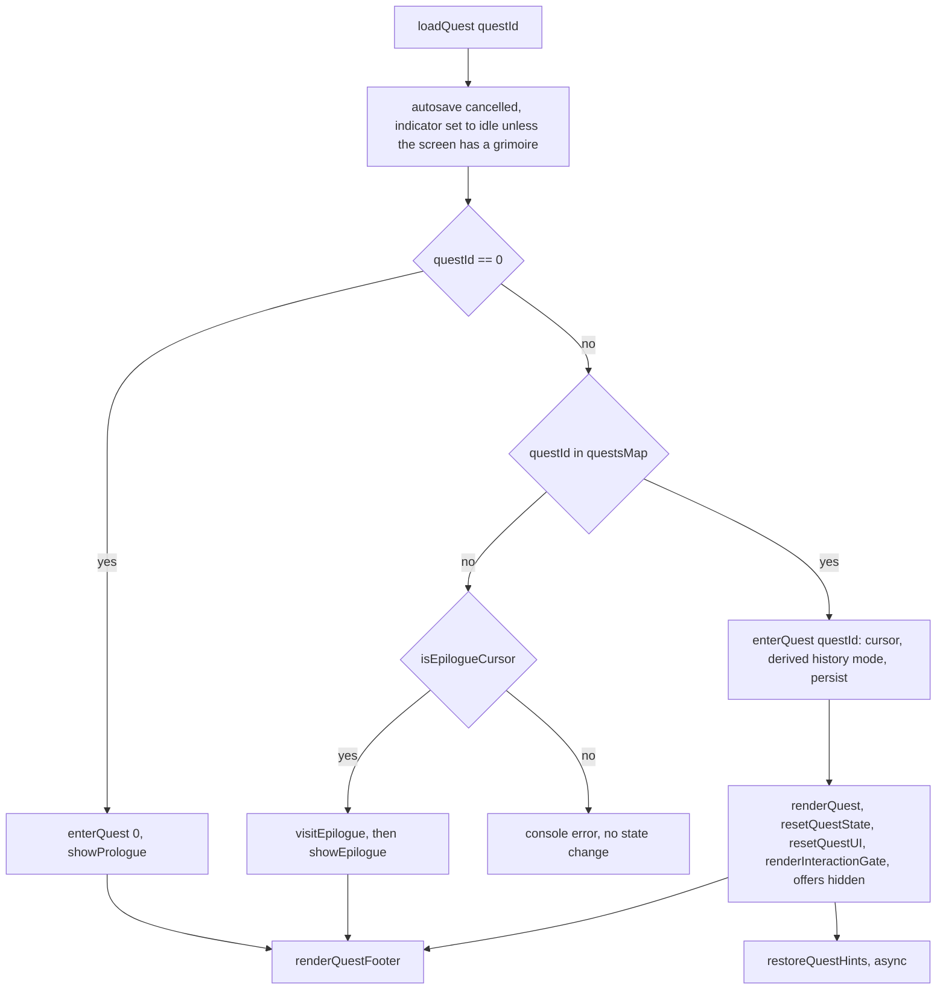

Navigation guards: one rule per direction, each consulted by the action and by the control's `disabled` state alike.

| Rule | Definition | Read by |
| ------- | ------ | ------ |
| `canNavigateBack()` | `currentQuestId > 1` (`state-service.js:517`) | the back arrow's `disabled` (`quest-manager.js:361`) and `rewindQuest` (`state-service.js:288`) |
| `canNavigateForward()` | `currentQuestId < N && (questScores[currentQuestId+1] !== undefined \|\| (isHistoryMode && currentQuestId < activeQuestId))` (`state-service.js:528`) | the forward arrow's `disabled` (`quest-manager.js:362`) and the forward action (`quest-manager.js:379`) |

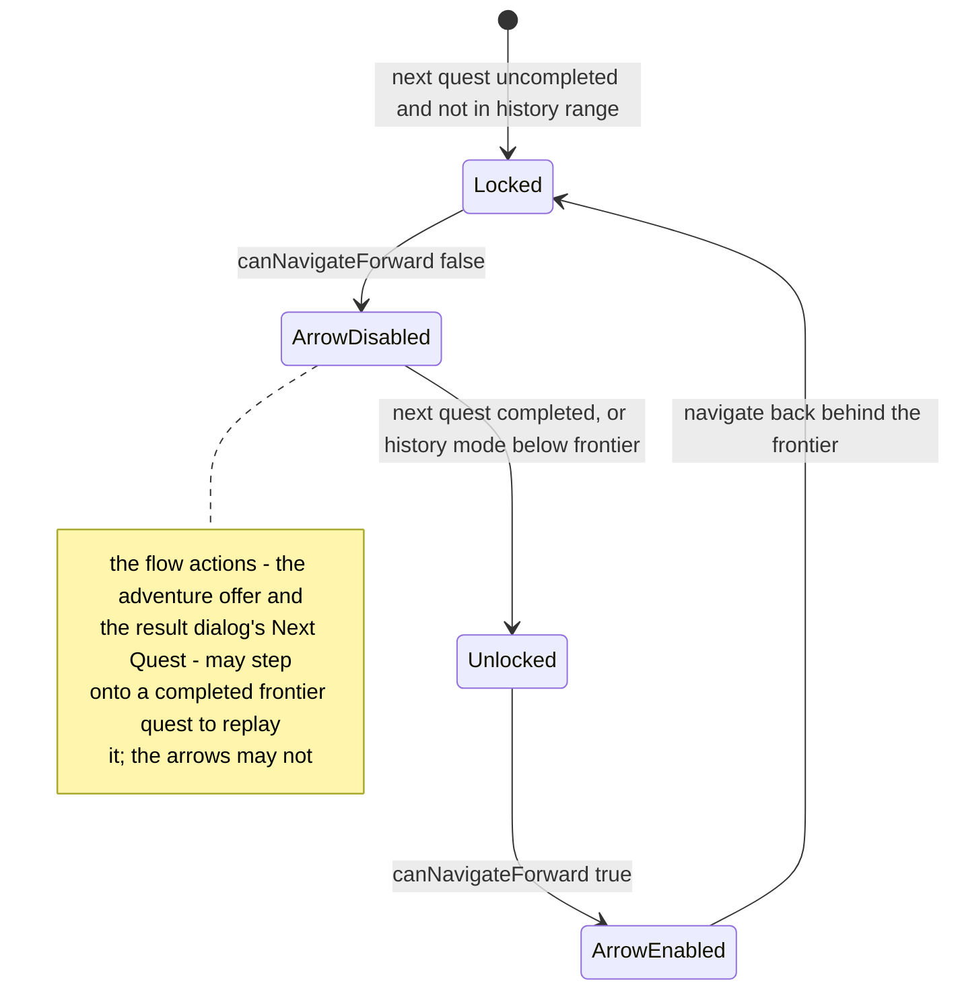

Details:

* `activeQuestId` has three writers and one restorer. `completeQuest` grows it at `state-service.js:462`, `advanceQuest` grows it at `state-service.js:273`, `visitEpilogue` sets it at `state-service.js:305`, and `loadPackState` (`state-service.js:103`) restores it from storage, falling back to `currentQuestId`. None of them lowers it, and navigating never touches it.
* Reaching the epilogue is a transition. `visitEpilogue` lands cursor and frontier on `N+1` (`state-service.js:303-305`); `showEpilogue` (`quest-manager.js:322`) renders and writes nothing, and `loadQuest` performs the transition before it renders. That is what makes the epilogue the resume target of a pack, and `isEpilogueCursor` (`state-service.js:486`) is the single definition of where it begins; the interaction gate reads the same predicate (M#6).
* Within a session the epilogue is reached by a passing verification of quest `N`: `canNavigateForward` bounds the forward arrow at the last quest. Once the epilogue has been visited, the `N+1` cursor is persisted, so a reload resumes straight onto it.
* `isHistoryMode` is not persisted (`savePackState`, `state-service.js:190`); every transition recomputes it, so derived state never sits in storage (M#5).
* The tour's first popover names its own controls: "Move through the tour with its Next and Previous buttons, the Left and Right arrow keys, or Enter; press Esc to leave the tour at any point" (`tutorial.js:137`). driver.js binds those keys and the popover focuses the Next button, so Enter advances the tour. Quest movement has no key binding: the arrows are buttons, and the only global shortcuts are Ctrl/Cmd+Enter and Ctrl/Cmd+S (`event-manager.js:170-184`).

### M#5 · History mode (pure derived state)

**Carrier:** `isHistoryMode` · **Owner:** `deriveHistoryMode` (`state-service.js:316`), recomputed by every cursor transition · **Persisted:** no, by design

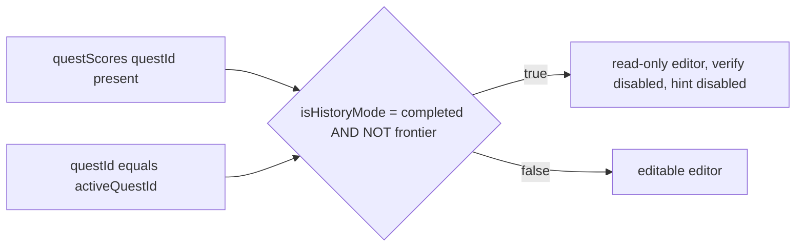

Re-entry rule: `deriveHistoryMode` (`state-service.js:316`) is recomputed by every transition that moves the cursor, i.e. `enterQuest`, `advanceQuest`, `rewindQuest`, `visitEpilogue` and `resetProgress`. Leaving history view therefore happens by moving the cursor onto the frontier quest, by `advanceQuest`, or by `resetProgress`.

The frontier quest *can* be completed and still be editable, because `questId === activeQuestId`. A completed quest is therefore "history" by score and "active" by mode at the same time. Replaying it is the only legitimate way to re-enter `completeQuest`.

### M#6 · Interaction gating

**Carrier:** one derived gate, rendered as `readOnly` + two `disabled` flags + pane `hidden` · **Owner:** `GameState.getInteractionGate()` derives (`state-service.js:499`); `UIManager.renderInteractionGate(gate)` writes (`ui-manager.js:333`) · **Persisted:** derived

One concept, one derived value, one writer. `GameState.getInteractionGate()` derives the four controls from the cursor, the derived history mode and whether the cursor stands on a playable quest. `UIManager.renderInteractionGate(gate)` is the only code that assigns `readOnly`, the two `disabled` attributes and the editor pane's `hidden` class.

| Logical state | `editor.readOnly` | `verifyBtn.disabled` | `hintBtn.disabled` | Editor pane |
| --------------- | ------------------- | ---------------------- | -------------------- | ------------- |
| `Editable` (frontier quest, not history) | false | false | false | visible |
| `HistoryReadOnly` (completed quest behind the frontier) | true | true | true | visible |
| `NarrativeStage` (prologue, epilogue) | true | true | true | hidden |
| No pack, or pack data not arrived | true | true | true | hidden |

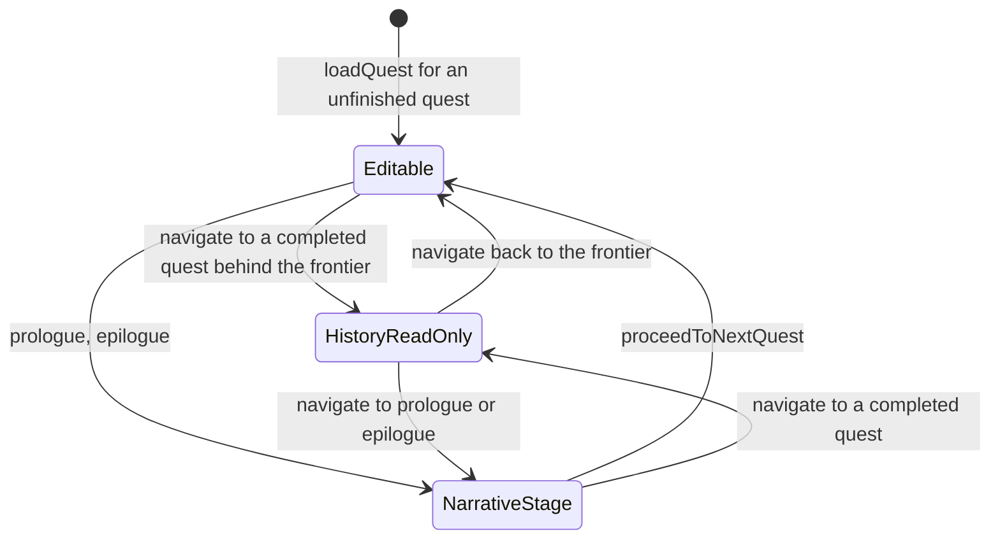

The keyboard path enters through the document-level `Ctrl/Cmd+Enter` handler (`event-manager.js:170-184`), which is suppressed while a `dialog[open]` exists, and reaches the same decision as the button: `handleVerify` consults `getInteractionGate().verifyEnabled` and the `verifying` flag before it sends anything (`event-manager.js:293`). No path asks whether the editor pane is visible in order to decide whether verifying is allowed.

### M#7 · Hint/solution reveal

**Carrier:** `hintsUsed`, `solutionViewed` · **Owner:** the progression is defined once in `nextReveal` (`reveal-service.js:39`); `state-service.js` persists the accounting · **Persisted:** yes (part of the pack body, M#27)

The progression is defined once, in `nextReveal` (`reveal-service.js:39`), and rendered by three consumers: the button label (`ui-manager.js:154`), the confirmation text of the confirm dialog (`managers/dialog-text.js:57`) and the reveal itself (`quest-manager.js:525`). Only the reveal path passes the real `solutionViewed` flag; the label and the confirmation text pass `false`, which is sound because a quest whose solution has been viewed has its hint button hidden (`quest-manager.js:546`) and no confirm dialog to open.

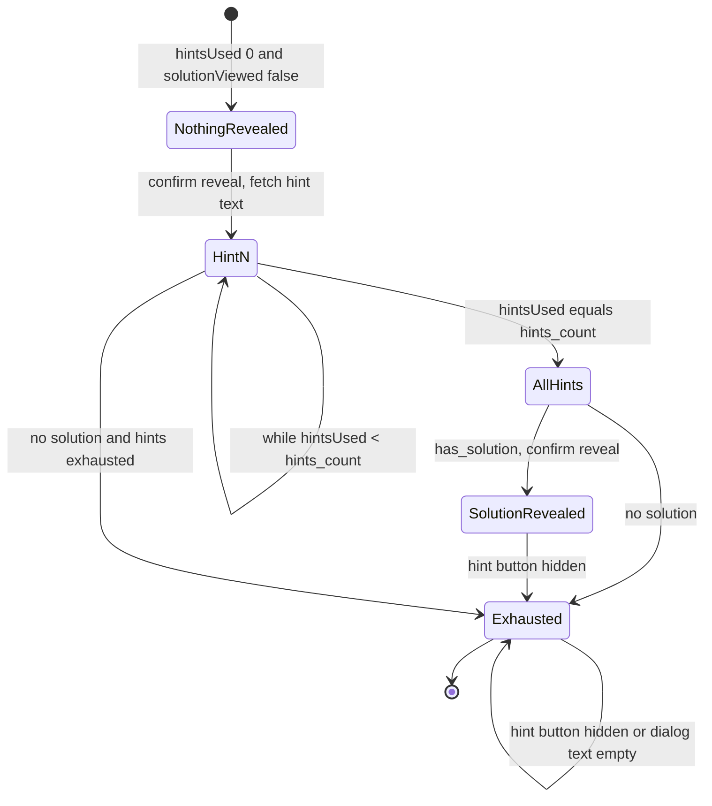

Persistence sub-machine (`state-service.js:334`, `353`):

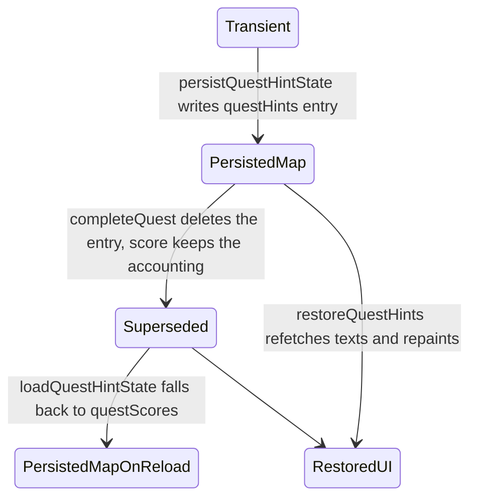

* Reveal accounting lives in **two** maps: `questHints[questId]` while a quest is in progress, `questScores[questId]` once it is completed. `completeQuest` deletes the former (`state-service.js:458`), and `loadQuestHintState` reads `questHints[id] ?? questScores[id]` (`state-service.js:356`).
* A completion is one record. `completeQuest` keeps the better of the recorded and the current attempt, with `hintsUsed` and `solutionViewed` travelling with `pointsEarned` (`state-service.js:451`). A replay that does not beat the recorded score leaves both halves of the record alone.
* A failed restore charges nothing new. When the stored reveal texts cannot be fetched, the stored accounting is applied anyway (`applyStoredReveals`, `quest-manager.js:489`), so the counters, the hint button and what the player already paid for stay in agreement (M#8).
* The backend marks the reveal endpoints `Cache-Control: no-store` (`handlers.go:66`) precisely because the *delivery order* of these artifacts is game state. The client keeps a per `pack:quest` cache (`quest-manager.js:43`) that lives exactly one pack visit: `clearCaches` (`quest-manager.js:61`) drops it at pack entry, at pack exit and at restart (M#29).

### M#8 · Async reveal overlay (race control)

**Carrier:** one record: `revealPhase` (`idle`, `restoring`, `revealing`), `revealQuestId`, `revealPromise` (`quest-manager.js:53`) · **Owner:** `claimReveal` (`quest-manager.js:77`), the only writer of the phase · **Persisted:** no

A second machine layered on M#7 to defuse races.

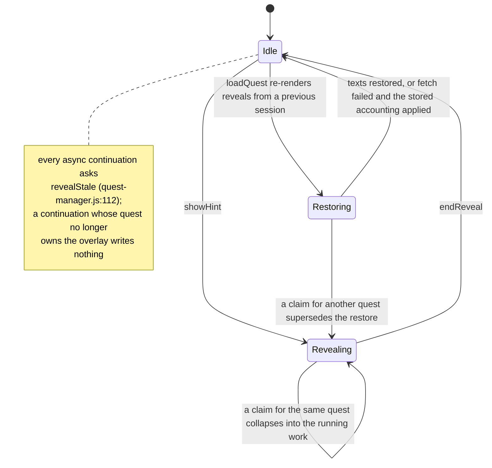

`claimReveal` is the only writer of the phase. A claim for the quest that already owns the overlay returns false and collapses into the work in flight; a claim for another quest supersedes it. `endReveal` (`quest-manager.js:89`) releases the overlay only to its owner. `isRevealTarget` (`quest-manager.js:102`) says whether the player still stands on that quest, and `revealStale` (`quest-manager.js:112`) composes the two; no continuation compares the cursor by hand. `clearCaches` (`quest-manager.js:61`) returns the record to `idle` along with the cached texts.

### M#9 · Quest scoring / replay

**Carrier:** `questScores` records, `totalScore` · **Owner:** `completeQuest` (`state-service.js:440`) · **Persisted:** yes (pack body, M#27)

| State | Carried by |
| ------- | ----------- |
| `Unrecorded` | no `questScores[id]` |
| `Scored` | `questScores[id].pointsEarned` |
| `Replayed` | the attempt with the better `pointsEarned` is kept, and its reveals travel with it (`state-service.js:451`) |
| `Perfect` | `hasPerfectScore()` (`state-service.js:475`) |

Penalty function: `10 − min(hintsUsed·2, 6) − (solutionViewed ? 3 : 0)`, floored at 1 (`state-service.js:404`). `totalScore` is derived from the records: `sumQuestScores` (`state-service.js:428`) computes the stored field at load and at every write, so the total cannot stand apart from the records that produce it.

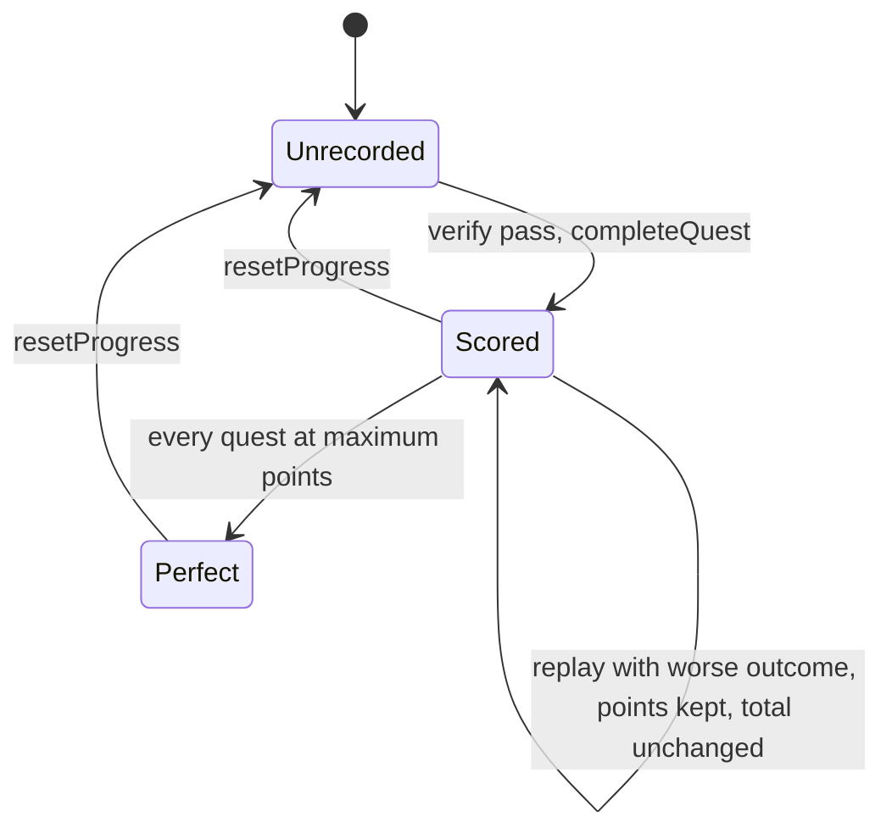

`totalScore` is stored *and* derivable from `questScores`. It is rebased by `total − previous + new` (`state-service.js:314`), which makes the sum an invariant maintained by hand. `hasPerfectScore()` uses exact equality (`state-service.js:342`); a score above the maximum would flip it to false, which cannot happen today.

---

## 8. Part C · Interface surfaces

Presentation, all fourteen machines of it: screens and themes, dialogs and their effects, music, toasts, the tutorial. Most of these are small. None is trivial, because each one has at least one edge that could strand the player if it fired out of order.

### M#3 · Screen + pack/theme context

**Carrier:** `hidden` classes on the two screens, `loadSeq` generation token · **Owner:** `showScreen` (`ui-manager.js:272`); `pack-manager.js` owns `loadSeq` · **Persisted:** no

`start-screen` and `game-interface` are mutually exclusive by class. The *theme* is a separate, independently-varying axis: which `<link data-quest-theme>` nodes exist, which `backgroundImage` is painted, which avatars are loaded. `PackManager.loadSeq` is a monotonically increasing generation token guarding stale async writes.

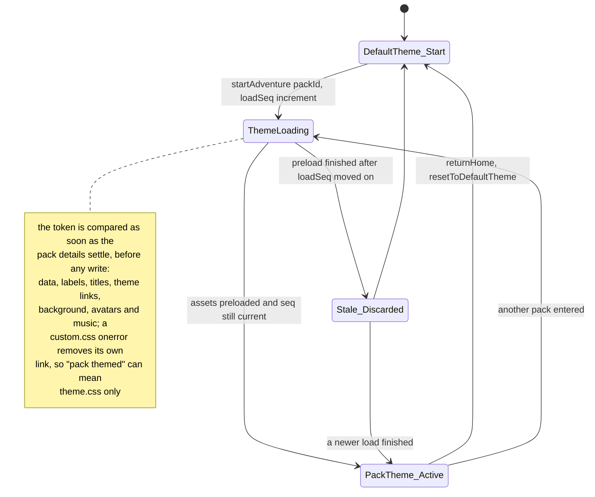

Two screens times two theme contexts gives four reachable combinations, and three of them are intended. `PackTheme` while on the start screen is unreachable because `beginQuestInFlight` serialises pack entries (`frontend/adventure/src/app.js:70-82`, M#1) and the game screen, which holds the only home button, is not shown until the pack has loaded (`pack-manager.js:243`). `loadSeq` protects the rest: the token is taken at the top of `loadPack` (`pack-manager.js:59`) and compared as soon as `fetchPackDetails` settles (`pack-manager.js:64`), before any write it governs. Those writes are quest data, labels, titles, theme `<link>` nodes, background, avatars and the music track. `loadPack` and `startAdventure` return whether the entry applied, so a caller that lost the race does not continue into the pack. `resetToDefaultTheme` (`pack-manager.js:187`) bumps the token, which is what stops a half-finished pack load from landing on top of the start screen.

A `custom.css` failure is an implicit "theme without effects" sub-state: silent, and no flag records it (M#34).

When `loadPack` fails, `rollbackPackEntry` clears the pack pointer and every pack-scoped in-memory field without writing anything, so no pack pointer survives an entry that did not load (M#27).

### M#14 · Dialogs

**Carrier:** `<dialog open>` · **Owner:** `ModalManager.openDialog` (`modal-manager.js:83`) / `closeDialog` (`modal-manager.js:93`) · **Persisted:** no

Seven `<dialog>` elements, each with its own micro-machine, and one open mode.

| Dialog | Opened with | Backdrop click | ESC | Extra close rule |
| -------- | ------------- | ---------------- | ----- | ------------------ |
| manual | `showModal` | closes | closes | focus close button |
| test payload | `showModal` | closes | closes | async fetch before opening |
| support modules | `showModal` | closes | closes | button disabled unless the quest has modules |
| hint confirmation | `showModal` | closes | closes | focus goes to **Cancel** |
| perfect score | `showModal` | closes | closes | confetti starts, `close` event → `cleanupEffects()` |
| restart confirmation | `showModal` | **blocked** | **blocked** (`cancel` → `preventDefault`) | explicit buttons only |
| result | `showModal` | closes | closes | `close` event → `cleanupEffects()` |

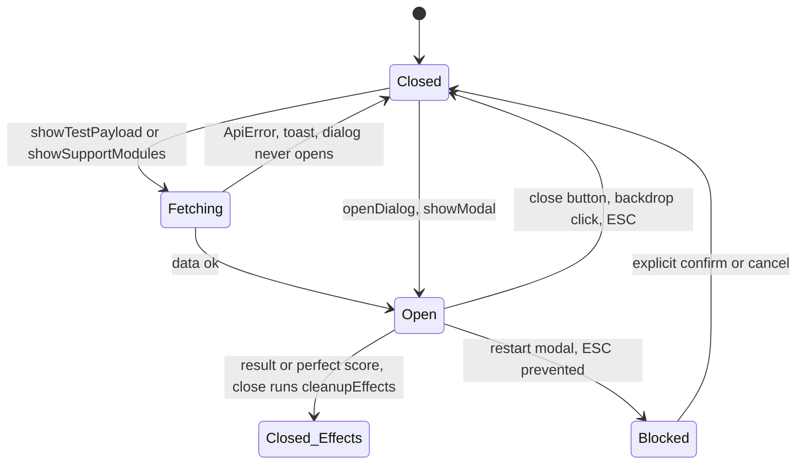

`openDialog` (`modal-manager.js:83`) and `closeDialog` (`modal-manager.js:93`) are idempotent: a double open or a double close is a no-op rather than an error. `openDialog` takes no modality switch; `showModal()` is the only call it makes, so the page behind an open dialog is unreachable and the state that dialog describes cannot change under it. `architecture-boundaries.test.js` fails a bare `show()` on a dialog element. The dismissal policy is stated in the `ModalManager` class comment (`modal-manager.js:32-52`) and matches the table above.

Both dialogs that start an effect attach a `close` listener running `cleanupEffects` (`modal-manager.js:125-135`), which covers the button, ESC and the backdrop alike, so no effect outlives the dialog that triggered it (M#22). The restart confirmation blocks `cancel` (`modal-manager.js:138-142`): leaving it takes an explicit click.

An eighth dialog sits outside the table. The tutorial prompt is created dynamically and follows the same explicit policy: ESC is prevented and forwarded to Decline (`tutorial.js:104-108`; see M#23).

Focus targets differ per dialog and encode an intent: cancel for the destructive confirmations, the action control for the result.

### M#15 · Result modal

**Carrier:** `open` + `nextQuestBtn` visibility · **Owner:** `showResult` (`modal-manager.js:258`); the caller passes points in · **Persisted:** no

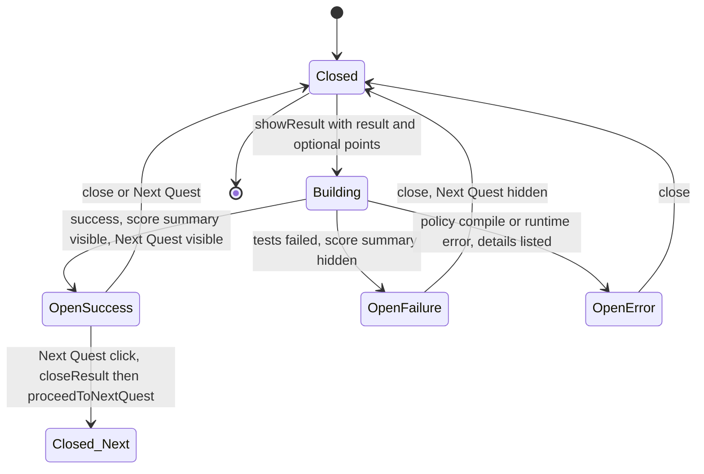

`pointsEarned` is passed *into* the modal by the caller that owns the state transition, so the machine that renders never mutates game state (`event-manager.js:321`, `modal-manager.js:258`). While the modal is open the page behind it is unreachable, which is what keeps a verify, a reveal or a navigation step from changing the quest the modal describes (M#14).

### M#16 · Perfect score reveal

**Carrier:** `perfectScoreBtn` `hidden` · **Owner:** `renderPerfectScoreButton` (`ui-manager.js:213`), the only writer of the visibility · **Persisted:** no

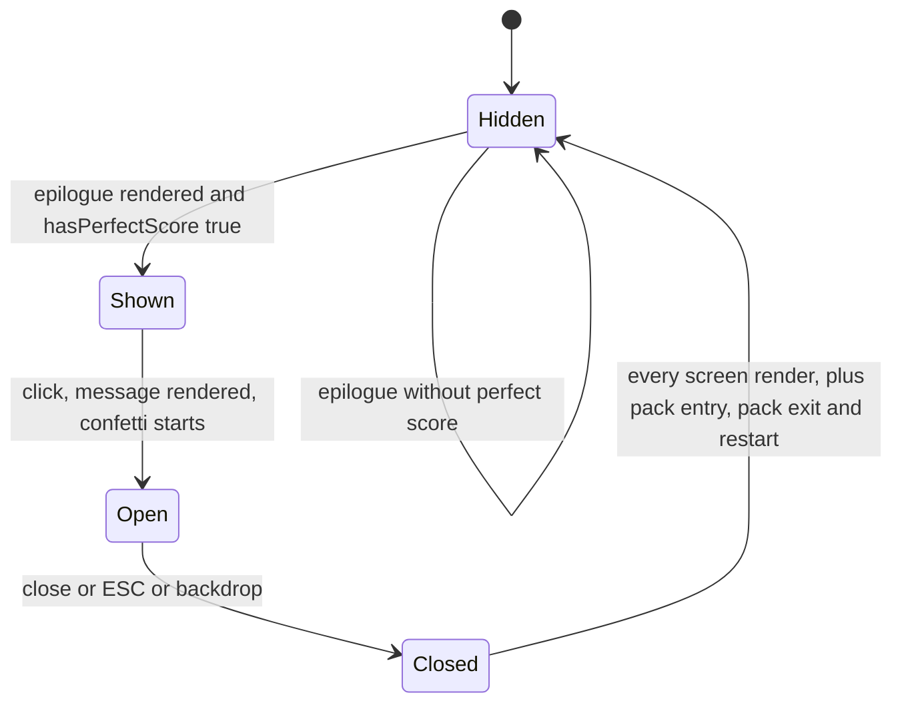

The visibility *is* the state; the click handler is wired once at startup (`event-manager.js:270`).

Showing happens at exactly one place: the epilogue, when `hasPerfectScore()` is true (`quest-manager.js:337`). Hiding happens at six: every quest render (`quest-manager.js:245`), either narrative stage (`quest-manager.js:297`), the epilogue without a perfect score (`quest-manager.js:339`), pack entry and pack exit (`pack-manager.js:218`, `:274`), and the restart handler (`event-manager.js:380`). A quest render hides it, so returning from the epilogue into history mode cannot leave it beside an unrelated quest. Closing the dialog changes nothing about the button either (M#17).

### M#17 · Quest footer visibility

**Carrier:** footer `hidden` class · **Owner:** `renderQuestFooter` (`ui-manager.js:177`), which folds button visibility after each render · **Persisted:** derived

A purely derived machine: the footer is hidden exactly when no descendant button is un-hidden. Its input set is closed and small. Exactly two buttons ever live in `.quest-footer` (`frontend/adventure/index.html:181-188`), namely `#perfect-score-btn` (`frontend/adventure/index.html:182`) and `#start-adventure` (`frontend/adventure/index.html:186`), and quest packs cannot add DOM nodes, only restyle existing ones (`routes.go:38-42`).

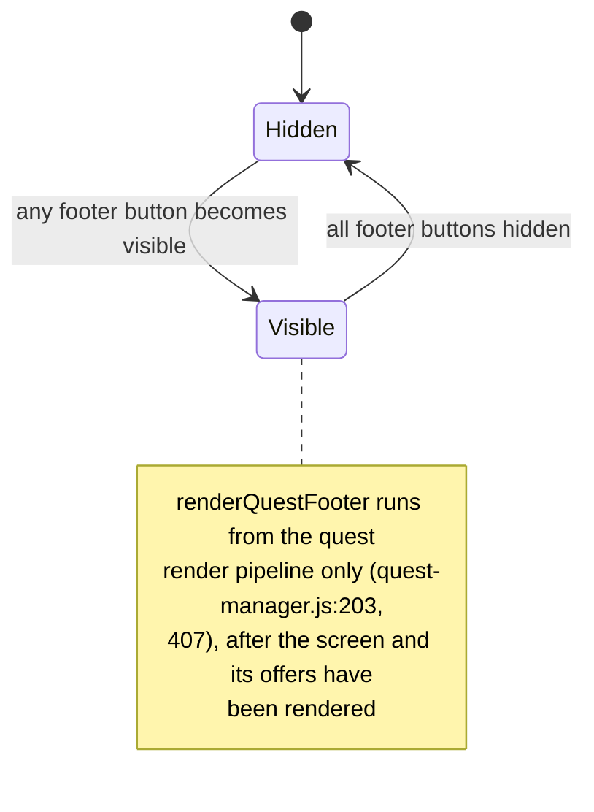

The rule is derived, and it is recomputed by the render pipeline rather than at the sites that change visibility: a screen first renders its offers (`renderQuestButtonVisibility`, `renderPerfectScoreButton`), and `renderQuestFooter` then folds the result.

Two ways a footer button becomes visible: the prologue offers the adventure (`renderQuestButtonVisibility(true, ...)` at `quest-manager.js:314`), and a perfect-score epilogue offers its button (`quest-manager.js:337`). `#start-adventure` has one DOM home, `.quest-footer`; no code reparents it. The quest arrows live in `.editor-footer` inside the **editor** pane (`frontend/adventure/index.html:216-229`), and the hint button sits above the editor (`frontend/adventure/index.html:168`), so neither touches this machine. `resetQuestUI` (`ui-manager.js:321`) re-shows the hint button and clears its `disabled` flag; the interaction gate itself is derived (M#6), not restored by a layout function.

### M#18 · Lore pagination

**Carrier:** `currentLoreIndex` · **Owner:** `navigateLore` (`quest-manager.js:415`); rendered at quest entry (`quest-manager.js:252`) and by `ui-manager.js:88` · **Persisted:** no, and never restored per quest

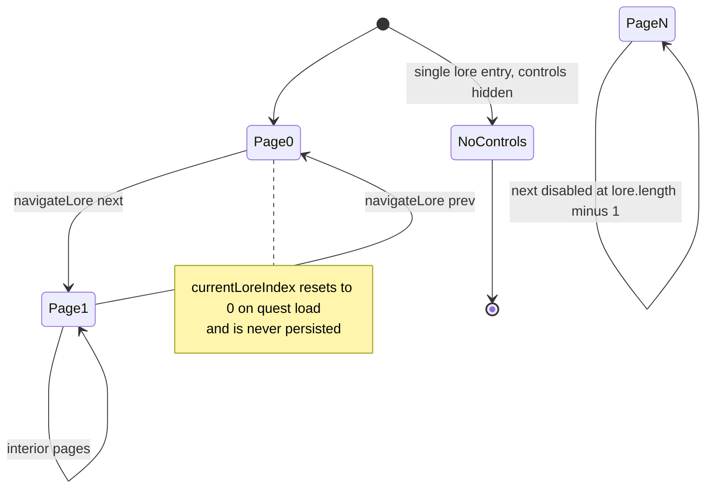

Three controls, one machine: `lorePrevBtn.disabled`, `loreNextBtn.disabled` and the `#lore-page-indicator` text, all derived from `currentLoreIndex`.

### M#19 · Background music

**Carrier:** one value, `MusicState` (`audio-manager.js:43`); `pauseTimer` is an implementation detail of the two fading states · **Owner:** `transitionTo` (`audio-manager.js:339`), the only writer after construction; `renderMusicButton` (`audio-manager.js:348`) renders from that value and from nothing else · **Persisted:** no

The track plays once per toggle.

| State | Meaning | Control |
| ------- | --------- | --------- |
| `silent` | a track is available, nothing is playing | off |
| `unavailable` | the pack has no playable track | off, disabled |
| `fading-in` | `play()` called, gain ramping up | on |
| `playing` | `play()` resolved, gain at target | on |
| `fading-out` | gain ramping to 0, the element still runs | off |
| `play-rejected` | `play()` rejected; cleared by the next toggle | off |

```mermaid
stateDiagram-v2
    [*] --> Silent : setupMusic, element reloaded and paused
    Silent --> FadingIn : toggleMusic, play called, gain ramped from 0
    FadingIn --> Playing : play promise resolved
    FadingIn --> PlayRejected : play rejected
    PlayRejected --> FadingIn : the next toggle retries
    Playing --> FadingOut : toggleMusic off
    FadingOut --> Silent : ramp reached 0 and the element pauses; only stopMusic rewinds it
    Playing --> Silent : ended event, rewound and the control returns to off
    Playing --> FadingOut : stopMusic on pack exit, rewound at the end of the fade
    Silent --> Unavailable : the track fails to load or to decode
    Playing --> Unavailable : the track fails mid-play
    Unavailable --> Silent : a later pack's track loads cleanly
```

`setupMusic` (`audio-manager.js:88`) points the element at the pack's `bg-music.m4a`, pauses it, rewinds and enters `silent`; it is the only edge that leaves `unavailable`. A track that then fails to load or decode raises `error` on the element and `handleTrackError` (`audio-manager.js:239`) enters `unavailable`, which disables the button rather than letting it claim a state it cannot deliver. The same handler answers a failure that arrives mid-play: a network failure during playback and a metadata-probe failure at pack entry are rendered identically, because both mean the pack has no playable track from that moment on.

`handleMusicEnded` (`audio-manager.js:223`) rewinds the element and returns to `silent`, so the control and the element agree about where the track stands. `fadeOut(rewind)` (`audio-manager.js:297`) pauses only after the ramp reaches 0, and `stopMusic` (`audio-manager.js:321`) is the rewinding form used when a pack is left.

A generated pack ships a valid, silent placeholder track (M#38), so its music control is enabled and reaches `playing`. A 0-byte file is what puts the machine in `unavailable`, the one branch that disables the button.

### M#20 · Web Audio graph lifecycle

**Carrier:** `audioCtx`, `gainNode`, `audioGraphFallback` (`audio-manager.js:67`) · **Owner:** `audio-manager.js` · **Persisted:** no

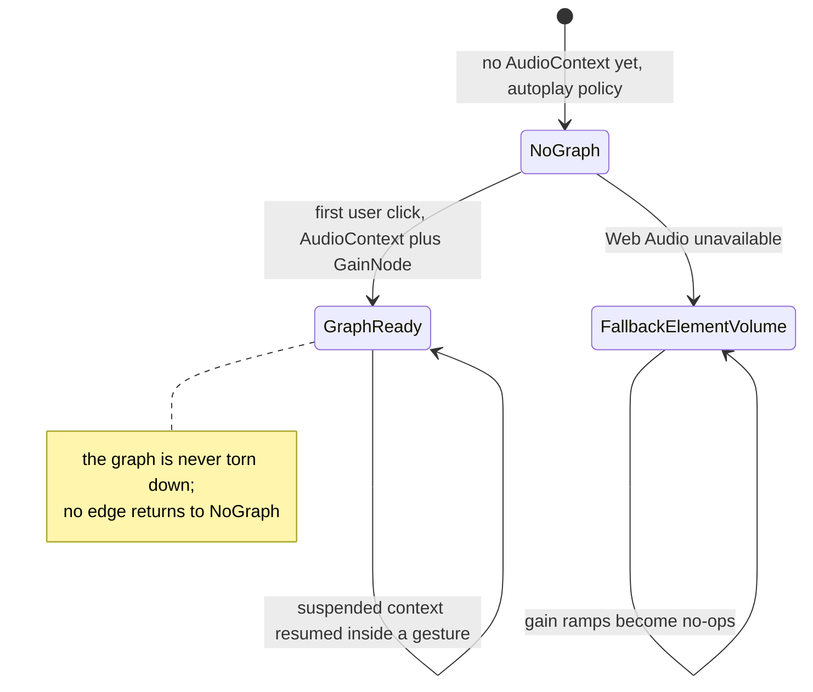

The graph outlives pack switches. `setupMusic` changes the element `src` but never re-creates `createMediaElementSource`, which may only be called once per element. `audioGraphFallback` records which half of the machine owns volume: it is set when `AudioContext` construction or `createMediaElementSource` throws (`audio-manager.js:135`), and `setGain`/`rampGain` then act on the element's own volume instead of the node, leaving the ramps immediate. The flag is not reset per pack, because the failure is about the browser, not the pack.

### M#21 · Visual effects toggle

**Carrier:** `body.effects-disabled` · **Owner:** toggle at `ui-manager.js:420` · **Persisted:** yes, `localStorage` under `EFFECTS_ENABLED`

Off by default (`getLocalStorage(EFFECTS_ENABLED, 'false')`, `ui-manager.js:383`).

```mermaid
stateDiagram-v2
    [*] --> Off : default
    Off --> On : toggle
    On --> Off : toggle
    On --> On : page reload, persisted
    Off --> Off : page reload, persisted
```

### M#22 · Result effects (confetti / dark overlay)

**Carrier:** `confettiInterval` (`effects.js:23`, the module's only state) + `#dark-overlay.active` · **Owner:** `effects.js` · **Persisted:** no

```mermaid
stateDiagram-v2
    [*] --> Neutral
    Neutral --> Confetti : success, an interval spawning particles for 3 s
    Neutral --> DarkOverlay : failure, and the effects opt-out allows it
    Confetti --> Neutral : interval self-clears at duration end, or cleanupEffects on dialog close
    DarkOverlay --> Neutral : hideDarkOverlay on success or cleanupEffects
    Confetti --> Confetti : showConfetti replaces a running interval
```

The opt-out is consulted once per effect, at the effect's own edge. `showConfetti` (`effects.js:39`) and `showDarkOverlay` (`effects.js:97`) return immediately while the body carries `effects-disabled`, so `triggerResultEffect` (`effects.js:132`) stays unconditional and its `hideDarkOverlay()` runs effect or not. A result cannot leave an overlay behind, and `showPerfectScore` may call `showConfetti` directly for the same reason: the guard belongs to the effect, not to the caller (M#21).

Both dialogs that can start an effect close through a `close` listener running `cleanupEffects` (`modal-manager.js:125-135`), so confetti and overlay end with the dialog instead of outliving it (M#14).

The overlay is a **sticky** element: once a failure has happened, `#dark-overlay` stays in the DOM and only its `active` class toggles (`effects.js:97-125`), which makes "never shown" and "currently hidden" the same DOM state. `cleanupEffects` (`effects.js:144`) hides it and clears the interval.

### M#23 · Tutorial

**Carrier:** `driverObj`, `hiddenElementsState`, plus the `TUTORIAL_COMPLETED` storage flag · **Owner:** `tutorial.js` (`startTutorial` at `tutorial.js:373`) · **Persisted:** the completion flag, yes

```mermaid
stateDiagram-v2
    [*] --> Eligible : no TUTORIAL_COMPLETED flag
    [*] --> Skipped : flag present, showTutorialPrompt returns
    Eligible --> Prompt : TIMING.TUTORIAL_SHOW_DELAY after entering a NEW pack only
    Prompt --> Touring : accept, optional markCompleted
    Prompt --> Declined : decline, or ESC forwarded to Decline
    Prompt --> Eligible : accept without the checkbox
    Prompt --> Skipped : accept or decline with checkbox
    Touring --> Restoring : driver destroyed, undoTour
    Touring --> NoTour : no visible steps, reveals restored in the same call
    NoTour --> Restoring
    Restoring --> [*] : focus handed to Start Adventure one frame later
```

`startTutorial` (`tutorial.js:373`) is a transaction. `temporarilyUnhideElements` (`tutorial.js:346`) records the selectors it un-hid in `hiddenElementsState`, and a `finally` block restores them unless a driver is running, so a driver that fails to build or start leaves the screen as it was found. `undoTour()` is the undo of a tour that ran, and both destroy hooks call it: `onDestroyStarted` (`tutorial.js:436`) and `onDestroyed` (`tutorial.js:441`). It returns immediately when nothing was hidden and no driver is held, so a destroy arriving twice, or an exit from a tour that never started, are both safe.

`onDestroyStarted` exists because driver.js restores its own focus after running the destroy hooks. The hand-off of focus to `#start-adventure` is deferred by one frame (`requestAnimationFrame`, `tutorial.js:468`) so the tour's teardown cannot win the race.

Re-entry is asymmetric. Accepting the tour without ticking "Don't show this again" runs the tour and leaves the player eligible; a resumed adventure never shows the prompt (`pack-manager.js:249-253`), because a player who came back mid-policy should not be interrupted.

### M#24 · Toast notifications

**Carrier:** `toast-show` / `toast-hide` classes · **Owner:** `toast-service.js` · **Persisted:** no

```mermaid
stateDiagram-v2
    [*] --> Created : element appended
    Created --> Shown : toast-show class after 10 ms
    Shown --> Hiding : auto timer, 3 to 6 s by level, or close click
    Hiding --> Removed : DOM removal after 300 ms
    Hiding --> [*] : close path already removed it, guarded by parentElement
    Removed --> [*]
```

Durations encode the severity machine (`info` 3 s … `critical` 6 s, `toast-service.js:25-30`), and `aria-live` switches from `polite` to `assertive` only at `critical` (`toast-service.js:59`). The `ErrorLevel` machine also gates `showError`: only `error`/`critical` reach a toast, `info`/`warning` are console-only (`services/error-display.js:26-34`).

The toast container is a lazily created singleton (`toast-service.js:37-45`), so "no container yet" is a pre-state of every toast machine.

### M#25 · Copy-to-clipboard feedback

**Carrier:** `dataset.copyFeedback` · **Owner:** copy handler at `ui-manager.js:347` · **Persisted:** no

```mermaid
stateDiagram-v2
    [*] --> Idle
    Idle --> Copying : clipboard API or textarea fallback
    Copying --> Feedback : success, icon plus class swapped, dataset lock set
    Copying --> Idle : failure, error toast
    Feedback --> Idle : 1500 ms timer restores original icon
    Feedback --> Feedback : re-entry blocked by dataset.copyFeedback
```

The `dataset.copyFeedback` flag is the mutex. The fallback path (`execCommand`) is an implicit sub-state chosen by `navigator.clipboard && window.isSecureContext` (`managers/ui-render.js:162`).

### M#26 · Interface minimize

**Carrier:** `interfaceMinimized` (`ui-manager.js:43`), rendered as `game-interface.minimized` · **Owner:** `toggleInterfaceMinimized` (`ui-manager.js:254`), reset by `resetInterfaceMinimized` (`ui-manager.js:262`) · **Persisted:** no

```mermaid
stateDiagram-v2
    [*] --> Normal
    Normal --> Minimized : minimize click
    Minimized --> Normal : second click, or pack entry, pack exit, restart
```

`renderInterfaceMinimized` (`ui-manager.js:229`) writes the layout class, the icon (`fa-minus` ⇄ `fa-expand`) and `aria-pressed` in one call, so the three renderings cannot fall out of step. `resetInterfaceMinimized` is called at pack entry, on the way back to the start screen and at restart. The state is not persisted, so a reload returns to `Normal` as well.

---

## 9. Part D · Persistence and transport

State that outlives a click or crosses the network. Five machines: what the browser keeps (M#27, M#10), what a request goes through (M#11, M#28) and what caches live between them (M#29).

### M#10 · Editor persistence (autosave)

**Carrier:** the debounce timer plus the `save-indicator` class · **Owner:** `GrimoireAutosave` (`src/managers/grimoire-autosave.js`) holds the timer, performs the write and reports the result; `renderSaveStatus` (`ui-manager.js:289`) is the only writer of the indicator class · **Persisted:** the written draft, yes (in the pack body, M#27)

| State | Carried by |
| ------- | ----------- |
| `Idle` | indicator class `idle`; this screen has no grimoire to write (`SaveStatus`, `constants.js:57`) |
| `Saved` | indicator class `saved`; the last write reached storage |
| `Dirty` | autosave timer armed (`grimoire-autosave.js:41`) plus indicator class `dirty` |
| `Flushing` | `GrimoireAutosave.flush` running (`grimoire-autosave.js:55`) |
| `Failed` | indicator class `failed`; storage refused the last write |

```mermaid
stateDiagram-v2
    [*] --> Idle : a screen with no grimoire
    [*] --> Saved : a grimoire screen, code loaded from map, template or default
    Saved --> Dirty : input event
    Dirty --> Dirty : another keystroke, timer re-armed
    Dirty --> Flushing : debounce fires
    Dirty --> Flushing : blur, pagehide, visibilitychange hidden, Ctrl or Cmd plus S, navigation, verify
    Flushing --> Saved : storage accepted the write
    Flushing --> Failed : storage refused the write
    Failed --> Dirty : typing continues
    Saved --> Idle : loadQuest reaches a prologue or an epilogue
```

`markDirty` re-arms the timer (`TIMING.GRIMOIRE_AUTOSAVE_DELAY`, `grimoire-autosave.js:45`), `flush` writes at once, and `cancel` drops a pending write the moment a quest is loaded (`quest-manager.js:192`). The flush edges are blur, `pagehide`, `visibilitychange`, Ctrl/Cmd+S, navigation and verify (`event-manager.js:128-163`, `:181`), and the markup starts the indicator in `idle` (`frontend/adventure/index.html:196`).

`saveGrimoire(questId, code)` (`state-service.js:384`) returns the status rather than a boolean: `IDLE` when `isGrimoireScreen(questId)` is false (`state-service.js:372`), `SAVED` only when the storage write succeeded, `FAILED` when storage refused it (quota full, `localStorage` switched off, or a private-mode rejection). A screen without a grimoire reports `IDLE` through `QuestManager.loadQuest` as well, so the prologue and the epilogue show grey instead of the colour the last typed quest left behind. The tour describes exactly these four colours (`tutorial.js:195`).

The draft store is `state.grimoires[questId]`, read back through `loadQuestCode` in a three-way choice: saved code, quest template, then `DEFAULT_REGO_CODE` (`quest-manager.js:263-271`).

### M#11 · Verify request (client)

**Carrier:** `verifying` + the button label · **Owner:** `handleVerify` (`event-manager.js:292`) · **Persisted:** no

```mermaid
stateDiagram-v2
    [*] --> Gated : button disabled in history and narrative states
    Gated --> Idle : editable state
    Idle --> Idle : empty editor content, early return
    Idle --> Verifying : click or Ctrl/Cmd plus Enter, label swapped to pack text
    Verifying --> Passed : no error and passed, completeQuest then result modal with points
    Verifying --> Failed : tests failed
    Verifying --> PolicyError : result carries error and error_details
    Verifying --> TransportError : ApiError, toast only, no modal
    Passed --> NavigationRefreshed : updateQuestNavigationButtons
    Failed --> Idle : finally restores label and enabled
    PolicyError --> Idle
    TransportError --> Idle
    NavigationRefreshed --> Idle
```

`Ctrl/Cmd+Enter` and the button converge in `handleVerify`, which consults the interaction gate (M#6) and the `verifying` flag before sending. Both shortcuts are suppressed while any `dialog[open]` exists (`event-manager.js:172`).

### M#27 · localStorage persistence / resume

**Carrier:** two keys forming a product machine: the **pointer** `rego_pack_id` and the **body** `rego_pack_state_<packId>` · **Owner:** `storage-service.js` (keys and migration); `state-service.js` (pointer and body transitions) · **Persisted:** yes, this is the persistence

| Pointer | Body | Resulting state |
| --------- | ------ | ----------------- |
| absent | any | start screen, body retained |
| present | absent | fresh adventure, state initialised and written |
| present | unparseable JSON | body kept aside under `rego_pack_state_<packId>_corrupt`, adventure starts fresh, a warning toast says so (`state-service.js:123`) |
| present | valid, `questId === 0` | fresh adventure |
| present | valid, `questId > 0` | resume at `currentQuestId`, `activeQuestId` restored |
| present | `activeQuestId` missing | back-computed as `currentQuestId` (`state-service.js:115`) |

```mermaid
stateDiagram-v2
    [*] --> NoPointer
    NoPointer --> PointerSet : setCurrentPack
    PointerSet --> FreshBody : no saved state or questId 0, everything reset
    PointerSet --> CorruptBody : JSON parse fails, unreadable body copied to the _corrupt key
    PointerSet --> ResumableBody : questId greater than 0
    CorruptBody --> FreshBody
    ResumableBody --> PointerCleared : returnHome, progress flushed and kept
    PointerCleared --> ResumableBody : pack card clicked again
    PointerSet --> PointerClearedOnFailure : resume threw, PACK_ID removed
    FreshBody --> PointerCleared : returnHome
```

`loadPackState` (`state-service.js:103`) and `setCurrentPack` (`state-service.js:136`) return `{ resumed, corrupt }`, so reading a saved adventure reports what it found instead of signalling through a null body, and pack entry turns `corrupt` into a warning toast. An entry that then fails is rolled back by `rollbackPackEntry` (`state-service.js:178`), which clears the pointer and every pack-scoped in-memory field without writing anything (M#3). `clearCurrentPack` (`state-service.js:162`) leaves the loaded quests alone and only flushes the state of a pack that is being left.

A third micro-machine runs before any of this. `migrateStorageKeys()` (`frontend/adventure/src/app.js:173`) moves `adventureTutorialCompleted` → `rego_tutorial_completed` once at startup (`storage-service.js:112`), before any manager reads persisted state and before `init()` runs. That legacy-key state decides whether the tutorial machine (M#23) starts `Eligible` or `Skipped`.

A fourth wrinkle: the *body* is also read from the `GameState` constructor (`state-service.js:54`). On a reload with a pointer set, the state is already loaded before any pointer/body transition in the diagram above gets a chance to run.

### M#28 · API request + token renewal

**Carrier:** `ApiError.status` and `ApiError.authFailure` · **Owner:** `api-service.js` (`request` at `api-service.js:93`), renewing via `auth-service.js:24` · **Persisted:** no

```mermaid
stateDiagram-v2
    [*] --> Preparing : AuthService.getToken injects Bearer when present
    Preparing --> InFlight : fetch with AbortSignal.timeout
    InFlight --> NetworkFailure : TimeoutError or AbortError, status 0
    InFlight --> Renewal : status 401
    Renewal --> InFlight : renewToken true, single retry with the same options
    Renewal --> Failure : renewToken false, authFailure renewal_failed
    InFlight --> Failure : still 401 after a renewal, authFailure token_rejected
    InFlight --> Success : response ok
    InFlight --> Failure : status kept on ApiError
    Failure --> [*] : apiErrorHint maps status and authFailure to a sentence
```

`status` on `ApiError` is the machine's observable state, and on a 401 `authFailure` says which session path it came from. The UI branches on those rather than on message text (`error-service.js:33-54`): `401` with `renewal_failed` → the session could not be renewed, `401` otherwise → session expired, `0` → server down, `408` → policy timeout, `>=500` → server error. The same sentence is what the start screen writes when the failure happens during `init()`.

Two boundaries of this machine matter. `/config` sits outside it: a `fetch` bounded by `AbortSignal.timeout(API.CONFIG_TIMEOUT_MS)` (`config-service.js:31-47`), carrying no token and throwing plain errors instead of `ApiError`s. The answer is bounded, and a timeout or an error status leaves `get()` returning null, which is what the start screen's "configuration could not be loaded" message keys on. The client's own 30 s `AbortSignal.timeout` (`api-service.js:69`, `:94`) is longer than every server clock on the same request (section 12.2), so a stalled verify is always decided server-side first.

* Renewal is reached from two places, `getToken` before the request (`auth-service.js:124-135`) and the 401 path after it (`api-service.js:96-104`), and both wait on the one in-flight attempt (M#2). A refused renewal is remembered, so an expired token costs one silent renewal and one round trip.
* A 401 whose renewal could not be attempted and a 401 that outlived a renewed token are different outcomes and carry different `authFailure` values, which is what the two sentences of `apiErrorHint` branch on.
* `AuthService.init()` runs *after* the config gate (`frontend/adventure/src/app.js:98-105`), and a failed `signinCallback()` is only logged (`auth-service.js:64-70`). A broken callback leaves the app "unauthenticated but running" rather than in an error state (M#1, M#2).

### M#29 · Lazy reveal caches

**Carrier:** three independent `Map`s keyed by `packId:questId` · **Owner:** `quest-manager.js:43` and `modal-manager.js:61`; dropped by `clearPackCaches` (`pack-manager.js:264`) · **Persisted:** no, exactly one pack visit

| Cache | Owner | Fetched artifact | Backend `Cache-Control` |
| ------- | ------- | ------------------ | ------------------------- |
| `revealCache` | `quest-manager.js:43`, cleared at `quest-manager.js:61` | hint texts, solution | `no-store` |
| `testPayloadCache` | `modal-manager.js:61`, cleared at `modal-manager.js:70` | test payloads | `private, max-age=300` |
| `supportModulesCache` | `modal-manager.js:61`, cleared at `modal-manager.js:70` | support module sources | `no-store` |

```mermaid
stateDiagram-v2
    [*] --> Uncached
    Uncached --> Loading : first access
    Loading --> Cached : response ok
    Loading --> Uncached : ApiError, nothing stored
    Cached --> Cached : later access served locally
    Cached --> Uncached : the pack visit ends, clearPackCaches
```

`clearPackCaches` is called by pack entry (`pack-manager.js:217`), by the way back to the start screen (`pack-manager.js:273`) and by the restart handler (`event-manager.js:375`), so a cache lives exactly one pack visit and nothing outlives a restart. The lifetime of the client cache is the lifetime of the state that produced it, which is what makes the backend's `no-store` on the reveal endpoints meaningful in the browser as well (M#7, M#36).

`testPayloadCache` has no second source: the pack payload carries no test data (M#36), so the cache is the only copy the browser holds until the pack visit ends and `clearPackCaches` drops it.

---

## 10. Part E · Server

The Go side. Nine machines cover one boot (M#30, M#31), one load (M#32) and the guards every request passes through on the way in or out (M#12, M#13, M#33-M#36).

### M#12 · Verify pipeline (server)

**Carrier:** request `context` + the error shape returned · **Owner:** the HTTP handler (`handlers.go:221`) and the verifier loop (`verifier.go:334`) · **Persisted:** no, per request

Two cooperating machines: the HTTP handler's status machine and the verifier's internal evaluation machine.

```mermaid
flowchart TD
    A[POST /api/verify] --> B{ShouldBindJSON ok}
    B -- oversized body --> C[413 Request Entity Too Large]
    B -- malformed --> D[400 Invalid request]
    B -- ok --> E{quest found for pack and id}
    E -- no --> F[404 Quest not found]
    E -- yes --> G[context.WithTimeout 3 s]
    G --> H{context.Err before each test}
    H -- cancelled --> I[499 client closed request]
    H -- clear --> J{prepared query cached for this data document}
    J -- miss --> K[PrepareForEval]
    K -- compile error --> L[200 with VerificationResult error Compilation error plus details]
    K -- timeout --> M[408 Verification timed out]
    J -- hit --> N[Eval one test case]
    N -- eval error --> O[200 with VerificationResult error Runtime error plus details]
    N -- ok --> P{more tests}
    P -- yes --> H
    P -- no --> Q[200 with results and passed flag]
```

The asymmetry is deliberate. Compile and runtime problems are **not** HTTP errors: they answer 200 with a structured result, because a failing policy is a legitimate game move. Only budget and cancellation conditions become HTTP statuses (`handlers.go:50`, `verifier.go:309`).

* The prepared-query cache is keyed by the canonical JSON of the test's `data` document (`verifier.go:138`). That is an implicit "per-data-document preparation" state, and it also decides *where* a compile error surfaces.
* Evaluation **aborts on the first runtime error**, and the results collected so far are discarded (`verifier.go:373-378`). An all-or-nothing outcome rule that is never stated.
* Three independent clocks bound one verify request: the 3 s budget, the 15 s server read/write windows, and the client's 30 s fetch timeout. Section 12.2 lists them together.

### M#13 · Verification outcome shape

**Carrier:** the `VerificationResult` fields: `Error`, `Results`, and per-test `Undefined` · **Owner:** `backend/quest/verifier.go`, which serialises the result · **Persisted:** no, per response

`VerificationResult` has three mutually exclusive shapes plus a per-test tri-state.

```mermaid
stateDiagram-v2
    [*] --> AllPassed : every test equals expected
    [*] --> SomeFailed : at least one test differs
    [*] --> CompileError : Error equals Compilation error plus error_details
    [*] --> RuntimeError : Error equals Runtime error plus error_details
    [*] --> UnstructuredError : Error carries a formatted message, no details
    AllPassed --> UI_SuccessModal : no error and passed
    SomeFailed --> UI_FailureModal
    CompileError --> UI_ErrorModal
    RuntimeError --> UI_ErrorModal
    UnstructuredError --> UI_ErrorModal
```

Per-test outcome, a machine of its own inside every `Results` entry:

```mermaid
stateDiagram-v2
    [*] --> Undefined : empty result set, never passes
    [*] --> Match : DeepEqual true
    [*] --> Mismatch : values differ
    Undefined --> Reported : rendered as undefined, no rule produced a value
    Match --> Reported
    Mismatch --> Reported : failed tests reveal their input payload
    Reported --> [*]
```

`undefined` versus `null` is a state distinction with consequences (`verifier.go:182`, `managers/dialog-text.js:40`). The modal must not print `null` for "no rule produced a value", and an undefined query fails even a test that expects `null`.

### M#30 · Backend process lifecycle

**Carrier:** `context` + `errCh` · **Owner:** `RunWithGracefulShutdown` (`shutdown.go:114`) driven from `main.go` · **Persisted:** no

```mermaid
stateDiagram-v2
    [*] --> Logging : logger Setup, invalid LOG_LEVEL exits
    Logging --> ConfigLoading : config Load
    ConfigLoading --> Failed : any validation error exits 1
    ConfigLoading --> PacksLoading : LoadPacksFromDir
    PacksLoading --> Failed : quests dir unreadable, exit 1
    PacksLoading --> ServerCreating : http.New
    ServerCreating --> Failed : trusted-proxy setup error, exit 1
    ServerCreating --> Routing : SetupRoutes
    Routing --> Failed : inline import map CSP hash cannot be computed
    Routing --> Serving : RunWithGracefulShutdown, ListenAndServe in goroutine
    Serving --> Failed : listen or serve error
    Serving --> Draining : SIGINT or SIGTERM, Shutdown with 10 s budget
    Draining --> Stopped : in-flight requests completed
    Draining --> Failed : drain exceeded, graceful shutdown failed
    Stopped --> [*] : exit 0
```

* The two ways a run ends are separate outcomes. `RunWithGracefulShutdown` returns `OutcomeDrained` after the drain it performed and `OutcomeServerEnded` when `ListenAndServe` ended by itself (`shutdown.go:93-104`), and `main` logs the difference instead of one sentence for both (`main.go:103-106`).
* The clocks of one request and of one boot are declared together with their settings (`shutdown.go:36-67`); section 12.2 gives the whole table.
* Zero loaded packs is a **warning** rather than a failure (`main.go:64-68`): `/api/packs` answers `[]` and the interface renders that as a notice instead of an empty selection (M#32).
* Router posture is fixed at construction and does not depend on config: `gin.ReleaseMode`, the recovery and logging middleware, trusted proxies forced to "none" when the list is empty, and `RedirectTrailingSlash`/`RedirectFixedPath` disabled (`server.go:36-65`). Disabling those redirects is precisely what lets unmatched paths reach the fallthrough machine in M#35 instead of being rewritten.

### M#31 · Backend config / auth boot gate

**Carrier:** `Auth.Enabled`, `JWKS` (refreshing in the background for the life of the process) · **Owner:** `backend/config/config.go` · **Persisted:** no, fixed at boot except the JWKS refresh

```mermaid
stateDiagram-v2
    [*] --> OpenAuth : AUTH_ENABLED false or unset
    [*] --> AuthMisconfigured : AUTH_ENABLED true, missing issuer, client id, audience or discovery URL
    AuthMisconfigured --> [*] : exit 1
    [*] --> Discovering : required fields present
    Discovering --> JWKSReady : discovery doc plus jwks_uri reachable
    Discovering --> AuthMisconfigured : JWKS init fails, exit 1
    JWKSReady --> Serving_Auth : Auth middleware validates tokens
    [*] --> ConfigRejected : bad DOMAIN, PORT, TRUSTED_PROXIES, AUTH_ALLOWED_ALGORITHMS, SHOW_IMPRESSUM or AUTH_ENABLED typo
    ConfigRejected --> [*] : exit 1
```

`AUTH_ENABLED=yes` is a **startup failure**, and it does not degrade to "false" (`config.go:120`). The code chooses to fail rather than to fail open.

`JWKS` keeps refreshing in the background (`keyfunc.NewDefault`), an implicitly continuously mutating state the middleware reads per request. `cfg.JWKS == nil` is a hand-built-config state the middleware still guards against (`middleware.go:172`).

CSP is a *function of config state*: with auth enabled, the issuer origin is added to `connect-src` (`middleware.go:89-93`). This boot gate decides that posture.

### M#32 · Quest pack load pipeline

**Carrier:** repo map membership · **Owner:** `loader.go` scans, `repository.go:61` registers · **Persisted:** rebuilt at every boot from disk

```mermaid
flowchart TD
    A[scan quests dir] --> B{entry is a directory}
    B -- no --> A
    B -- yes --> C{IsValidPackID}
    C -- no --> W[PackLoadWarning, skip]
    C -- yes --> D{quests.json readable}
    D -- no --> W
    D -- yes --> E{JSON unmarshal ok}
    E -- no --> W
    E -- yes --> F{validateQuestPack}
    F -- no --> W
    F -- yes --> G{quest IDs contiguous from 1 AND test IDs unique}
    G -- no --> W
    G -- yes --> H[pack registered in repository]
    W --> I{zero packs registered}
    H --> I
    I -- yes --> J[warn only, server serves an empty pack list]
    I -- no --> K[server fully usable]
```

The ID-contiguity invariant (`repository.go:84`) is what makes `activeQuestId = questId + 1` navigation legal on the frontend (M#4). A cross-machine contract, enforced only here at load time and mirrored by the editor's renumbering (M#40).

A pack that fails validation is *silently absent* from the running app. Its only signal is a startup `slog.Warn`. Quest data is parsed once at startup; `main.go:52` runs `LoadPacksFromDir`, so a `quests.json` replaced on disk stays invisible until the process restarts, while the images, audio and stylesheets of the same pack are read per request (M#34, M#35).

`repo.GetNumberOfPacks() == 0` is a legal state: running, and unusable. The player-facing contract is an empty pack list plus a notice (M#30).

### M#33 · Server auth middleware decision

**Carrier:** sequential guards over the request · **Owner:** `middleware.go:155` · **Persisted:** no. A guard chain rather than a stored machine: each guard is a transition to a terminal 4xx/5xx.

```mermaid
flowchart LR
    A[request to /api] --> B{Auth.Enabled}
    B -- false --> P[passthrough]
    B -- true --> C{Authorization Bearer header well formed}
    C -- missing --> R1[401 authorization header required]
    C -- malformed --> R2[401 invalid authorization header format]
    C -- ok --> D{cfg.JWKS initialised}
    D -- no --> R3[500 JWKS not initialized]
    D -- yes --> E{jwt.Parse with allowed algs, exp required}
    E -- no --> R4[401 invalid token]
    E -- yes --> F{aud and iss claims match}
    F -- no --> R5[401 invalid audience or invalid issuer]
    F -- yes --> P
```

The rejection *reason strings* are declared as package-level sentinel errors (`middleware.go:144-152`) and shipped to the client. An unusual case in which an internal state name becomes public API.

### M#34 · Static asset request gates

**Carrier:** sequential gates over the request path · **Owner:** `routes.go` per route; shared guard logic in `serveSafeFile` (`routes.go:239-294`) and `security.go` · **Persisted:** no. The same guard shape as M#33, over file names instead of tokens.

```mermaid
flowchart TD
    A[GET /quests/pack/asset] --> B{isValidPackName}
    B -- no --> X1[403]
    B -- yes --> C{containsPathTraversal}
    C -- yes --> X2[403]
    C -- no --> D{extension whitelist}
    D -- no --> X3[403]
    D -- yes --> E{not sensitive, no solution, readme, json}
    E -- no --> X4[403]
    E -- yes --> F{resolveContained, symlink safe}
    F -- no --> X5[403]
    F -- yes --> G{Lstat target exists}
    G -- no --> X6[404]
    G -- yes --> H{is SVG}
    H -- yes --> S1[SVG locked down by its own CSP]
    H -- no --> S2[serve file]
    S1 --> S2
```

Quest CSS serving uses a different validator, a three-name allowlist (`theme.css`, `custom.css`, `styles.css`; `routes.go:37-47`), and shared CSS a third one, "any `.css`" (`routes.go:49-52`, `:189-195`). Three sibling machines with the same guard shape and different state sets over one resource family. Traversal, containment and the missing-file 404 are shared because they live in `serveSafeFile`, while the validator differs per route. The shared-CSS route has no pack-name gate at all.

### M#35 · SPA fallthrough routing

**Carrier:** path classification in `NoRoute`, plus the `index.html` bytes frozen at startup · **Owner:** `routes.go:297` · **Persisted:** no

```mermaid
stateDiagram-v2
    [*] --> Requested : NoRoute
    Requested --> ApiJson404 : path under /api, JSON not HTML
    Requested --> NotFound404 : path traversal detected
    Requested --> IndexHtml : root, dot, missing file or directory
    Requested --> FileServed : real file, full HTTP semantics
    IndexHtml --> [*] : indexHTML cached at handler creation, 500 if unreadable
```

The `index.html` bytes are captured once at startup, an implicit "frozen SPA document" state. A deployed file change without a restart is invisible; README's "Replacing the SPA Document" states the operational rule that follows from it.

Two boundaries. `/callback` never reaches this machine, since it is registered explicitly and answers the same `index.html` directly (`routes.go:141-143`), which is what the OIDC redirect URI depends on (M#2). And unmatched paths *fall through* rather than being normalised, because the router's `RedirectTrailingSlash`/`RedirectFixedPath` are switched off at construction (M#30, `server.go:58-59`).

### M#36 · Progressive disclosure (cross-tier)

**Carrier:** what the pack payload projects away, plus the `Cache-Control` headers served per artifact · **Owner:** the projection in `backend/quest/public.go:27-39` and the endpoints in `handlers.go`; the client caches from M#29 hold the revealed state · **Persisted:** the client-side part lives one pack visit (M#29)

Quest content artifacts have a two-state visibility machine that spans backend and frontend:

| Artifact | Pack payload | Reveal endpoint | Client cache | Scoring effect |
| ---------- | -------------- | ----------------- | -------------- | ---------------- |
| lore, task, manual, template, query | present | not served | `private, max-age=300` | none |
| test cases (`input`, `data`, `expected_value`) | absent, no count | `GET .../test-payload` | `private, max-age=300` + in-memory | none |
| hint text | count only (`hints_count`) | `GET .../hints/:hint_id` | `no-store` + in-memory | −2 points each, capped at 6 |
| solution | `has_solution` only | `GET .../solution` | `no-store` + in-memory | −3 points |
| support modules | `has_support_modules` only | `GET .../support-modules` | `no-store` + in-memory | none |

```mermaid
stateDiagram-v2
    [*] --> Withheld : pack payload projects the artifact away
    Withheld --> Countable : hints_count, has_solution, has_support_modules
    Withheld --> Served : test cases, no countable state
    Served --> CacheOnly : test-payload endpoint, no scoring effect
    Countable --> Revealed : explicit player action, dedicated endpoint
    Revealed --> Scored_Penalty : hint or solution, persisted reveal state
    Revealed --> CacheOnly : support modules, no scoring effect
    Revealed --> Withheld : only restart or a new pack, backend sends no-store
```

The backend projection (`public.go:27-39`) and the two cache headers (`handlers.go:63`, `:67`) are the two halves of one machine. The frontend caches in M#29 are the escape hatch.

**Test cases are withheld from the payload and served by an endpoint that is not a secrecy boundary.** They reach the client only through `GET .../test-payload` (`handlers.go:150-160`), which answers every test's input, its `data` document and its expected outcome under the same `private, max-age=300` header as the payload itself. The projection keeps the startup payload small; the truth table the player codes against is fetched, not shipped. Pinned at the projection by `TestQuest_PublicView_CarriesNoTestData`, at the served bytes by `TestGetPack_WithholdsSecrets`, and in the browser by `dialog-qa`.

---

## 11. Part F · Tooling

Offline machines: two generators, a verifier CLI and the operator's quest editor. Their carriers are exit codes and files on disk, and most of their edge cases exist to turn a partial failure into a visible one rather than a half-written one.

### M#37 · `solutionverifier` CLI

**Carrier:** per-quest evaluation state, plus process-level exit code and counters · **Owner:** `cmd/solutionverifier/main.go` · **Persisted:** no

Per quest:

```mermaid
stateDiagram-v2
    [*] --> NeedsModule
    NeedsModule --> NoSolution : solution empty, tests counted but none pass
    NeedsModule --> HasPackage : solution declares a package
    NeedsModule --> DerivedPackage : package derived from the quest query
    DerivedPackage --> QueryUnusable : query not in data package rule form
    HasPackage --> Verifying : verify with 3 s budget
    DerivedPackage --> Verifying
    QueryUnusable --> CountedFailed : module could not be assembled
    Verifying --> Results : passed and failed tests counted
    Verifying --> ResultError : result carries Error, compile or runtime
    ResultError --> CountedFailed : the quest's tests join the total
    Verifying --> VerifierFailure : Verify itself returns an error, timeout or cancel
    VerifierFailure --> NotCounted : the quest adds nothing to either counter
    Results --> [*]
    CountedFailed --> [*]
    NotCounted --> [*]
```

Process-level exit-code machine (`cmd/solutionverifier/main.go:147-191`): flag missing / read / parse / load failure → 1; `totalTests === 0` → 1 with "No tests were executed!"; all passed → 0; anything else → 1.

"error" and "test failed" are deliberately collapsed into one counter so a broken solution cannot shrink the denominator. That invariant is stated only in a comment (`cmd/solutionverifier/main.go:108-111`, `:133-140`). It does **not** hold for the third path. When `verifier.Verify` itself returns an error, from a context deadline or cancellation, the CLI prints the error and `continue`s without touching either counter (`cmd/solutionverifier/main.go:116-119`), so that quest drops out of the denominator. A pack whose only failure was a slow policy can report "All tests PASSED!" with a smaller total than the pack has.

### M#38 · `assetgen` pack scaffolding

**Carrier:** files on disk · **Owner:** `cmd/assetgen/tools/assetgen/generator.go`, every step logged via `noteBefore` (`:76`) and undone via `undo` (`:102`) · **Persisted:** yes, with the caveat below

```mermaid
stateDiagram-v2
    [*] --> Validated : theme name is a single directory name
    Validated --> Rejected : name escapes the output directory
    Validated --> AssetsWritten : images plus a silent placeholder track
    AssetsWritten --> QuestsWritten : quests.json
    QuestsWritten --> ThemeCssWritten : theme.css
    ThemeCssWritten --> CustomCssWritten : custom.css
    CustomCssWritten --> Complete : README.md
    AssetsWritten --> Partial : any later step fails
    QuestsWritten --> Partial : any later step fails
    ThemeCssWritten --> Partial : any later step fails
    CustomCssWritten --> Partial : any later step fails
    Partial --> [*] : error returned, files put back and this run's directory removed
    Complete --> [*]
```

`Partial` is a state only for a process that dies mid-run. Each step records what it is about to touch (`noteBefore`), and any failure runs `undo`: a directory this run created is removed, and a file that was already there is restored with its previous content and mode. But a process killed between a write and its rollback leaves a replaced file truncated. `generateAssets` can also fail partway and leave some images written; a pack missing an image still loads, because a missing asset is a 404 rather than a load error.

The `bg-music.m4a` a fresh pack ships is a valid, silent five-second track (`cmd/assetgen/tools/assetgen/generator.go:47`), which is what lets the music control of a generated theme play instead of disabling itself (M#19).

### M#39 · `importmapgen` rewriting

**Carrier:** the `index.html` file bytes, guarded by validation gates · **Owner:** `cmd/importmapgen/main.go` · **Persisted:** yes, idempotently

```mermaid
flowchart TD
    A[read package.json] --> B{all devDependency versions are strict semver}
    B -- no --> X[abort, exit 1]
    B -- yes --> C{subpaths declared only for declared deps and non empty}
    C -- no --> X
    C -- yes --> D{document contains an import map block}
    D -- no --> X
    D -- yes --> E[replace import map block]
    E --> F{cdnjs link library slug matches a devDependency and version segment non empty}
    F -- yes --> G[version segment spliced by index]
    F -- no --> H[link left untouched]
    G --> I[write index.html with the original file mode]
    H --> I
```

Two gates are duplicated on purpose: `buildImportMap` rejects a bad version before `syncCdnJsVersions` runs, and the latter still re-validates defensively rather than interpolating an unvalidated string into a URL (`cmd/importmapgen/main.go:124-130`). A third, quieter branch is the no-op rewrite. When the spliced version already equals the cleaned one, the link is returned unchanged (`cmd/importmapgen/main.go:134-136`), which makes the generator idempotent. Running it twice never drifts the document.

### M#40 · Quest editor (operator tool)

**Carrier:** `questData` (`docu/quest-editor/app.js:28`), memory-only, plus view `active` classes · **Owner:** `docu/quest-editor/app.js`; validation in `docu/quest-editor/rules.js` · **Persisted:** no, a reload loses an unsaved draft (hazard 4)

```mermaid
stateDiagram-v2
    [*] --> Empty : no questData
    Empty --> Editing : file loaded and parsed
    Empty --> Empty : JSON parse error, alert, still no questData
    Editing --> Editing : form change writes straight into questData
    Editing --> Editing : switchView meta, prologue, epilogue or quest index
    Editing --> Blocked : save clicked while validatePack reports problems
    Blocked --> Editing : #validationReport lists every problem, nothing exported
    Editing --> Exported : save passes validation, renumberQuests, download quests.json
    Exported --> Editing
```

`questData` is the whole state of the tool, and it is memory-only: a reload loses an unsaved draft, and the only output is a browser download.

Validation is one shared rule set rather than a copy of the server's. `docu/quest-editor/rules.js` holds `PACK_RULES` (a JSON block with `limits` and the rule list) plus `validatePack` (`rules.js:339`), `PACK_LIMITS` (`rules.js:134`) and `PACK_GENRE_PATTERN` (`rules.js:140`). `saveJSON` (`docu/quest-editor/app.js:189`) refuses the export while `validatePack` reports problems and writes all of them to `#validationReport` at once (`docu/quest-editor/app.js:952`); the form fields cap typing at the same numbers through `maxLength` (`docu/quest-editor/app.js:112`). The same `PACK_RULES` block is read by `TestEditorLimitsMatchBackendConstants` (`backend/quest/rules_parity_test.go`) against `backend/quest/constants.go`. The rules are exercised through `docu/quest-editor/testdata/pack-validation-fixtures.json`, one set of packs run by both halves of the comparison: the Go test sends each through the server's own load path (`backend/quest/rules_parity_test.go:572`), and `docu/quest-editor/rules.test.js` sends each through `validatePack`. A rule the server enforces at pack load therefore has a counterpart in the tool, and a divergence fails CI.

Quest identity is positional. The quest-ID field is read-only, and `renumberQuests` (`rules.js:368`) gives every quest the ID of its position, on add, on delete and again at export. That is the contiguity the repository requires (`backend/quest/repository.go:82-86`; the other end of the contract in section 12.3). `addQuest` (`docu/quest-editor/app.js:657`) seeds a new quest with a title, a query and empty lore, task text, hints, solution and tests, so an export is refused until the operator fills in what the server requires.

Views are cloned per quest and dropped on every structural change. `switchToQuest` (`docu/quest-editor/app.js:237`) clones `#questTemplate` into `view-quest-N`, where N is the quest's position, and the cloned controls close over that position; `addQuest` and `deleteQuest` (`docu/quest-editor/app.js:688`) call `destroyQuestViews` (`docu/quest-editor/app.js:705`), so no view survives a change of position to show or edit the wrong quest. The template node itself stays.

### M#41 · Quest editor test modal

**Carrier:** `openTestCase = { mode, questIndex, testIndex }` (`docu/quest-editor/app.js:32`) · **Owner:** `saveModalTest` (`docu/quest-editor/app.js:812`), which reads it once per save · **Persisted:** no

```mermaid
stateDiagram-v2
    [*] --> Closed : openTestCase null
    Closed --> Adding : addTestItem, mode add, testIndex null
    Closed --> Editing : editTestItem, mode edit, testIndex n
    Adding --> Closed : saveModalTest pushes the test
    Editing --> Closed : saveModalTest replaces tests n
    Adding --> Closed : close or cancel, openTestCase null, nothing stored
    Editing --> Closed
    Adding --> Adding : blank, non-numeric or duplicate ID, or invalid JSON; error line, modal stays open
    Editing --> Editing
```

`openTestCase` names add versus edit instead of encoding it as a sentinel number. `parseTestId` (`rules.js:389`) rejects a blank or non-numeric ID, and `saveModalTest` rejects an ID another test of the same quest already uses; both write their sentence into `#modalError` (`docu/quest-editor/app.js:799`) and leave the modal open. A new test starts at `nextFreeTestId` (`rules.js:380`). The cap on the number of test cases is applied before the modal opens, at `PACK_LIMITS.MaxQuestTests` (`docu/quest-editor/app.js:749`), which is the cap the server applies to the pack.

---

## 12. Cross-cutting state concepts

Three kinds of state-relevant facts cut across single machines: state held in more than one place, clocks that bound the same operations from different sides, and invariants that two or more machines must honour together.

### 12.1 · Duplicated and derived state

Where the same concept lives twice, and what keeps the copies together:

| Concept | Where it lives | Owner, and what keeps the copies together |
| --------- | ---------------- | -------------------------------------------- |
| Quest cursor | `currentQuestId` (persisted) and the DOM: quest counter, arrows, footer | the transition set in M#4; the arrows' `disabled` state and the navigation action consult the same two rules |
| Frontier | `activeQuestId` (persisted) | grows in `completeQuest` and `advanceQuest`, and is never lowered (M#4) |
| History mode | derived, not persisted | `deriveHistoryMode` runs inside every transition that moves the cursor (M#5) |
| Reveal accounting | `questHints` while a quest is in progress, `questScores` once it is completed | written as one record by `completeQuest`, read back by `loadQuestHintState` (M#7) |
| Total score | stored `totalScore` | `sumQuestScores` computes it at load and at every write (M#9) |
| Editor content | editor value and the `grimoires` map | `GrimoireAutosave` owns the timer, the write and the indicator (M#10) |
| Interaction gate | `readOnly`, two `disabled` attributes, pane `hidden` | one derived value, one renderer (M#6) |
| Screen | two `hidden` classes | `showScreen` (M#3) |
| Theme | `<link>` nodes, `backgroundImage`, avatar `src`, titles | one load-sequence token, compared as soon as the pack fetch settles (M#3) |
| Visibility | one `hidden` class, `display: none !important` (`frontend/shared/css/base.css:104-106`) | one owner in the SPA: `services/visibility.js` (`show`, `hide`, `setHidden`, `isHidden`), and `architecture-boundaries.test.js` fails a `hidden` class access outside it. The quest editor is a separate document with six direct accesses of its own |
| Modality | `<dialog open>`, plus a global `dialog[open]` query for shortcuts | `showModal` is the only open mode, and `architecture-boundaries.test.js` rejects a bare `show()` on a dialog (M#14) |
| Save status | indicator class, and the `SaveStatus` that `saveGrimoire` returns | both come from the storage write result, and `renderSaveStatus` is the only writer (M#10) |
| Timer-armed state | autosave timer, `pauseTimer`, `confettiInterval`, `revealPromise`, `beginQuestInFlight` | each is owned by the module that arms it and has one cancellation path (M#8, M#10, M#19, M#22) |

### 12.2 · One system, several clocks

Every operation worth bounding here is bounded twice or three times, from different sides. The values are declared together in the server code (`shutdown.go:36-67`, which carries the interplay rules in its comment); this table collects all of them, including the frontend ones it cannot see:

| Clock | Value | Set in | Bounds |
| ------- | ------- | -------- | -------- |
| Request, headers only | 5 s | `backend/http/shutdown.go` (`ServerReadHeaderTimeout`) | slowloris-style header dribbles |
| Request, whole body | 15 s | `shutdown.go` (`ServerReadTimeout`) | request lifecycle |
| Response write | 15 s | `shutdown.go` (`ServerWriteTimeout`) | response delivery |
| Keep-alive idle | 120 s | `shutdown.go` (`ServerIdleTimeout`) | idle connections |
| Graceful shutdown drain | 10 s | `shutdown.go`, `main.go` | in-flight requests during shutdown |
| One solution verification | 3 s | `backend/quest/verifier.go:37` (`DefaultVerifyTimeout`) | the verify budget (M#12) |
| OIDC discovery at boot | 10 s | `backend/config/config.go:278` | issuer metadata fetch (M#31) |
| SPA request before the client gives up | 30 s | `services/api-service.js:69` | every API call (M#28) |
| `/config` fetch | 5 s | `services/constants.js` (`API.CONFIG_TIMEOUT_MS`) | boot-time config (M#1, M#28) |
| Autosave debounce | 1.5 s | `services/constants.js` (`TIMING.GRIMOIRE_AUTOSAVE_DELAY`) | the editor's Dirty state (M#10) |
| Toast auto-dismiss | 3 to 6 s by level | `services/toast-service.js:25-30` | toast lifetime (M#24) |
| Confetti run | 3 s | `src/effects.js:39` | the confetti interval (M#22) |
| Copy feedback | 1.5 s | `ui-manager.js:347` | the Feedback state (M#25) |

Two relationships in that table are load-bearing:

* The SPA's 30 s fetch timeout is longer than every server-side window on the same request. A stalled verify is therefore always decided by the server (408, or 499 on client disconnect), and the browser reports it as an error rather than a spinner (M#12, M#28).
* The verify budget (3 s) sits well inside the read and write windows (15 s), so a verifying request is answered long before the drain window (10 s) could matter. The drain bounds how long those per-request windows may still be finishing when the process is asked to stop (M#30).

### 12.3 · Contracts between machines

Invariants that two or more machines must honour together for the game to stay consistent:

| Contract | Machines involved | What holds, and what enforces it |
| ---------- | ------------------- | ---------------------------------- |
| Quest IDs are contiguous from 1 | M#4 ⇔ M#32 ⇔ M#40 | `activeQuestId = questId + 1` navigation is legal only because the repository validates contiguity (`backend/quest/repository.go:84`) and the editor's `renumberQuests` produces it. The parity test (`rules_parity_test.go`) fails a server/editor rule divergence |
| Reveal delivery order is game state | M#7 ⇔ M#29 ⇔ M#36 | The backend sends `no-store` on reveal endpoints and the client caches one pack visit, so the order hints and solutions arrive in stays the order they were paid for |
| Modality freezes the described state | M#14 ⇒ M#15, M#8 | The result modal and the reveal overlay describe a quest that cannot change under them, because `showModal()` makes the page behind unreachable; pinned by `architecture-boundaries.test.js` |
| Client timeouts outlast server clocks | M#28 vs M#12 | 30 s client fetch vs 3 s verify budget and 15 s server windows; see 12.2 |
| Gated artifacts have a single source | M#36 ⇔ M#29 | Test payloads, hints, solutions and support modules reach the client only through their endpoints, and `clearPackCaches` makes the client's copy expire with the pack visit |
| Theme writes are generation-guarded | M#3 with M#1 | `loadSeq` is compared before any theme write, and `beginQuestInFlight` serialises pack entries, so no stale load lands on the start screen |
| Pack entry either loads or leaves nothing behind | M#1, M#3, M#27 | `rollbackPackEntry` clears pointer and in-memory fields without writing, and `clearPackCaches` drops revealed content on both pack entry and pack exit |

## 13. Verified hazards

This is a register, not a list of suspicions. Each entry has a reachable path through the code as it stands today. Hazards differ from machines: their identifiers are not stable. A fixed hazard leaves the list, and a new one takes the next free number, so hazard `n` here need not be hazard `n` in older documents that referenced the previous register.

1. **Two tabs on the same pack overwrite each other.** Each tab holds its own `AdventureProgress` in memory and writes the same `rego_pack_state_<packId>` key (`storage-service.js:44`); no code listens for the `storage` event, so the last tab to write wins while the other keeps showing progress it no longer owns (M#27).
2. **Quest data is parsed at startup.** `LoadPacksFromDir` runs once (`main.go:52`), so a `quests.json` replaced on disk stays invisible until the process restarts, while the images, audio and stylesheets of the same pack are read per request (M#32).
3. **Test payloads can be up to five minutes old.** `GET .../test-payload` answers `private, max-age=300` and the client also caches the answer per pack visit (M#29), so a pack whose test cases changed keeps showing the old payloads until the browser entry expires and the player re-enters the pack (M#36).
4. **The quest editor keeps the whole pack in memory.** `questData` (`docu/quest-editor/app.js:28`) has no durable copy, so a reload, a crash or a closed tab loses an unsaved draft, and the only output is a browser download (M#40).
5. **`assetgen` rolls back failed steps, not a killed process.** `noteBefore` and `undo` put back what a failing step replaced (`cmd/assetgen/tools/assetgen/generator.go:76`); a process killed between a write and its rollback leaves the replaced file truncated (M#38).

## 14. Keeping this document current

The code is the ground truth; this document describes it. Four habits from the audit passes so far:

* **Point at machines by `M#n`.** The identifiers are stable, unlike section numbering — discussions, refactor plans, tests and review comments can rely on them.
* **Cite symbols, not line numbers, when editing.** Line references in this document were accurate at the last pass but drift with every refactor. When you change code covered by a machine, locate it by symbol and update the entry; the quoted fragment usually survives when the line number does not.
* **Let the boundary tests do the guarding.** The strongest ownership rules are pinned by tests: `architecture-boundaries.test.js` (visibility and modality ownership), the modal-manager suite (dismissal policy), `rules_parity_test.go` and the editor fixture set (validation rules), and the projection/handler tests for the progressive disclosure table. If you add a rule as strong as those, add a test for it alongside the entry.
* **Treat section 13 as a register.** A fixed hazard is removed; a discovered one is added with the reachable path spelled out, in one sentence or two, with its machine references.

---

## Appendix A · Glossary

Terms used throughout this document, most of them also used by the code:

* **State carrier**: the variable or attribute that really holds a machine's state, as opposed to code that reads or renders it (section 4).
* **Cursor** (`currentQuestId`): which quest the player is looking at, from `0` (prologue) through `N` (quests) to `N+1` (epilogue).
* **Frontier** (`activeQuestId`): the highest unlocked quest; everything behind it that is completed is history view. Grows, never shrinks.
* **History view**: standing on a completed quest behind the frontier; read-only (M#5, M#6).
* **Interaction gate**: the single derived decision that sets `readOnly`, the verify and hint `disabled` flags and the editor pane's visibility (M#6).
* **Reveal accounting**: the two-map record of what a player has paid for, `questHints` in progress and `questScores` after completion (M#7).
* **Grimoire**: the in-fiction name for the Rego code editor and, in storage, its saved drafts (`state.grimoires[questId]`).
* **Pack pointer / pack body**: the two `localStorage` keys of M#27. `rego_pack_id` says which pack is active; `rego_pack_state_<packId>` holds its progress.
* **Load sequence token** (`loadSeq`): the monotonically increasing number that makes stale pack loads write nothing (M#3).
* **Progressive disclosure**: the backend pattern of projecting gated artifacts (tests, hints, solutions, modules) out of the pack payload and serving them on dedicated endpoints (M#36).
* **Part**: this document's grouping of the 42 machines into six chapters of related behaviour (section 5).
