# Implicit State Machines in Rego Adventure

Forty-five state machines run this codebase, and none of them is declared as one. None is tested as
a machine either, and no file states a whole transition table in one place. A few individual
invariants are written down in prose comments (replay score safety, the `loadSeq` token, the verify
status asymmetry), and each of those comments describes one edge of a machine.

The state is emergent. It lives in scattered booleans, `hidden` CSS classes, `disabled` attributes,
`localStorage` keys, DOM parentage, timers, context cancellation and HTTP status codes.

Scope: `frontend/adventure/` (`src/` plus `index.html`), the shared CSS it loads
(`frontend/shared/css`), `backend/`, `cmd/`, `docu/quest-editor`.

Method: every mutable field, guard clause, early return, timer, `open`/`closed` element and
status-code branch was followed to its effect on later behaviour.

In the tables below, **state carrier** means the variable or attribute that really holds the
machine's state.

Citation convention: bare frontend names (`quest-manager.js`, `app.js`, `state-service.js`,
`index.html`, …) mean the SPA, `frontend/adventure/src/…` and `frontend/adventure/index.html`; bare
`main.go` means the server entry point at the repo root. The operator tool is always qualified
(`docu/quest-editor/app.js`), and the CLIs are always qualified
(`cmd/solutionverifier/main.go`, `cmd/importmapgen/main.go`,
`cmd/assetgen/tools/assetgen/generator.go`), as is every path in the index table.

---

## Index

| # | Machine | Where | State carrier |
| --- | --------- | ------- | --------------- |
| 1 | Application boot | `frontend/adventure/src/app.js:78` | control flow + `beginQuestInFlight` |
| 2 | Authentication / session (client) | `services/auth-service.js`, `managers/ui-manager.js:677` | `userManager`, `ConfigService.config` |
| 3 | Screen + pack/theme context | `managers/pack-manager.js`, `managers/ui-manager.js:524` | `hidden` classes, `loadSeq` |
| 4 | Adventure progression (the big one) | `services/state-service.js`, `managers/quest-manager.js` | `currentQuestId`, `activeQuestId` |
| 5 | History mode (derived) | `managers/quest-manager.js:158` | `isHistoryMode` |
| 6 | Interaction gating (editor/verify/hint) | `managers/ui-manager.js:559` | `readOnly` + two `disabled` flags |
| 7 | Hint/solution reveal | `services/reveal-service.js`, `managers/quest-manager.js:428` | `hintsUsed`, `solutionViewed` |
| 8 | Async reveal overlay (race control) | `managers/quest-manager.js:41` | `hintRequestInFlight`, `restorePromise` |
| 9 | Quest scoring / replay | `services/state-service.js:309` | `questScores`, `totalScore` |
| 10 | Editor persistence (autosave) | `managers/event-manager.js:159`, `managers/ui-manager.js:539` | `saveTimeout`, indicator classes |
| 11 | Verify request (client) | `managers/event-manager.js:314` | `verifyBtn.disabled`, label swap |
| 12 | Verify pipeline (server) | `backend/http/handlers.go:221`, `backend/quest/verifier.go:334` | `context` + error shape |
| 13 | Verification outcome shape | `backend/quest/verifier.go` | `Error` / `Results` / `Undefined` |
| 14 | Dialogs | `managers/modal-manager.js:100` | `<dialog open>` |
| 15 | Result modal (non-modal dialog) | `managers/modal-manager.js:271` | `open` + `nextQuestBtn` class |
| 16 | Perfect score reveal | `managers/quest-manager.js:274`, `managers/modal-manager.js:368` | `perfectScoreBtn` `hidden` |
| 17 | Quest footer visibility | `managers/ui-manager.js:498` | footer `hidden` class |
| 18 | "Next/Begin" button parentage | `managers/quest-manager.js:238` | DOM parent node |
| 19 | Lore pagination | `managers/quest-manager.js:357` | `currentLoreIndex` |
| 20 | Background music | `managers/audio-manager.js` | `isMusicPlaying`, `pauseTimer` |
| 21 | Web Audio graph lifecycle | `managers/audio-manager.js:68` | `audioCtx`, `gainNode` |
| 22 | Visual effects toggle | `managers/ui-manager.js:619` | `body.effects-disabled` |
| 23 | Result effects (confetti / dark overlay) | `src/effects.js` | `confettiInterval`, `#dark-overlay.active` |
| 24 | Tutorial | `src/tutorial.js` | `driverObj`, `hiddenElementsState`, storage flag |
| 25 | Toast notifications | `services/toast-service.js` | `toast-show` / `toast-hide` classes |
| 26 | Copy-to-clipboard feedback | `managers/ui-manager.js:366` | `dataset.copyFeedback` |
| 27 | Interface minimize | `managers/event-manager.js:417` | `game-interface.minimized` |
| 28 | localStorage persistence / resume | `services/state-service.js:86`, `services/storage-service.js` | `PACK_ID` pointer × `PACK_STATE` |
| 29 | API request + token renewal | `services/api-service.js:87` | `ApiError.status` |
| 30 | Lazy reveal caches | `managers/quest-manager.js:40`, `managers/modal-manager.js:89` | `Map` keys |
| 31 | Backend process lifecycle | `backend/http/shutdown.go:80`, `main.go` | `context` + `errCh` |
| 32 | Backend config / auth boot gate | `backend/config/config.go` | `Auth.Enabled`, `JWKS` |
| 33 | Quest pack load pipeline | `backend/quest/loader.go`, `backend/quest/repository.go:61` | repo map membership |
| 34 | Server auth middleware decision | `backend/http/middleware.go:155` | sequential guards |
| 35 | Static asset request gates | `backend/http/routes.go:239`, `backend/http/security.go` | sequential gates |
| 36 | SPA fallthrough routing | `backend/http/routes.go:297` | path classification |
| 37 | Progressive disclosure of quest content | `backend/quest/public.go`, `backend/http/handlers.go` | payload projection + `Cache-Control` |
| 38 | `solutionverifier` CLI | `cmd/solutionverifier/main.go:98` | exit code + counters |
| 39 | `assetgen` pack scaffolding | `cmd/assetgen/tools/assetgen/generator.go:45` | files on disk |
| 40 | `importmapgen` rewriting | `cmd/importmapgen/main.go` | file bytes + gates |
| 41 | Quest editor (operator tool) | `docu/quest-editor/app.js` | `questData`, view `active` class |
| 42 | Quest editor test modal | `docu/quest-editor/app.js:754` | `currentModalTest.testIndex` sentinel |
| 43 | Dead machine: inline outcome area | `frontend/adventure/index.html:175` | `#outcome-area.hidden` (never removed) |
| 44 | Page-ready gate (whole-document reveal) | `frontend/adventure/src/app.js:19` | `html.loaded` class |
| 45 | Dead machine: editor lifecycle | `frontend/adventure/src/services/editor-service.js:220` | unused `destroy()`, dead fallback branch |

---

## 1. Application boot machine

`init()` is a straight-line script with four exits, and each exit leaves the UI in a different
persistent condition. `beginQuestInFlight` (`app.js:63`) is a hand-rolled mutex. Someone added it
because the pack cards are clickable before the resume path finishes.

| State | Carried by |
| ------- | ----------- |
| `Booting` | control flow |
| `ConfigUnavailable` | `questPackList.innerHTML` error text, `ConfigService.config === null` |
| `AwaitingLogin` | `loginContainer` visible, `questPackList.hidden` |
| `PackListReady` | cards rendered, no `currentPackId` |
| `Resuming` / `InAdventure` | `state.currentPackId`, `showScreen('game')` |
| `ResumeFailed` | `PACK_ID` removed after a failed resume |
| `FatalApiError` | `questPackList.innerHTML` (401 vs generic) |

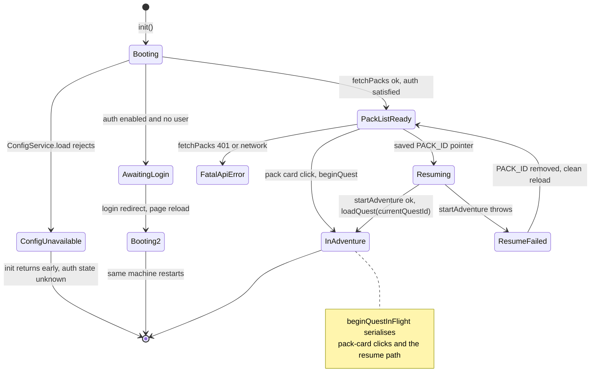

Notes:

* A pack-card click during `Resuming` is dropped without a word (`if (beginQuestInFlight) return`).
  No feedback, no queueing.
* `ConfigUnavailable` is the only state in which authentication is *unknown* rather than disabled.
  The code says so deliberately (`app.js:89-91`).
* `ResumeFailed` keeps the pack's `PACK_STATE` and drops the pointer, so the next load starts on the
  pack list with progress still resumable.
* None of this is observable until the page-ready gate fires. The document stays hidden until
  `html.loaded` is added (`frontend/adventure/src/app.js:19-25`, see #44), and the `readyState`
  branch means that can happen before or after `init()` begins.

---

## 2. Authentication / session machine (client)

States are spread over `ConfigService.config`, the module-level `userManager` closure variable and
the DOM.

| State | Carried by |
| ------- | ----------- |
| `ConfigNotLoaded` | `ConfigService.config === null` → `isEnabled()` falsy |
| `OpenMode` | `config.enabled === false`, `userManager === null` |
| `Unauthenticated` | `getUser()` → null; login button visible |
| `Redirecting` | `signinRedirect()`, page leaves |
| `Callback` | URL has `?code=`, `signinCallback()`, then URL scrubbed |
| `Authenticated` | user with unexpired `access_token` |
| `TokenExpired` | `user.expired === true` |
| `Renewing` | `signinSilent()` |
| `SignedOut` | `signoutRedirect()` |

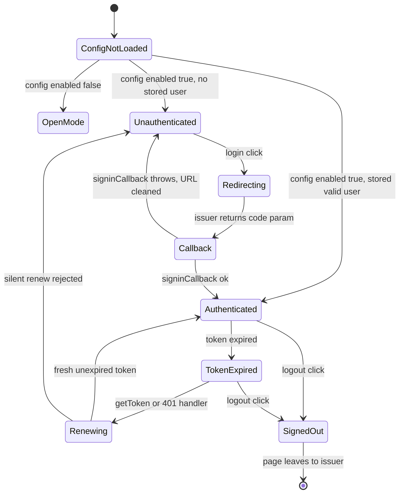

`ConfigNotLoaded` behaves exactly like `OpenMode` for `isEnabled()`: a missing config is
indistinguishable from auth-disabled everywhere except inside `init()`. A request made in that
window would go out without `Authorization` (`api-service.js:57-60`). In practice none is, because
`ConfigService.load()` is awaited before auth setup, before the event listeners that could trigger
one, and before `fetchPacks()` (`app.js:87-119`). `/config` itself is a plain `fetch` that never
carries a token (`config-service.js:29`).

Two details the diagram leaves out:

* `Callback` is entered purely from the URL, with no variable involved. The code param is removed in
  *all* cases, so a failing callback cannot loop (`auth-service.js:51-53`).
* `renewToken()` failure never marks the user logged out. The UI keeps showing logged-in chrome
  until an API call returns 401 (`error-service.js:50`).

---

## 3. Screen + pack/theme context machine

`start-screen` and `game-interface` are mutually exclusive by class. The *theme* is a separate,
independently-varying axis: which `<link data-quest-theme>` nodes exist, which `backgroundImage` is
painted, which avatars are loaded. `PackManager.loadSeq` is a monotonically increasing generation
token guarding stale async writes.

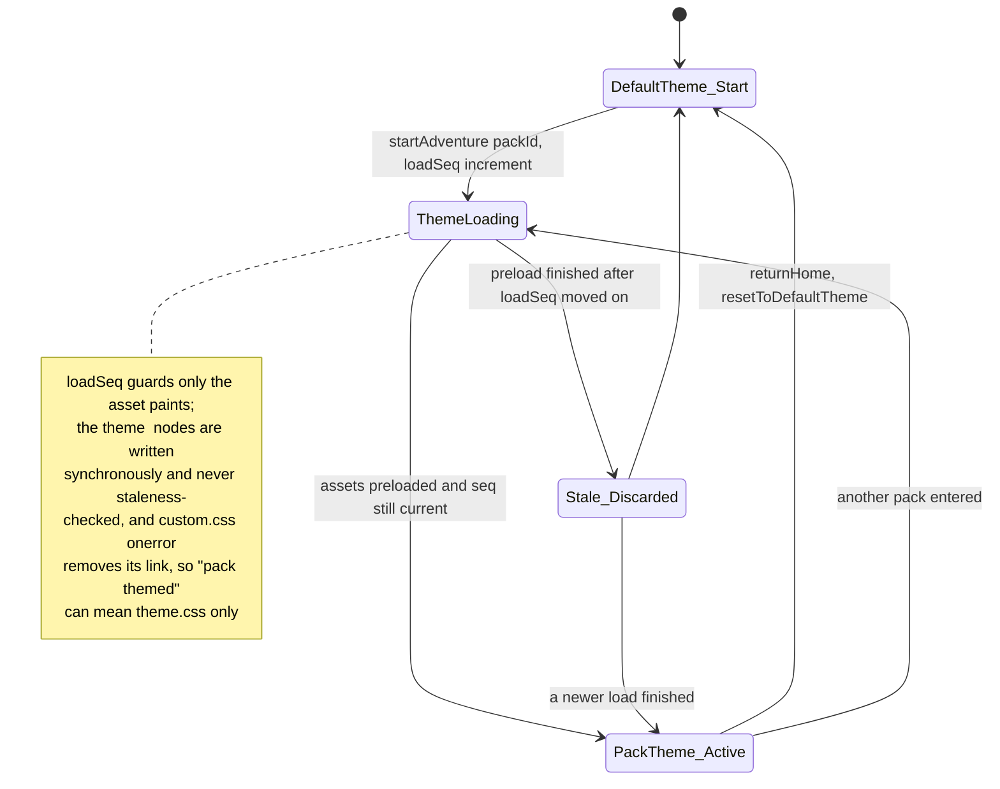

Two screens times two theme contexts gives four reachable combinations, and three of them are
intended. `PackTheme` while on the start screen is unreachable because `beginQuestInFlight`
serialises pack entries (`app.js:63-72`) and the game screen, which holds the only home button, is
not shown until `loadPack` has finished (`pack-manager.js:200`). What protects it there is not
`loadSeq`. That token is compared only inside `loadPackAssets` (`pack-manager.js:136`);
`loadPackData`, the label and title writes, and `loadPackTheme` all run after
`await fetchPackDetails` with no sequence check (`pack-manager.js:47-62`).
`resetToDefaultTheme` bumps `loadSeq` (`pack-manager.js:165`, called by `returnHome` at `228`),
which protects the background and the avatars and nothing else. The theme half of this machine is
protected by accident, so any second entry point into `loadPack` would make the fourth combination
reachable.

A `custom.css` failure is an implicit "theme without effects" sub-state. Silent, and no flag records
it.

And when `loadPack` fails, `state.currentPackId` keeps pointing at a pack whose data never loaded,
while `state.quests` may still hold the *previous* pack's quests (`pack-manager.js:44-71`).

---

## 4. Adventure progression machine (the central one)

Three integers encode the whole game:

| Variable | Domain | Meaning |
| ---------- | -------- | --------- |
| `currentQuestId` | `0 … N+1` | `0` = prologue, `1…N` = quest, `N+1` = epilogue (`quest-manager.js:120`) |
| `activeQuestId` | `0 … N+1` | the unlocked frontier; sentinel `N+1` = "epilogue visited" |
| `questScores[questId]` | present/absent | quest completed |

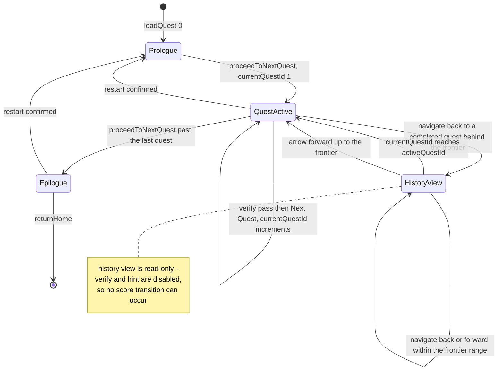

Transitions in detail:

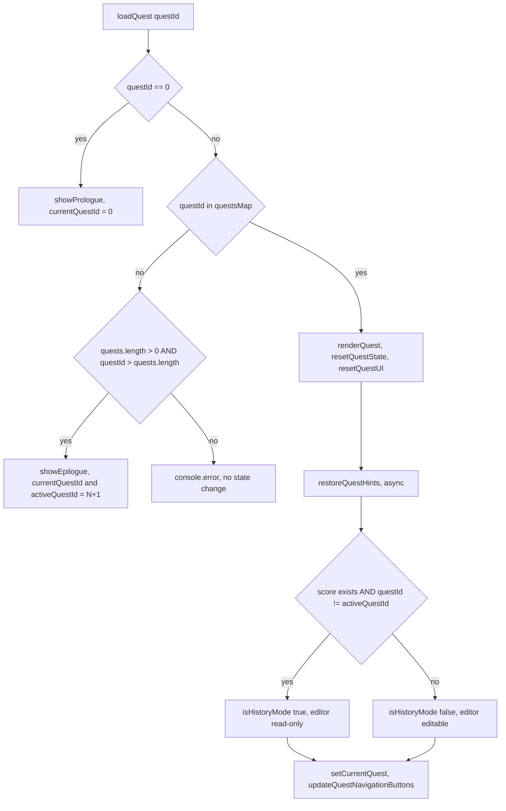

Navigation guards, three independent implementations that are not equivalent:

| Guard | Rule | Site |
| ------- | ------ | ------ |
| `canNavigateBack()` | `currentQuestId > 1` | `state-service.js:349` |
| `canNavigateForward()` | `currentQuestId < N && (score[currentQuestId+1] \|\| (isHistoryMode && currentQuestId < activeQuestId))` | `state-service.js:357` |
| `navigateToNextQuest()` | `currentQuestId < (isHistoryMode ? activeQuestId : quests.length)` | `quest-manager.js:322` |

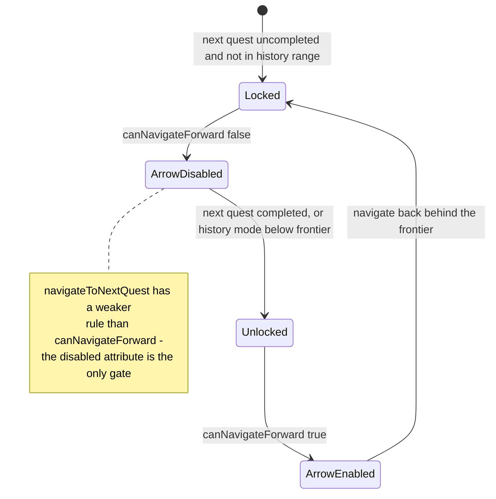

Details and hazards:

* `activeQuestId` has **four** writers plus one restorer: `completeQuest` (`state-service.js:328`),
  `showEpilogue` (`quest-manager.js:252`), `proceedToNextQuest` (`quest-manager.js:348`) and
  `navigateToPreviousQuest` (`quest-manager.js:312`, which fires only when leaving a non-history
  quest, making it a no-op while standing on the frontier). `loadPackState` (`state-service.js:97`)
  restores it from storage, falling back to `currentQuestId`.
* `showEpilogue()` **mutates** `currentQuestId` and `activeQuestId` (`quest-manager.js:251-252`). A
  render function writes frontier state, so merely *viewing* the epilogue completes the pack's
  frontier accounting, and `loadQuest` then persists that cursor (`quest-manager.js:134`). That is
  what makes the epilogue resumable on reload.
* `proceedToNextQuest()` sets `activeQuestId = currentQuestId` unconditionally
  (`quest-manager.js:348`), so it *lowers* the frontier when invoked while viewing a quest before the
  frontier. History view cannot reach it, but the non-modal result dialog can (#14). The sequence
  takes about four clicks: pass quest 3, frontier moves to 4; click the still-enabled background back
  arrow (`event-manager.js:126`, re-enabled by `updateQuestNavigationButtons` at
  `event-manager.js:342`); `navigateToPreviousQuest` drops the frontier to 3; click the modal's Next
  Quest (`event-manager.js:279-282`). `proceedToNextQuest` then parks the frontier at the
  already-completed quest 3 and the player has to verify it again. The invariant here is enforced by
  a UI accident, and that accident is already breakable.
* `completeQuest` advances the frontier only `if (questId < quests.length)`
  (`state-service.js:328`). After the last quest the frontier stays at `N`, so *within a session*
  the epilogue is reachable only through a passing verification of quest `N`; the arrows are
  disabled. It is not the only way to land there. Once visited, the `N+1` cursor is persisted, so a
  reload resumes straight onto the epilogue (`loadPackState` → `loadQuest(N+1)` →
  `quest-manager.js:131-135`).
* `isHistoryMode` is not persisted (`savePackState`, `state-service.js:151-163`) and is recomputed by
  `loadQuest`. Derived state that looks like stored state.
* The tour's first popover says "Navigate with the buttons, the arrow keys, or Enter; press Esc to
  leave the tour at any point" (`tutorial.js:122`). In context that sentence is about the **tour**,
  and tour navigation does exist: driver.js binds Escape and ArrowLeft/ArrowRight plus a Tab
  focus trap, and the popover focuses the Next button so Enter advances (`tutorial.js:400-411`). It
  is attached to a sentence about moving between quests, and there is no global arrow-key quest
  navigation (`event-manager.js:193-207` binds only Ctrl/Cmd+Enter and Ctrl/Cmd+S). Ambiguous at
  best, a broken promise at worst.

---

## 5. History-mode machine (pure derived state)

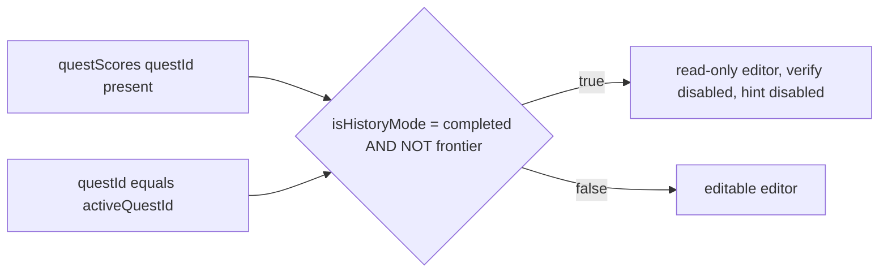

Re-entry rule: leaving history view happens only when `currentQuestId === activeQuestId`
(`quest-manager.js:328`) or through `proceedToNextQuest`/`resetProgress`.

The frontier quest *can* be completed and still be editable, because `questId === activeQuestId`. A
completed quest is therefore "history" by score and "active" by mode at the same time. Replaying it
is the only legitimate way to re-enter `completeQuest`.

---

## 6. Interaction gating machine

One tri-state concept, encoded in **three** attributes set by **two** functions.

| Logical state | `editor.readOnly` | `verifyBtn.disabled` | `hintBtn.disabled` | Editor pane | Set by |
| --------------- | ------------------- | ---------------------- | -------------------- | ------------- | -------- |
| `Editable` (active quest) | false | false | false | visible | `resetQuestUI` (`ui-manager.js:559`) |
| `HistoryReadOnly` | true | true | true | visible | `setEditorReadOnly(true)` (`ui-manager.js:575`) |
| `NarrativeStage` (prologue/epilogue) | true | true | true | hidden | `prepareNarrativeStage` → `setEditorReadOnly(true)` |

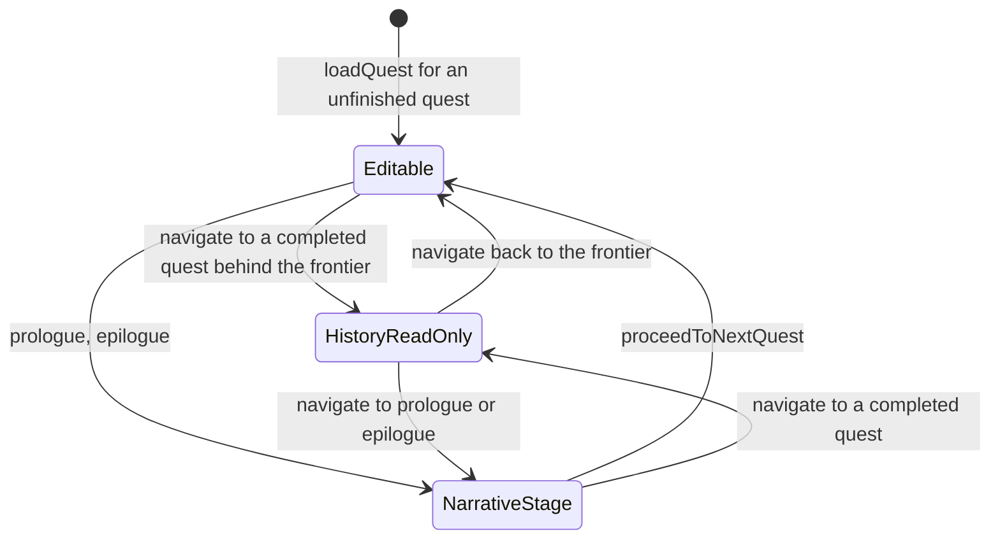

The keyboard shortcut path is the only entry that bypasses *layout* gating. `Ctrl/Cmd+Enter` is
suppressed only when a `dialog[open]` exists (`event-manager.js:196`), and `handleVerify` re-checks
`verifyBtn.disabled` (`event-manager.js:315`). Gating survives because
`prepareNarrativeStage` disables the button; the hidden pane contributes nothing.

---

## 7. Hint / solution reveal machine

The progression is defined once, in `reveal-service.js:39` (`nextReveal`), and rendered by three
consumers: the button label (`ui-manager.js:479`), the confirmation text (`modal-manager.js:70`) and
the reveal itself (`quest-manager.js:428`).

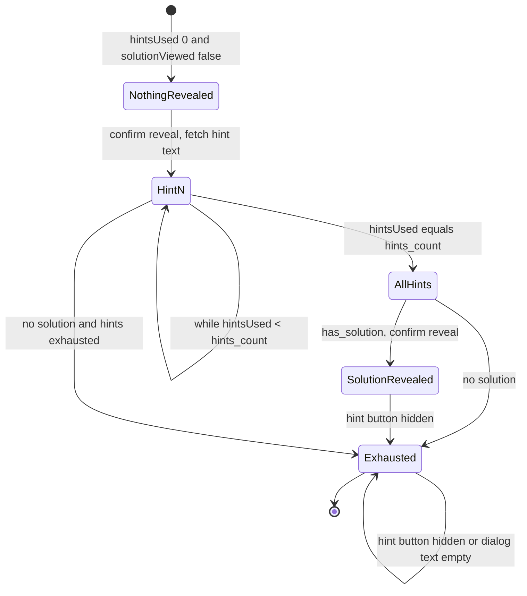

Persistence sub-machine (`state-service.js:225`, `244`):

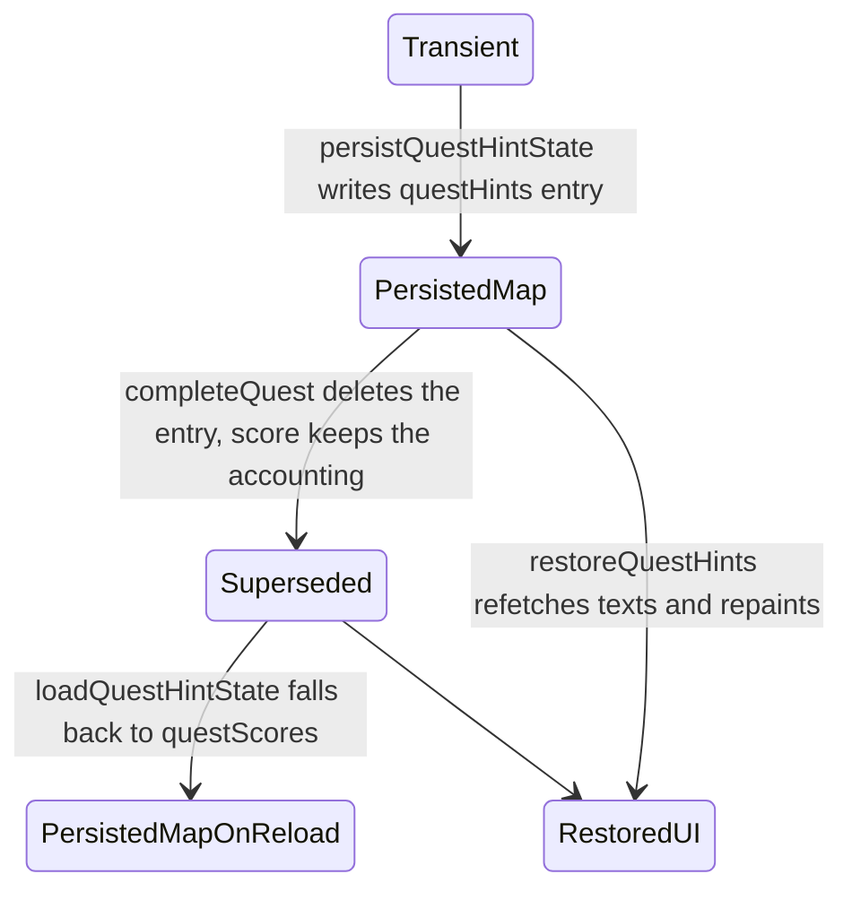

* Reveal accounting lives in **two** maps: `questHints[questId]` while a quest is in progress,
  `questScores[questId]` once it is completed. `completeQuest` deletes the former
  (`state-service.js:324`), and `loadQuestHintState` reads `questHints[id] ?? questScores[id]`
  (`state-service.js:247`).
* Re-verifying the frontier quest overwrites `hintsUsed`/`solutionViewed` in `questScores` while
  keeping the better `pointsEarned` (`Math.max`, `state-service.js:311`). After a reload the UI
  re-reveals the *worse* reveal history under the *better* score. The two halves of one machine
  drift apart.
* `updateHintButtonText` and `buildHintConfirmationText` both call `nextReveal(..., false)` with
  `solutionViewed` hard-coded false (`ui-manager.js:482`, `modal-manager.js:71`), so they can
  describe a solution reveal after the solution was already shown. Latent, because the hint button is
  hidden in that case.
* A **failed** restore produces the opposite drift, and that one is not latent. If the hint/solution
  refetch throws (`quest-manager.js:402-418`), the in-memory counters stay at 0, the hint button is
  never hidden (`quest-manager.js:406` is skipped), and `restorePromise` resolves anyway (#8). The
  player sees no reveals, is still charged the stored penalty, and can buy the same reveal again,
  rewriting `questHints[questId]` (`state-service.js:228-231`) under the old score.
* The backend marks the reveal endpoints `Cache-Control: no-store` (`handlers.go:66`) precisely
  because the *delivery order* of these artifacts is game state. The frontend then re-introduces its
  own per-`pack:quest` cache (`quest-manager.js:50`).

---

## 8. Async reveal overlay machine (concurrency control)

A second machine layered on #7 to defuse races: `hintRequestInFlight` (`quest-manager.js:432`) and
`restorePromise` (`quest-manager.js:381`).

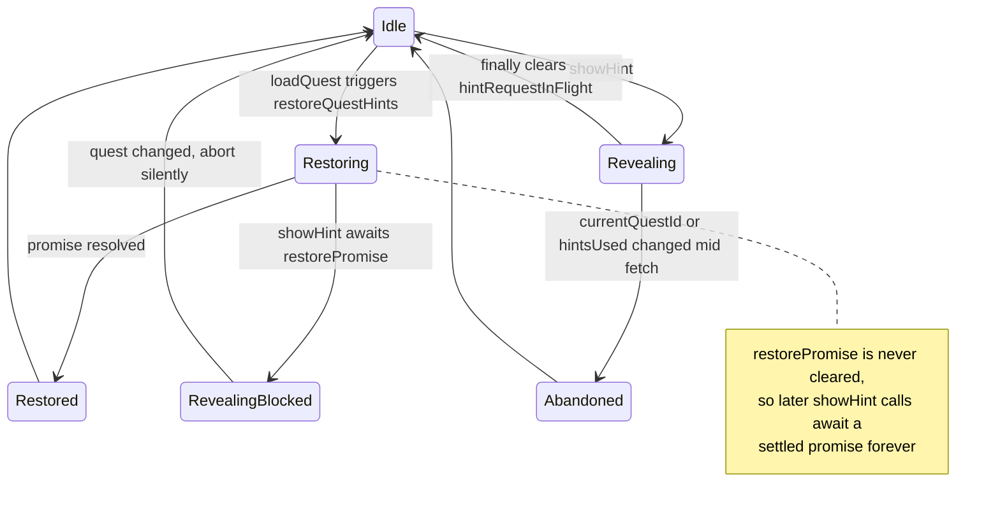

Seven separate staleness checks exist (`quest-manager.js:396`, `404`, `439`, `451`, `452`, `461`,
`462`). Each is an implicit "state changed while I was away" guard.

---

## 9. Scoring machine

| State | Carried by |
| ------- | ----------- |
| `Unrecorded` | no `questScores[id]` |
| `Scored` | `questScores[id].pointsEarned` |
| `Replayed (no loss)` | `Math.max(previous, new)` |
| `Perfect` | `totalScore === quests.length * 10` |

Penalty function: `10 − min(hintsUsed·2, 6) − (solutionViewed ? 3 : 0)`, floored at 1
(`state-service.js:283-302`).

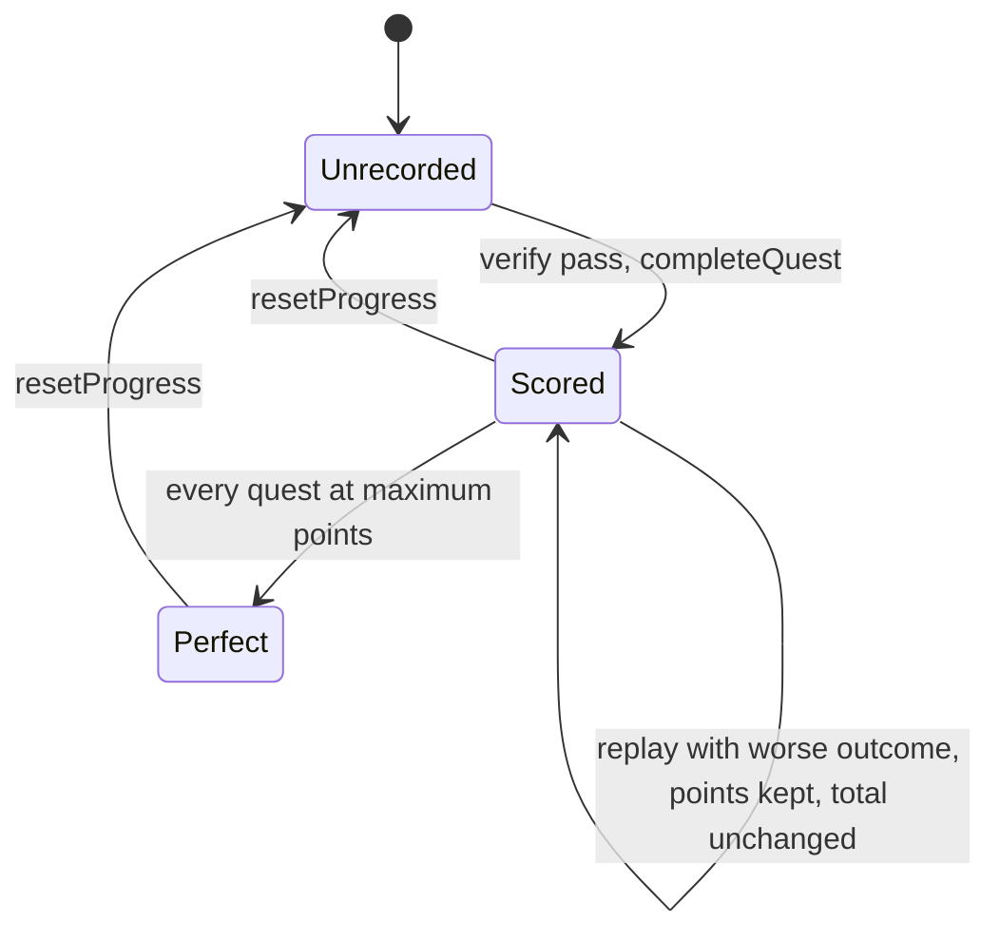

`totalScore` is stored *and* derivable from `questScores`. It is rebased by
`total − previous + new` (`state-service.js:314`), which makes the sum an invariant maintained by
hand. `hasPerfectScore()` uses exact equality (`state-service.js:342`); a score above the maximum
would flip it to false, which cannot happen today.

---

## 10. Editor persistence machine

| State | Carried by |
| ------- | ----------- |
| `Saved` | indicator class `saved` |
| `Dirty` (debounce armed) | `saveTimeout` + `dirty` class |
| `SavedNow` | timer/blur/`pagehide`/`visibilitychange` fired |
| `Error` | `error` class, `state.saveGrimoire` returned false, reached only when `currentPackId` is unset (`state-service.js:263`) and **never** on a quota or `localStorage` failure |

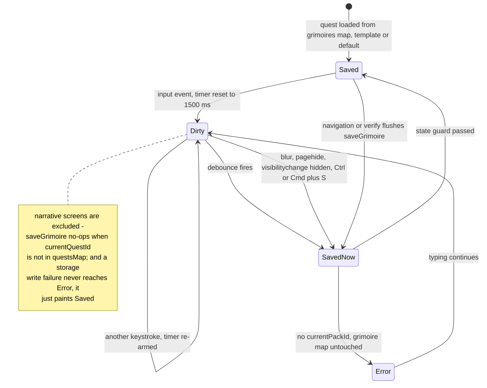

`saveGrimoire` is guarded by `state.questsMap.has(currentQuestId)` (`event-manager.js:145`). That
guard opens a silent no-op state in which the indicator keeps whatever colour it had before, so the
prologue and epilogue show a stale green or orange light.

The draft store is `state.grimoires[questId]` (`state-service.js:262`), keyed by quest and loaded
through `loadQuestCode` in a three-way choice: saved code, quest template, then `DEFAULT_REGO_CODE`
(`quest-manager.js:180`).

The write result is discarded, so `Error` is not the "storage is full" state at all.
`setLocalStorage` returns false on a quota error or when `localStorage` is off
(`storage-service.js:44-52`), `savePackState` ignores the return (`state-service.js:164-167`), and
`state.saveGrimoire` returns `true` regardless (`state-service.js:262-268`). A player with
persistence disabled sees a permanently green light while nothing is saved.

The only reachable path to red is accidental. The global `pagehide`/`visibilitychange` flushers
(`event-manager.js:176-185`) can run after `returnHome()` cleared `currentPackId`
(`pack-manager.js:214-219`) while `questsMap` still holds the previous pack's quests, because
`clearCurrentPack` keeps them (`state-service.js:140-146`). That guard in `state.saveGrimoire`
fails, and the indicator turns red on a hidden editor.

On the player-facing side: the tour explains that red means saving failed (`tutorial.js:185`),
yet the failures a player can hit, namely quota full, `localStorage` switched
off, and private-mode write rejection, are all rendered as **saved**. Red is reserved for an
unrelated internal guard. Treat the indicator as a two-colour machine plus a dead state, like #43.

---

## 11. Verify machine (client)

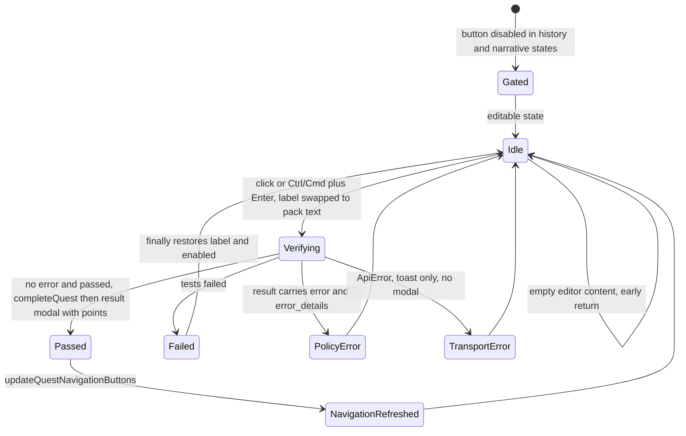

`Ctrl/Cmd+Enter` and the button converge in `handleVerify` (`event-manager.js:314`). Both shortcuts
are suppressed while **any** `dialog[open]` exists (`event-manager.js:196`).

---

## 12. Verify pipeline machine (server)

Two cooperating machines: the HTTP handler's status machine and the verifier's internal evaluation
machine.

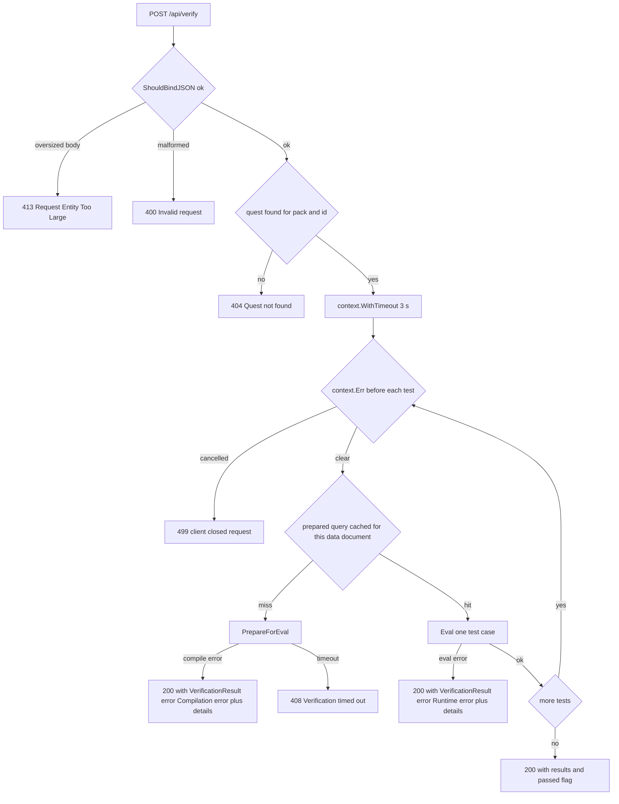

The asymmetry is deliberate. Compile and runtime problems are **not** HTTP errors: they answer 200
with a structured result, because a failing policy is a legitimate game move. Only budget and
cancellation conditions become HTTP statuses (`handlers.go:50`, `verifier.go:309`).

* The prepared-query cache is keyed by the canonical JSON of the test's `data` document
  (`verifier.go:138`). That is an implicit "per-data-document preparation" state, and it also decides
  *where* a compile error surfaces.
* Evaluation **aborts on the first runtime error**, and the results collected so far are discarded
  (`verifier.go:373-378`). An all-or-nothing outcome rule that is never stated.
* `ServerReadTimeout`/`WriteTimeout` are 15 s while the verify budget is 3 s and the shutdown drain
  is 10 s (`shutdown.go:41-52`). Three independent clocks on the same request.

---

## 13. Verification outcome shape machine

`VerificationResult` has three mutually exclusive shapes plus a per-test tri-state.

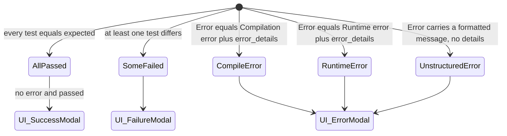

Per-test outcome, a machine of its own inside every `Results` entry:

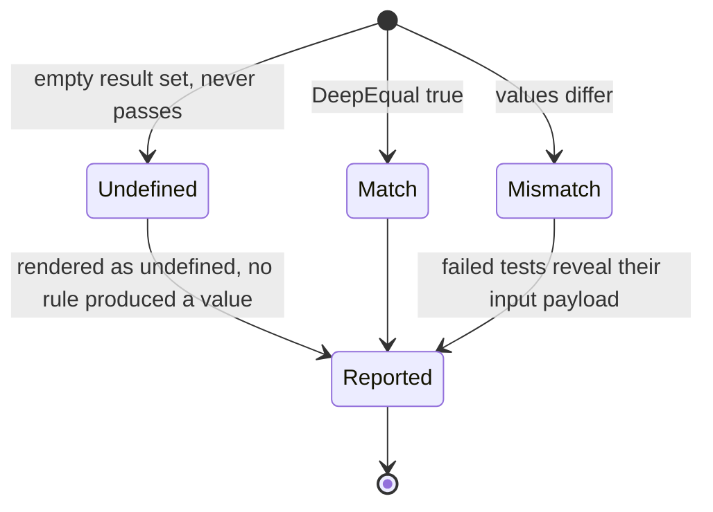

`undefined` versus `null` is a state distinction with consequences (`verifier.go:182`,
`modal-manager.js:54`). The modal must not print `null` for "no rule produced a value", and an
undefined query fails even a test that expects `null`.

---

## 14. Dialog machine

Seven `<dialog>` elements, each with its own micro-machine, plus two *different* dismissal policies.

| Dialog | Opened with | Backdrop click | ESC | Extra close rule |
| -------- | ------------- | ---------------- | ----- | ------------------ |
| manual | `showModal` | closes | closes | focus close button |
| test payload | `showModal` | closes | closes | async fetch before opening |
| support modules | `showModal` | closes | closes | button disabled unless the quest has modules |
| hint confirmation | `showModal` | closes | closes | focus goes to **Cancel** |
| perfect score | `showModal` | closes | closes | confetti starts, **no** cleanup on close |
| restart confirmation | `showModal` | **blocked** | **blocked** (`cancel` → `preventDefault`) | explicit buttons only |
| result | `show()`, **non-modal** | closes | closes | `close` event → `cleanupEffects()` |

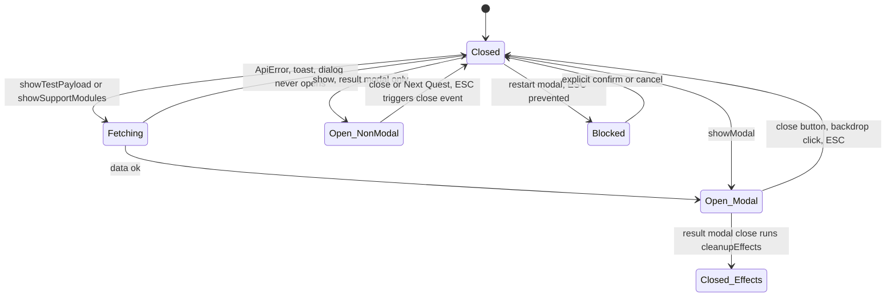

`openDialog`/`closeDialog` are idempotent (`modal-manager.js:100`, `114`). A double-open is a no-op
state instead of an error.

The result dialog is the only non-modal one, which leaves the page behind it fully interactive, and
not merely focusable. In the success case nothing is disabled: verify is re-enabled by
`handleVerify`'s `finally` (`event-manager.js:348-353`), the hint button keeps `disabled = false`
from `resetQuestUI` (`ui-manager.js:568`), and the back arrow was just re-enabled by
`updateQuestNavigationButtons` (`event-manager.js:342`). Only the Ctrl/Cmd+Enter shortcut is
suppressed, and only because it tests `dialog[open]` (`event-manager.js:196`). Three consequences
are reachable. Verify again while the modal is open. Reveal a hint for the just-completed quest,
which re-creates the `questHints` entry `completeQuest` deleted (`state-service.js:324`). Navigate
behind the modal and then press Next Quest inside it, lowering the frontier (#4).
`updateQuestFooterVisibility` is no protection at all; it toggles a CSS class (#17).

The perfect-score dialog calls `showConfetti()` (`modal-manager.js:378`) and has no
`close → cleanupEffects` hook. That listener is attached to the result dialog only
(`modal-manager.js:146-150`), so closing it leaves confetti running until the interval self-expires
at 3 s (#23).

An eighth dialog sits outside the table. The tutorial prompt is created dynamically and carries a
third dismissal policy: ESC is `preventDefault`ed and forwarded to Decline
(`tutorial.js:103-106`), which is restart-style blocking without an explicit cancel button (#24).

Focus targets differ per dialog and encode an intent: cancel-focused for the two destructive
confirmations, action-focused for the result.

---

## 15. Result modal machine

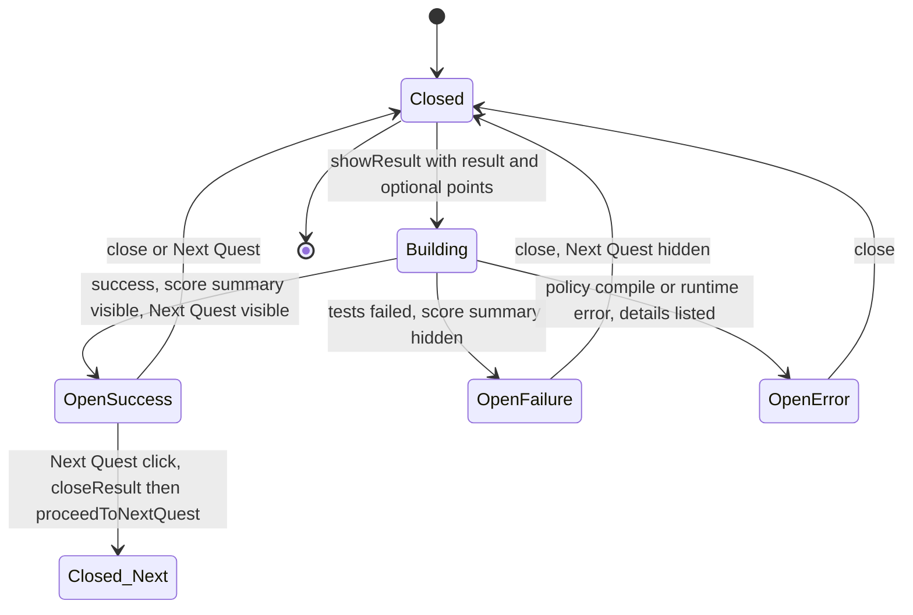

`pointsEarned` is passed *into* the modal by the caller that owns the state transition. That layering
is deliberate: the machine that renders never mutates game state (`event-manager.js:338`,
`modal-manager.js:271`). What it cannot be is modal, since it opens itself over a live page and
disables nothing (#14).

---

## 16. Perfect score machine

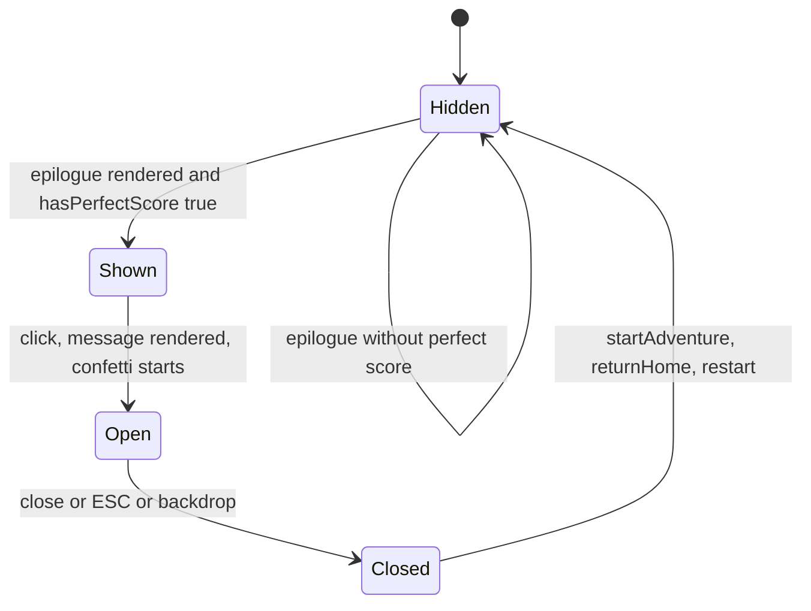

`showPerfectScoreButton` only toggles visibility, plus the pack's label text; the click handler is
wired once at startup (`event-manager.js:288`). The button's visibility *is* the state.

Showing happens at exactly one place, `showEpilogue` when `hasPerfectScore()`
(`quest-manager.js:263-264`). Hiding happens at exactly three: `startAdventure`
(`pack-manager.js:189`), `returnHome` (`pack-manager.js:215`) and the restart handler
(`event-manager.js:395`). `resetQuestUI` does **not** touch it, so navigating back from the epilogue
into history mode leaves the button in the quest footer, visible and clickable, beside unrelated
quests. Closing the dialog changes nothing about the button either (#17).

---

## 17. Quest footer visibility machine

A purely derived machine: the footer is hidden exactly when no descendant button is un-hidden
(`ui-manager.js:498-507`). Its input set is closed and small. Exactly two buttons ever live in
`.quest-footer`, namely `#perfect-score-btn` (`index.html:184`) and the reparented
`#start-adventure` (#18), and quest packs cannot add DOM nodes, only restyle existing ones
(`routes.go:38-42`).

```mermaid
stateDiagram-v2
    [*] --> Hidden
    Hidden --> Visible : any footer button becomes visible
    Visible --> Hidden : all footer buttons hidden
    note right of Visible
        updateQuestFooterVisibility is called
        from 9 sites (quest-manager.js:149,240,
        266,281,415,468; event-manager.js:362,
        402; ui-manager.js:517), each of which
        must agree with the current visibility
        of the footer buttons
    end note
```

The rule is derived but only *recomputed* at those nine sites, and each call has to be paired with a
visibility change made somewhere else.

Three ways a footer button becomes visible: `showPrologue` un-hides and reparents
`#start-adventure` (`quest-manager.js:232-240`), `showPerfectScoreButton` un-hides the perfect-score
button, and `showEpilogue` re-renders the footer for the new label (`quest-manager.js:266`, `281`).
The quest arrows live in `.editor-footer` inside the **editor** pane (`index.html:216-229`) rather
than in `.quest-footer` (`index.html:183-188`), so they never affect this machine.

`resetQuestUI` re-enables the hint button, by un-hiding it (`ui-manager.js:564`) and clearing
`disabled` (`568`), and that is the only path back from `setEditorReadOnly(true)` (#6).

`updateQuestFooterVisibility` looks the footer up **by class** (`ui-manager.js:499`), so it keeps
finding and re-classing the same element even after #25 has moved it to the end of `<body>`. The
machine follows the node wherever it ends up in the document.

---

## 18. "Next/Begin" button parentage machine

`#start-adventure` starts life in the **editor footer** (`frontend/adventure/index.html:227`) and is
moved into the **quest footer** the first time the prologue renders
(`quest-manager.js:236-239`), never moving back. Its DOM parent is part of its state.

```mermaid
stateDiagram-v2
    EditorFooter --> QuestFooter : showPrologue appends it
    QuestFooter --> QuestFooter : all later screens, hidden but still a child
    QuestFooter --> EditorFooter : only a full page reload
```

Consequences. `updateQuestFooterVisibility` counts it, and being hidden makes that harmless. The CSS
placement and animation of the button differ for the rest of the page's lifetime. The node is cached
in `ui.elements.startAdventureBtn` (`ui-manager.js:81`) at startup, so every manager keeps addressing
the same object after the move; `resetQuestUI` hiding it (`ui-manager.js:561`) works on the copy that
now lives in the quest footer. Nothing ever re-appends it to `.editor-footer`, so pack switch,
restart and `returnHome` all leave it where `showPrologue` put it (hazard 13, #27).

---

## 19. Lore pagination machine

```mermaid
stateDiagram-v2
    [*] --> Page0
    Page0 --> Page1 : navigateLore next
    Page1 --> Page1 : interior pages
    Page1 --> Page0 : navigateLore prev
    PageN --> PageN : next disabled at lore.length minus 1
    [*] --> NoControls : single lore entry, controls hidden
    NoControls --> [*]
    note right of Page0
        currentLoreIndex resets to 0 on quest load
        and is never persisted
    end note
```

Three controls, one machine: `lorePrevBtn.disabled`, `loreNextBtn.disabled` and the
`#lore-page-indicator` text, all derived from `currentLoreIndex` (`ui-manager.js:163`).

---

## 20. Background music machine

Explicitly *not* a loop: the track plays once per toggle (`audio-manager.js:21-24`, and
`handleMusicEnded` at `167-178`).

```mermaid
stateDiagram-v2
    [*] --> Silent : setupMusic for a pack, paused, ring reset
    Silent --> FadingIn : toggleMusic, gain anchored at 0 then ramped
    FadingIn --> Playing : play promise resolved
    FadingIn --> Silent : play rejected
    Playing --> FadingOut : toggleMusic off, gain ramped to 0
    FadingOut --> Paused : after 250 ms fade, element paused at current position
    Paused --> FadingIn : toggleMusic on again
    Playing --> Ended : ended event
    Ended --> Silent : isMusicPlaying false, ring reset
    Playing --> FadingOutStop : stopMusic on returnHome
    FadingOutStop --> Silent : pause and currentTime reset to 0
```

`isMusicPlaying` flips **before** the `play()` promise settles. On rejection the flag is corrected
but `updateMusicButton()` is not re-run (`audio-manager.js:196-202`, compared with the unconditional
call at `212`). The icon claims "playing" while nothing plays, and keeps claiming it until the player
touches the button again. The next click re-syncs the pair, since `toggleMusic` flips the flag and
re-renders, and retries `play()`. So the user experience is a stale icon plus a first click that
appears to do nothing.

For generated packs this is the default path rather than an edge case. `assetgen` writes an **empty**
`bg-music.m4a` (`cmd/assetgen/tools/assetgen/generator.go:114-118`) and the asset gate serves it
happily, `.m4a` being whitelisted (`backend/http/security.go:31-38`). Every player of a fresh theme
who presses the music button lands exactly on the rejection branch above.

`pauseTimer` is a hidden state, "fade in progress, pause pending". Both `toggleMusic` and
`stopMusic` re-arm it, and the callback re-checks `!isMusicPlaying` before acting
(`audio-manager.js:205`, `223`).

`handleMusicEnded` resets the *ring* but keeps the element at the track end. Browsers restart from 0
on the next `play()`, so "Paused at end" and "Silent" are indistinguishable.

---

## 21. Web Audio graph machine

```mermaid
stateDiagram-v2
    [*] --> NoGraph : no AudioContext yet - autoplay policy
    NoGraph --> GraphReady : first user click, AudioContext plus GainNode
    NoGraph --> FallbackElementVolume : Web Audio unavailable
    GraphReady --> GraphReady : suspended context resumed inside a gesture
    GraphReady --> NoGraph : nothing - the graph is never torn down
    FallbackElementVolume --> FallbackElementVolume : gain ramps become no-ops
```

The graph outlives pack switches. `setupMusic` changes the element `src` but never re-creates
`createMediaElementSource`, which may only be called once per element.

---

## 22. Visual effects toggle machine

Off by default (`getLocalStorage(EFFECTS_ENABLED, 'false')`, `ui-manager.js:627`).

```mermaid
stateDiagram-v2
    [*] --> Off : default
    Off --> On : toggle
    On --> Off : toggle
    On --> On : page reload, persisted
    Off --> Off : page reload, persisted
```

---

## 23. Result effects machine (confetti / dark overlay)

```mermaid
stateDiagram-v2
    [*] --> Neutral
    Neutral --> Confetti : success, interval spawning particles for 3 s
    Neutral --> DarkOverlay : failure AND body has no effects-disabled class
    Confetti --> Neutral : interval self-clears at duration end, or cleanupEffects on modal close
    DarkOverlay --> Neutral : hideDarkOverlay on success or cleanupEffects
    Confetti --> Confetti : showConfetti clears any previous interval
```

The success branch of `triggerResultEffect` never consults the effects toggle
(`effects.js:110-114`), and `showPerfectScore` calls `showConfetti()` directly
(`modal-manager.js:378`). A player who turned effects off still gets a three-second confetti storm,
while their failure dark overlay is respected. Of the two machines that share this setting, one
checks it and one does not.

Two follow-ons. The perfect-score dialog never runs `cleanupEffects`, that hook being attached to the
result dialog only (`modal-manager.js:146-150`), so its confetti can outlive the dialog by up to 3 s
(#14). And the overlay is a **sticky** element: once a failure has happened, `#dark-overlay` sits in
the DOM forever and only its `active` class toggles (`effects.js:81-103`), which makes "never shown"
and "currently hidden" the same DOM state.

---

## 24. Tutorial machine

```mermaid
stateDiagram-v2
    [*] --> Eligible : no TUTORIAL_COMPLETED flag
    [*] --> Skipped : flag present, showTutorialPrompt returns
    Eligible --> Prompt : 250 ms after entering a NEW pack only
    Prompt --> Touring : accept, optional markCompleted
    Prompt --> Declined : decline or ESC, optional markCompleted
    Prompt --> Eligible : accept without the checkbox
    Prompt --> Skipped : accept or decline with checkbox
    Touring --> Restoring : driver destroyed, restoreHiddenElements
    Touring --> NoTour : no visible steps, elements restored immediately
    NoTour --> Restoring
    Restoring --> [*] : focus handed to Start Adventure when visible
```

`temporarilyUnhideElements` records which selectors it un-hid in `hiddenElementsState`
(`tutorial.js:331`). It is a *transaction* whose undo is bound to driver.js's `onDestroyed`. If the
driver is never destroyed, hidden elements stay visible.

Re-entry is asymmetric. Accepting the tour without ticking "Don't show this again" runs the tour and
leaves the player eligible forever; resuming a saved adventure never shows the prompt at all
(`pack-manager.js:203-207`).

---

## 25. Toast machine

```mermaid
stateDiagram-v2
    [*] --> Created : element appended
    Created --> Shown : toast-show class after 10 ms
    Shown --> Hiding : auto timer, 3 to 6 s by level, or close click
    Hiding --> Removed : DOM removal after 300 ms
    Hiding --> [*] : close path already removed it, guarded by parentElement
    Removed --> [*]
```

Durations encode the severity machine (`info` 3 s … `critical` 6 s, `toast-service.js:25-30`), and
`aria-live` switches from `polite` to `assertive` only at `critical` (`toast-service.js:59`). The
`ErrorLevel` machine also gates `showError`: only `error`/`critical` reach a toast, `info`/`warning`
are console-only (`error-service.js:32-40`).

The toast container is a lazily created singleton (`toast-service.js:37-45`), so "no container yet"
is a pre-state of every toast machine.

Severity is not always routed through the enum. `modal-manager.js:223` passes the raw string
`'info'`, which happens to equal `ErrorLevel.INFO` (`constants.js:25-30`) and therefore works, but it
bypasses the machine. Renaming the enum value would keep the styling and silently fall back to the
default duration (`toast-service.js:90`).

---

## 26. Copy-to-clipboard feedback machine

```mermaid
stateDiagram-v2
    [*] --> Idle
    Idle --> Copying : clipboard API or textarea fallback
    Copying --> Feedback : success, icon plus class swapped, dataset lock set
    Copying --> Idle : failure, error toast
    Feedback --> Idle : 1500 ms timer restores original icon
    Feedback --> Feedback : re-entry blocked by dataset.copyFeedback
```

The `dataset.copyFeedback` flag is the mutex. The fallback path (`execCommand`) is an implicit
sub-state chosen by `navigator.clipboard && window.isSecureContext` (`ui-manager.js:338`).

---

## 27. Interface minimize machine

```mermaid
stateDiagram-v2
    [*] --> Normal
    Normal --> Minimized : minimize click, class toggled
    Minimized --> Normal : second click
    Minimized --> Minimized : pack switch, home and restart do NOT reset it
```

Icon swap (`fa-minus` ⇄ `fa-expand`) plus `aria-pressed` are one state rendered three ways
(`event-manager.js:417-437`). Nothing else in the app resets `minimized`, so it survives pack
changes, restarts and result modals. It is not persisted, so a plain reload is the only way back to
`Normal`.

---

## 28. localStorage persistence / resume machine

Two keys form a product machine: the **pointer** `rego_pack_id` and the **body**
`rego_pack_state_<packId>`.

| Pointer | Body | Resulting state |
| --------- | ------ | ----------------- |
| absent | any | start screen, body retained |
| present | absent | fresh adventure, state initialised and written |
| present | unparseable JSON | warn, treated as fresh (`state-service.js:100`) |
| present | valid, `questId === 0` | fresh adventure |
| present | valid, `questId > 0` | resume at `currentQuestId`, `activeQuestId` restored |
| present | `activeQuestId` missing | back-computed as `currentQuestId` (`state-service.js:97`) |

```mermaid
stateDiagram-v2
    [*] --> NoPointer
    NoPointer --> PointerSet : setCurrentPack
    PointerSet --> FreshBody : no saved state or questId 0, everything reset
    PointerSet --> CorruptBody : JSON parse fails, console warn only
    PointerSet --> ResumableBody : questId greater than 0
    CorruptBody --> FreshBody
    ResumableBody --> PointerCleared : returnHome, progress flushed and kept
    PointerCleared --> ResumableBody : pack card clicked again
    PointerSet --> PointerClearedOnFailure : resume threw, PACK_ID removed
    FreshBody --> PointerCleared : returnHome
```

A third micro-machine runs before any of this. `migrateStorageKeys()` moves
`adventureTutorialCompleted` → `rego_tutorial_completed` once at startup
(`storage-service.js:96-110`), called before `init()` (`app.js:155-156`). That legacy-key state
decides whether the tutorial machine (#24) starts `Eligible` or `Skipped`.

A fourth wrinkle: the *body* is also read from the `GameState` constructor
(`state-service.js:74-77`). On a reload with a pointer set, the state is already loaded before any
pointer/body transition in the diagram above gets a chance to run.

---

## 29. API request + token renewal machine

```mermaid
stateDiagram-v2
    [*] --> Preparing : AuthService.getToken injects Bearer when present
    Preparing --> InFlight : fetch with AbortSignal.timeout
    InFlight --> NetworkFailure : TimeoutError or AbortError, status 0
    InFlight --> Renewal : status 401 and renewToken true
    Renewal --> InFlight : single retry, same options
    Renewal --> Failure : renew failed
    InFlight --> Success : response ok
    InFlight --> Failure : status kept on ApiError
    Failure --> [*] : handleApiError maps status to a user hint
```

`status` on `ApiError` is the machine's observable state. The UI branches on it
(`error-service.js:50-66`) rather than on message text: `401` → session expired, `0` → server down,
`408` → policy timeout, `>=500` → server error.

Two boundaries of this machine matter. `/config` is fetched by a bare `fetch` outside it
(`config-service.js:29`), with no timeout, no token and no `ApiError`. And the client's own 30 s
`AbortSignal.timeout` (`api-service.js:87`, `65`) is longer than every server clock on the same
request (#12, #31), so a stalled verify is always decided server-side first.

* Renewal lives at **two** layers of the same machine and both swallow their failures. `getToken`
  renews inline before the request (`auth-service.js:81-92`; `renewToken` returns `false` on any
  error with only a `console.warn`, `70-79`), and `fetchWithAuth` renews again after a 401
  (`api-service.js:88-91`). An expired token therefore costs up to two silent-renewal attempts and
  three round-trips.
* A 401 whose renewal fails is **returned, not thrown** (`api-service.js:88-92`). It only becomes an
  error in `ensureOk` (`102-105`). "Renewal failed" and "the server rejected the token" are therefore
  one indistinguishable `ApiError` with `status === 401` (#12).
* Renewal is per-request, with no coalescing. N concurrent 401s fire N overlapping `signinSilent()`
  calls, which race on the same OIDC storage keys.
* `AuthService.init()` runs *after* the config gate (`app.js:86-94`), and a failed `signinCallback()`
  is only logged (`auth-service.js:46-50`). A broken callback leaves the app "unauthenticated but
  running" rather than in an error state (#1, #2).

---

## 30. Lazy reveal-cache machine

Three independent caches keyed by `packId:questId`:

| Cache | Owner | Fetched artifact | Backend `Cache-Control` |
| ------- | ------- | ------------------ | ------------------------- |
| `revealCache` | `quest-manager.js:40`, `50` | hint texts, solution | `no-store` |
| `testPayloadCache` | `modal-manager.js:89` | test payloads | `private, max-age=300` |
| `supportModulesCache` | `modal-manager.js:90` | support module sources | `no-store` |

```mermaid
stateDiagram-v2
    [*] --> Uncached
    Uncached --> Loading : first access
    Loading --> Cached : response ok
    Loading --> Uncached : ApiError, nothing stored
    Cached --> Cached : later access served locally
    Cached --> [*] : never evicted, survives restart and resetProgress
```

`resetProgress` clears the persisted reveal accounting but leaves `revealCache` alone. After a
restart the hint texts are already local, so the player re-pays the score penalty without a network
round trip, and the backend's `no-store` intent is bypassed by the client's own cache.

---

## 31. Backend process lifecycle machine

```mermaid
stateDiagram-v2
    [*] --> Logging : logger Setup, invalid LOG_LEVEL exits
    Logging --> ConfigLoading : config Load
    ConfigLoading --> Failed : any validation error exits 1
    ConfigLoading --> PacksLoading : LoadPacksFromDir
    PacksLoading --> Failed : quests dir unreadable, exit 1
    PacksLoading --> ServerCreating : http.New
    ServerCreating --> Failed : trusted-proxy setup error, exit 1
    ServerCreating --> Routing : SetupRoutes
    Routing --> Failed : inline import map CSP hash cannot be computed
    Routing --> Serving : RunWithGracefulShutdown, ListenAndServe in goroutine
    Serving --> Failed : listen or serve error
    Serving --> Draining : SIGINT or SIGTERM, Shutdown with 10 s budget
    Draining --> Stopped : in-flight requests completed
    Draining --> Failed : drain exceeded, graceful shutdown failed
    Stopped --> [*] : exit 0
```

* `ErrServerClosed` is folded into the success path (`shutdown.go:84-88`). "Shut down cleanly" and
  "`ListenAndServe` never worked" share one outcome, and `main` logs "server stopped gracefully" for
  both (`main.go:96-102`).
* Six clocks run independently: `ReadTimeout` 15 s, `WriteTimeout` 15 s, `ReadHeaderTimeout` 5 s,
  `IdleTimeout` 120 s (`shutdown.go:41-51`, wired in `NewServer`), verify budget 3 s
  (`verifier.go:37` via `handlers.go:37`), drain 10 s (`shutdown.go:29`), plus the OIDC discovery
  client at 10 s (`config.go:277-284`) during #32.
* Zero loaded packs is a **warning** rather than a failure (`main.go:64-68`). See machine #33.
* Router posture is fixed at construction and does not depend on config: `gin.ReleaseMode`, the
  recovery and logging middleware, trusted proxies forced to "none" when the list is empty, and
  `RedirectTrailingSlash`/`RedirectFixedPath` disabled (`server.go:36-65`). Disabling those redirects
  is precisely what lets unmatched paths reach the fallthrough machine in #36 instead of being
  rewritten.

---

## 32. Backend config / auth boot-gate machine

```mermaid
stateDiagram-v2
    [*] --> OpenAuth : AUTH_ENABLED false or unset
    [*] --> AuthMisconfigured : AUTH_ENABLED true, missing issuer, client id, audience or discovery URL
    AuthMisconfigured --> [*] : exit 1
    [*] --> Discovering : required fields present
    Discovering --> JWKSReady : discovery doc plus jwks_uri reachable
    Discovering --> AuthMisconfigured : JWKS init fails, exit 1
    JWKSReady --> Serving_Auth : Auth middleware validates tokens
    [*] --> ConfigRejected : bad DOMAIN, PORT, TRUSTED_PROXIES, AUTH_ALLOWED_ALGORITHMS, SHOW_IMPRESSUM or AUTH_ENABLED typo
    ConfigRejected --> [*] : exit 1
```

`AUTH_ENABLED=yes` is a **startup failure**, and it does not degrade to "false"
(`config.go:120`). The code chooses to fail rather than to fail open.

`JWKS` keeps refreshing in the background (`keyfunc.NewDefault`), which is an implicit continuously
mutating state the middleware reads per request. `cfg.JWKS == nil` is a hand-built-config state the
middleware still guards against (`middleware.go:172`).

CSP is a *function of config state*: with auth enabled the issuer origin is added to `connect-src`
(`middleware.go:89-93`), a security posture derived from #32.

---

## 33. Quest pack load machine

```mermaid
flowchart TD
    A[scan quests dir] --> B{entry is a directory}
    B -- no --> A
    B -- yes --> C{IsValidPackID}
    C -- no --> W[PackLoadWarning, skip]
    C -- yes --> D{quests.json readable}
    D -- no --> W
    D -- yes --> E{JSON unmarshal ok}
    E -- no --> W
    E -- yes --> F{validateQuestPack}
    F -- no --> W
    F -- yes --> G{quest IDs contiguous from 1 AND test IDs unique}
    G -- no --> W
    G -- yes --> H[pack registered in repository]
    W --> I{zero packs registered}
    H --> I
    I -- yes --> J[warn only, server serves an empty pack list]
    I -- no --> K[server fully usable]
```

The ID-contiguity invariant (`repository.go:84`) is what makes `activeQuestId = questId + 1`
navigation legal on the frontend. A cross-machine contract enforced only here.

A pack that fails validation is *silently absent* from the running app. Its only signal is a startup
`slog.Warn`.

`repo.GetNumberOfPacks() == 0` is a legal state: running, and unusable.

---

## 34. Server auth middleware decision machine

A linear guard chain; each guard is a transition to a terminal 4xx/5xx.

```mermaid
flowchart LR
    A[request to /api] --> B{Auth.Enabled}
    B -- false --> P[passthrough]
    B -- true --> C{Authorization Bearer header well formed}
    C -- missing --> R1[401 authorization header required]
    C -- malformed --> R2[401 invalid authorization header format]
    C -- ok --> D{cfg.JWKS initialised}
    D -- no --> R3[500 JWKS not initialized]
    D -- yes --> E{jwt.Parse with allowed algs, exp required}
    E -- no --> R4[401 invalid token]
    E -- yes --> F{aud and iss claims match}
    F -- no --> R5[401 invalid audience or invalid issuer]
    F -- yes --> P
```

The rejection *reason strings* are declared as package-level sentinel errors
(`middleware.go:144-152`) and shipped to the client. An unusual case in which an internal state name
becomes public API.

---

## 35. Static asset request gate machine

```mermaid
flowchart TD
    A[GET /quests/pack/asset] --> B{isValidPackName}
    B -- no --> X1[403]
    B -- yes --> C{containsPathTraversal}
    C -- yes --> X2[403]
    C -- no --> D{extension whitelist}
    D -- no --> X3[403]
    D -- yes --> E{not sensitive, no solution, readme, json}
    E -- no --> X4[403]
    E -- yes --> F{resolveContained, symlink safe}
    F -- no --> X5[403]
    F -- yes --> G{Lstat target exists}
    G -- no --> X6[404]
    G -- yes --> H{is SVG}
    H -- yes --> S1[SVG locked down by its own CSP]
    H -- no --> S2[serve file]
    S1 --> S2
```

Quest CSS serving uses a different validator, a three-name allowlist (`theme.css`, `custom.css`,
`styles.css`, `routes.go:37-47`), and shared CSS a third one, "any `.css`" (`routes.go:49-52`,
`189-195`). Three sibling machines with the same guard shape and different state sets over one
resource family. Traversal, containment and the missing-file 404 are shared because they live in
`serveSafeFile` (`routes.go:239-294`), while the validator differs per route. The shared-CSS route
has no pack-name gate at all.

---

## 36. SPA fallthrough routing machine

```mermaid
stateDiagram-v2
    [*] --> Requested : NoRoute
    Requested --> ApiJson404 : path under /api, JSON not HTML
    Requested --> NotFound404 : path traversal detected
    Requested --> IndexHtml : root, dot, missing file or directory
    Requested --> FileServed : real file, full HTTP semantics
    IndexHtml --> [*] : indexHTML cached at handler creation, 500 if unreadable
```

`index.html` bytes are captured once at startup, an implicit "frozen SPA document" state. A deployed
file change without a restart is invisible.

Two boundaries. `/callback` never reaches this machine, since it is registered explicitly and answers
the same `index.html` directly (`routes.go:141-143`), which is what the OIDC redirect URI depends on
(#2). And unmatched paths *fall through* rather than being normalised, because the router's
`RedirectTrailingSlash`/`RedirectFixedPath` are switched off at construction (#31,
`server.go:58-59`).

---

## 37. Progressive disclosure machine (cross-tier)

Quest content artifacts have a two-state visibility machine that spans backend and frontend:

| Artifact | Pack payload | Reveal endpoint | Client cache | Scoring effect |
| ---------- | -------------- | ----------------- | -------------- | ---------------- |
| lore, task, manual, template, query, **tests** (every `input`, `data` and `expected_value`) | present | – | `private, max-age=300` | none |
| hint text | count only (`hints_count`) | `GET .../hints/:hint_id` | `no-store` + in-memory | −2 points each, capped at 6 |
| solution | `has_solution` only | `GET .../solution` | `no-store` + in-memory | −3 points |
| support modules | `has_support_modules` only | `GET .../support-modules` | `no-store` + in-memory | none |

```mermaid
stateDiagram-v2
    [*] --> Withheld : pack payload projects the artifact away
    Withheld --> Countable : hints_count, has_solution, has_support_modules
    Countable --> Revealed : explicit player action, dedicated endpoint
    Revealed --> Scored_Penalty : hint or solution, persisted reveal state
    Revealed --> CacheOnly : support modules, no scoring effect
    Revealed --> Withheld : only restart or a new pack, backend sends no-store
```

The backend projection (`public.go:25-38`) and the reveal cache header (`handlers.go:64-66`) are the
two halves of one machine. The frontend cache in #30 is the escape hatch.

**The withheld set is smaller than it looks.** `PublicQuest` serialises `Tests` verbatim
(`public.go:34`, `models.go:55-59`), so every test's input payload, its `data` document *and* its
expected outcome are already in the pack payload. The dedicated `test-payload` endpoint
(`handlers.go:143-152`) re-serves the same values with the same `private, max-age=300` header and
adds no disclosure boundary. That client cache (#30) exists only because the modal asks for data the
browser already has. Solutions and hint texts are withheld. The *truth table* the player is trying to
satisfy is not.

---

## 38. `solutionverifier` CLI machine

Per quest:

```mermaid
stateDiagram-v2
    [*] --> NeedsModule
    NeedsModule --> NoSolution : solution empty, tests counted but none pass
    NeedsModule --> HasPackage : solution declares a package
    NeedsModule --> DerivedPackage : package derived from the quest query
    DerivedPackage --> QueryUnusable : query not in data package rule form
    HasPackage --> Verifying : verify with 3 s budget
    DerivedPackage --> Verifying
    QueryUnusable --> CountedFailed : module could not be assembled
    Verifying --> Results : passed and failed tests counted
    Verifying --> ResultError : result carries Error, compile or runtime
    ResultError --> CountedFailed : the quest's tests join the total
    Verifying --> VerifierFailure : Verify itself returns an error, timeout or cancel
    VerifierFailure --> NotCounted : the quest adds nothing to either counter
    Results --> [*]
    CountedFailed --> [*]
    NotCounted --> [*]
```

Process-level exit-code machine (`cmd/solutionverifier/main.go:147-191`): flag missing / read /
parse / load failure → 1; `totalTests === 0` → 1 with "No tests were executed!"; all passed → 0;
anything else → 1.

"error" and "test failed" are deliberately collapsed into one counter so a broken solution cannot
shrink the denominator. That invariant is stated only in a comment
(`cmd/solutionverifier/main.go:108-111`, `133-140`). It does **not** hold for the third path. When
`verifier.Verify` itself returns an error, from a context deadline or cancellation, the CLI prints
the error and `continue`s without touching either counter
(`cmd/solutionverifier/main.go:116-119`), so that quest drops out of the denominator. A pack whose
only failure was a slow policy can report "All tests PASSED!" with a smaller total than the pack
has.

---

## 39. `assetgen` pack scaffolding machine

```mermaid
stateDiagram-v2
    [*] --> Validated : theme name is a single directory name
    Validated --> Rejected : name escapes the output directory
    Validated --> AssetsWritten : images plus empty bg-music.m4a
    AssetsWritten --> QuestsWritten : quests.json
    QuestsWritten --> ThemeCssWritten : theme.css
    ThemeCssWritten --> CustomCssWritten : custom.css
    CustomCssWritten --> Complete : README.md
    AssetsWritten --> Partial : any later step fails
    QuestsWritten --> Partial : any later step fails
    ThemeCssWritten --> Partial : any later step fails
    CustomCssWritten --> Partial : any later step fails
    Partial --> [*] : error returned, partial pack left on disk
    Complete --> [*]
```

`Partial` is an implicit state. A half-generated pack is a directory a later run may pick up, and the
placeholder `bg-music.m4a` is an **empty** file the server will happily serve, which is exactly the
input that drives the music machine into its failure branch (#20,
`cmd/assetgen/tools/assetgen/generator.go:114-118`). `generateAssets` itself can also fail partway,
leaving some images written and others missing while the pack still loads, since missing assets are
only 404s rather than load errors.

---

## 40. `importmapgen` rewriting machine

```mermaid
flowchart TD
    A[read package.json] --> B{all devDependency versions are strict semver}
    B -- no --> X[abort, exit 1]
    B -- yes --> C{subpaths declared only for declared deps and non empty}
    C -- no --> X
    C -- yes --> D{document contains an import map block}
    D -- no --> X
    D -- yes --> E[replace import map block]
    E --> F{cdnjs link library slug matches a devDependency and version segment non empty}
    F -- yes --> G[version segment spliced by index]
    F -- no --> H[link left untouched]
    G --> I[write index.html with the original file mode]
    H --> I
```

Two gates are duplicated on purpose: `buildImportMap` rejects a bad version before
`syncCdnJsVersions` runs, and the latter still re-validates defensively rather than interpolating an
unvalidated string into a URL (`cmd/importmapgen/main.go:124-130`). A third, quieter branch is the
no-op rewrite. When the spliced version already equals the cleaned one, the link is returned
unchanged (`cmd/importmapgen/main.go:134-136`), which makes the generator idempotent. Running it
twice never drifts the document.

---

## 41. Quest editor tool machine (operator-facing, `docu/quest-editor`)

```mermaid
stateDiagram-v2
    [*] --> Empty : no questData
    Empty --> Editing : file loaded and parsed
    Empty --> Empty : JSON parse error, alert only
    Editing --> Editing : form change writes straight into questData
    Editing --> Editing : switchView meta, prologue, epilogue or quest index
    Editing --> Blocked : save clicked while validateData false
    Blocked --> Editing : alert, no state change
    Editing --> Exported : download quests.json
    Exported --> Editing
```

Per-quest views are a lazily-created, **index-bound** set:

```mermaid
stateDiagram-v2
    [*] --> NotCloned : no view-quest-N node
    NotCloned --> Cloned : switchToQuest clones the template, binds questIndex forever
    Cloned --> Cloned : renderQuestDetails re-fills the same node
    Cloned --> Deleted : deleteQuest splices the array and removes only that node
    Deleted --> OrphanNodes : sibling views keep listeners bound to now-wrong indices
```

Hazards:

* `deleteQuest` (`docu/quest-editor/app.js:710-722`) splices the array but leaves the other
  `view-quest-N` nodes with listeners captured against the old `questIndex`. The DOM nodes' index
  state and the array's index state separate permanently, so later edits write into the wrong quest.
  Deleting the **last** quest is the one case that stays consistent, because nothing shifts.
* Neither the editor's `validateData` nor the UI enforces **contiguous quest IDs from 1**, which the
  server requires (`backend/quest/repository.go:82-86`), and `deleteQuest` never renumbers the
  surviving IDs. Deleting any quest except the last one therefore exports a pack that loads with a
  warning and disappears from the game (#33).
* Contiguity is only the best-known member of a **wider gate gap**. `validateData`
  (`docu/quest-editor/app.js:930-971`) checks ID uniqueness, test count and support-module caps, and
  nothing else. The server additionally requires a non-empty quest title, task and query, at least
  one lore entry, at least one test case, non-empty prologue/epilogue entries and non-empty pack
  title/description/genre (`backend/quest/models.go:174-194`, `264-269`, `341`, `353-371`, `392`,
  `400`). `addQuest` seeds `description_task: ''` (`docu/quest-editor/app.js:683-708`), so "add a
  quest, export immediately" is a second self-inflicted route to a pack that silently vanishes from
  the running game.
* `questData` is memory-only. There is no autosave, which makes "Editing" an unsaved-draft state lost
  on reload. The form listeners are labelled "auto-save" but only write into memory
  (`docu/quest-editor/app.js:114-115`, `845-861`).
* The editor's limits are a copy of the Go constants (`docu/quest-editor/app.js:17-62` ↔
  `backend/quest/constants.go`), kept in sync by comment only. The two machines can diverge silently.
  They currently agree on every value, and nothing enforces that they continue to.

---

## 42. Quest editor test modal machine

```mermaid
stateDiagram-v2
    [*] --> Closed : currentModalTest null
    Closed --> Adding : addTestItem, currentModalTest testIndex is minus 1
    Closed --> Editing : editTestItem, currentModalTest testIndex is n
    Adding --> Closed_Save : modalSave parses payloads, pushes a new test
    Editing --> Closed_Save : modalSave replaces tests n
    Adding --> Closed_Discard : close or cancel, currentModalTest cleared, nothing stored
    Editing --> Closed_Discard
    Adding --> Adding : invalid JSON in payload or expected value, alert stays open
    Editing --> Editing : invalid JSON, nothing written
```

`testIndex === -1` is a **sentinel state**: the machine encodes "add versus edit" as a number rather
than a flag, and the same global is read by `saveModalTest` long after the modal opened
(`docu/quest-editor/app.js:68`, `771`, `777`, `806-836`). A second implicit state is the test ID.
`parseInt(...) || 0` turns a blank or non-numeric ID into `0` (`docu/quest-editor/app.js:819`), and
nothing renumbers IDs. Several tests can therefore carry ID 0 until `validateData`'s uniqueness check
rejects the save, or the server's duplicate-test rule rejects the pack
(`backend/quest/repository.go:90-96`).

---

## 43. Dead machine: the inline outcome area

`#outcome-area`, `#outcome-message` and `#test-results` exist in the DOM with `aria-live="polite"`,
are looked up by the UI manager, and are **only ever hidden**
(`frontend/adventure/index.html:175-180`, `ui-manager.js:65-67`, `ui-manager.js:560`,
`quest-manager.js:212`). No code path removes the `hidden` class, so "results shown inline in the
quest pane" is a state the interface can never enter. Results moved to the modal (#15) and the
vestigial machine stayed behind.

The decay goes deeper than visibility. `outcomeMessage` and `testResults` are never written to at all
by any code path, and `hidden` means `display: none !important`
(`frontend/shared/css/base.css:104-106`), so an `aria-live` region that can never be displayed is
inert. The accessibility affordance those attributes advertise does not exist.

```mermaid
stateDiagram-v2
    [*] --> Hidden : class hidden in markup
    Hidden --> Hidden : resetQuestUI and prepareNarrativeStage add hidden again
    note right of Hidden : no transition to visible exists
```

---

## 44. Page-ready gate (whole-document reveal)

The document itself is a two-state machine that no code names: `html` ships invisible and is revealed
by adding the `loaded` class (`frontend/adventure/index.html:42-53`, `app.js:17-25`). It sits
*outside* every other machine's view, yet it decides whether any of them is observable.

```mermaid
stateDiagram-v2
    [*] --> Hidden : inline style visibility hidden, opacity 0
    Hidden --> Revealed : DOMContentLoaded adds html loaded
    [*] --> Revealed : readyState already interactive or complete when the module runs
    Revealed --> Revealed : 0.3 s opacity fade, never removed afterwards
```

Two mutually exclusive entry branches (`readyState` guard, `app.js:19-25`). The reveal can happen
**before** `init()` starts or after it, so "booting but invisible" and "booting but visible" are both
reachable. This is the machine that decides whether #1's early exits are seen at all.

Nothing ever removes `loaded`, and the reveal uses `visibility: hidden` rather than `display: none`.
Every element of every other machine exists and occupies layout while invisible, so measurements such
as `offsetWidth` still work during `Hidden`.

The reveal is also a **CSP dependency**. The rule lives in an inline `<style>`, which is permitted
only because `style-src` carries `'unsafe-inline'` (`middleware.go:100`). Tighten that header without
a hash for this block and the app boots into permanent invisibility, a silent failure
indistinguishable from a blank-page bug (#31, #36).

---

## 45. Dead machine: the editor lifecycle and its fallback element

`EditorService` owns a live Yace instance plus a `resize` listener, and offers a teardown that no
caller uses. `destroy()` (`editor-service.js:220-224`) has zero call sites, so the editor's "mounted"
is a permanent one-state machine. That is correct for a page whose editor never moves, but it means
the cleanup path is untested and can rot.

The second half is a fallback that cannot work. When no editor service is wired, the UI manager
resolves the editor element to the **mount `<div>`** instead of a textarea (`ui-manager.js:72-74`,
documented as the test path). `readOnly` is then assigned to a div (`ui-manager.js:566`, `576`), a
property a `<div>` ignores, so if that branch ever ran in the browser, history mode and narrative
screens would silently stop gating typing (#6). The content path would degrade too:
`setEditorValue` falls through to a bare `elements.editor.value = value` assignment
(`ui-manager.js:587-592`), which on a div creates an ordinary JS property. The text on screen would
never change, and `handleVerify`'s read of `editor.value` (`event-manager.js:320`) would submit
whatever string was last set programmatically rather than what the player typed. An unexercised
branch. Calling it a machine edge case would overstate it.

---

## Cross-cutting: state that is duplicated or derived

| Concept | Where it lives | Drift risk |
| --------- | ---------------- | ----------- |
| Quest cursor | `currentQuestId` (persisted) and DOM (quest counter, arrows) | arrows derive their state from three different guards (#4) |
| Frontier | `activeQuestId` (persisted, mutated by `showEpilogue`) | can be lowered by `proceedToNextQuest` |
| History mode | derived, not persisted | recomputed only inside `loadQuest` |
| Reveal accounting | `questHints` and `questScores` | `completeQuest` deletes one, keeps the other (#7) |
| Total score | stored `totalScore` + derivable from `questScores` | rebased by hand (#9) |
| Editor content | textarea value and `grimoires` map | debounced write, indicator can be stale (#10) |
| Interaction gate | `readOnly` + 2 `disabled` flags | one concept, three attributes (#6) |
| Screen | 2 `hidden` classes | independent of theme context (#3) |
| Theme | `<link>` nodes, `backgroundImage`, avatar `src`, titles | four independent writes; only the asset paints are guarded by `loadSeq` (#3) |
| Visibility | one `hidden` class, `display: none !important` (`frontend/shared/css/base.css:104-106`) | toggled at 47 sites across the frontend with no owner and no ordering; a permanently hidden `aria-live` region is inert (#43) |
| Modality | `showModal` vs `show()`, plus a global `dialog[open]` query | only the result dialog is non-modal, and it leaves the rest of the page live (#14) |
| Save status | indicator class + the boolean `state.saveGrimoire` returns | the boolean is computed without looking at the storage result (#10) |
| Timer-armed states | `saveTimeout`, `pauseTimer`, `confettiInterval`, `hintRequestInFlight`, `beginQuestInFlight` | each is a hidden "in-flight" state with its own cancellation rule |

## Cross-cutting: verified hazards worth acting on

Each of the following has a reachable path through the code as it stands today.

1. **Music button desynchronises from `isMusicPlaying`** when `play()` rejects: the flag is rolled
   back without re-rendering the button (`audio-manager.js:196-202` vs the unconditional
   `updateMusicButton()` at `212`). `assetgen`'s empty placeholder track makes this the default path
   for every generated pack (#20, #39).
2. **Confetti ignores the effects opt-out** (`effects.js:110-114`, `modal-manager.js:378`) while the
   dark overlay honours it. The perfect-score dialog also never runs `cleanupEffects` (#14, #23).
3. **`showEpilogue` mutates frontier *and* cursor state in a render path, and persists it**
   (`quest-manager.js:251-252` then `setCurrentQuest` at `134`). That is how the epilogue becomes the
   resume target (#4).
4. **Three non-equivalent navigation guards** (`state-service.js:349`, `357`;
   `quest-manager.js:322`). The `disabled` attribute is the only thing keeping the weakest guard
   unreachable.
5. **Reveal accounting and score can disagree** after replaying the frontier quest
   (`state-service.js:309-332`).
6. **`revealCache` outlives `resetProgress`** and defeats the backend's `no-store` intent
   (`quest-manager.js:40`, `handlers.go:66`).
7. **Corrupt saved state silently resets progress**, with only a `console.warn`
   (`state-service.js:86-106`), and the reset is then written back over the old body.
8. **A failed `loadPack` leaves the pack pointer set** and the quests array possibly holding the
   previous pack's data (`pack-manager.js:44-71`, `app.js:129-140`).
9. **`prepareNarrativeStage` is the only thing that gates verify on narrative screens.** The keyboard
   path bypasses the hidden editor pane and relies solely on `verifyBtn.disabled`
   (`ui-manager.js:575-579`, `event-manager.js:196`, `315`).
10. **The quest editor's `deleteQuest` breaks its own DOM index state and the server's contiguity
    invariant, and never renumbers IDs** (`docu/quest-editor/app.js:710-722`,
    `backend/quest/repository.go:82-86`). Any deletion except the last one exports a pack that
    loads as a warning and vanishes (#41, #33).
11. **`assetgen` can leave a partially written pack**, including an empty placeholder
    `bg-music.m4a` (`cmd/assetgen/tools/assetgen/generator.go:45-89`).
12. **Tutorial undo is a transaction whose only undo hook is driver.js's `onDestroyed`**
    (`tutorial.js:331-365`, `412-423`). driver.js normally always destroys, so the exposure is
    latent. There is no second path though, and anything that unloads the tour without a destroy
    leaves `#quest-back-btn`, `#verify-btn` and friends revealed.
13. **`minimized` and the reparented `#start-adventure` node are never reset** by pack change,
    restart or home (`event-manager.js:417-437`, `quest-manager.js:236-239`). Only a reload clears
    either (#18, #27).
14. **The tour's copy is ambiguous**: "Navigate with the buttons, the arrow keys, or Enter"
    (`tutorial.js:122`) reads as quest navigation but describes the tour, whose arrow/Enter/Esc
    handling does exist (`tutorial.js:400-411`). No arrow-key *quest* navigation exists
    (`event-manager.js:193-207`). Fix the sentence rather than the keymap.
15. **Zero loaded packs is a legal running state** (`main.go:64-68`). The app serves an unusable
    front page (#31, #33).
16. **Storage failure is rendered as success.** `setLocalStorage`'s false return is discarded
    (`storage-service.js:44-52` → `state-service.js:164-167` → `saveGrimoire` still returns true),
    so the red "saving failed" light the tour teaches (`tutorial.js:185`) is effectively unreachable
    while quota-full or `localStorage`-off shows permanent green (#10).
17. **The result modal opens non-modally over a live page** and disables nothing: verify, hint and
    the back arrow all answer behind it, which can re-create the `questHints` entry `completeQuest`
    deleted and can lower the frontier through the modal's own Next Quest button
    (`modal-manager.js:350`, `event-manager.js:342-349`, `quest-manager.js:309-317`) (#4, #14).
18. **A failed hint/solution restore re-charges a reveal the player already paid for.** The counters
    stay 0 and the hint button stays enabled while the stored penalty survives
    (`quest-manager.js:402-418`) (#7).
19. **The editor can export unloadable packs in several ways besides ID contiguity.** `addQuest`
    seeds `description_task: ''`, and `validateData` requires neither a minimum test count nor a
    minimum lore entry, both of which the server demands
    (`docu/quest-editor/app.js:683-708`, `930-971` vs `backend/quest/models.go:174-194`,
    `264-269`) (#41, #33).
20. **`solutionverifier` drops failed quests from the denominator** when `Verify` itself errors
    (timeout/cancel), so it can print "All tests PASSED!" for a pack whose slowest policy never ran
    (`cmd/solutionverifier/main.go:116-119`) (#38).
21. **The disclosure boundary is thinner than the endpoints suggest.** Every test's input, data and
    expected value ships in the pack payload (`backend/quest/public.go:34`, `models.go:55-59`), so
    `test-payload` adds no secrecy (#37).
22. **The theme half of the pack-load machine has no staleness guard.** `loadSeq` is checked only
    inside `loadPackAssets`, so labels, titles, state and theme `<link>`s are written unguarded after
    the fetch (`pack-manager.js:47-62` vs `136`). Currently safe only because `beginQuestInFlight`
    serialises entry (#3).

## Where an explicit machine would pay for itself

* `currentQuestId` / `activeQuestId` / `questScores` into one `AdventureProgress` type with
  `advance()`, `rewind()`, `complete()` and a single guard pair. Kills hazards 3, 4 and 5, and makes
  hazard 17's frontier lowering visible as an illegal transition.
* `nextReveal` already proves the pattern. Applying it to the interaction gate collapses `readOnly`
  plus two `disabled` flags into one derived value (kills hazard 9).
* `SaveStatus` computed from the **storage** result rather than the map guard, with one render
  function. Kills hazard 16 and makes the tour's three-colour promise true, instead of leaving a
  dead state of the #10/#43 kind.
* Reveal restore needs a third outcome, `RestoreFailed`, that re-applies the stored counters and
  re-disables reveal (kills hazard 18).
* `MusicState` as a small enum with explicit `fadingIn`/`fadingOut`/`playRejected` states and one
  render function (kills hazard 1).
* Move the `loadSeq` check up to just after `fetchPackDetails`, so it guards state, labels, titles
  and theme links along with the images (kills hazard 22).
* One line: `showModal()` for the result dialog, or `inert` on the game pane while it is open. That
  kills hazard 17 without touching any other machine.
* Quest editor: renumber IDs on delete, and generate `validateData`'s rules from the same list the
  Go validator uses (kills hazards 10 and 19).
* `solutionverifier`: count the tests of a quest whose verification errored, or fail the run outright
  (kills hazard 20).
* Pack-load lifecycle: refuse to enter "serving" with zero packs, or say so in the API (kills hazard
  15).
* Delete #43's three elements and #45's unused `destroy()` and fallback branch. Both are machines
  whose unreachable states are actively misleading, and the second would silently disable the typing
  gates.
